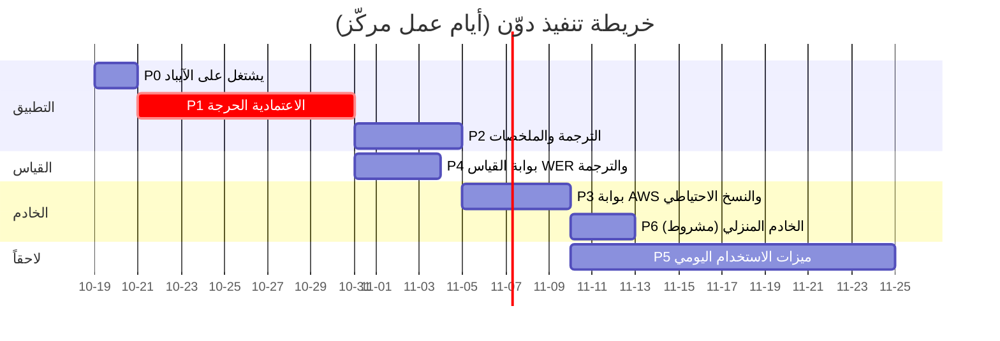

# حكم الحَكَم الخبير — «دوّن / Dawwen»

> **المُدخلات:** تقرير الإيجنت الأول (الجهاز أولاً) وتقرير الإيجنت الثاني (الخادم أولاً) مع ردّيهما في الجولة الثانية، وكل ملفات Swift (32 ملفاً، 3922 سطراً)، و`Config/Info.plist`، و`project.pbxproj`، و`README.md`. تاريخ الحكم: 2026-10-13.
>
> **كيف تحققت:**
> - قرأت كل سطر استشهد به الإيجنتان في الكود، ووجدت أخطاء إضافية لم يذكرها أي منهما (معلّمة بـ «الحَكَم» في القسم 3).
> - تحققت من الحقائق الخارجية المتنازع عليها: وثائق Apple الرسمية (بصيغة `.md` من developer.apple.com)، ومرجع Claude API المحدَّث في 2026-10-06، وبحث ويب لما حُجب مباشرة (soniox.com وhuggingface.co وdocs.aws.amazon.com محجوبة من بيئتي، فاعتمدت على نتائج البحث ونسخ GitHub الرسمية). المصادر في آخر الملف.
> - **اختبرت كود الخادم فعلاً:**
>   - 8 اختبارات pytest ناجحة (FastAPI + moto لـ DynamoDB وS3، وبدائل وهمية لـ Claude وSoniox).
>   - `cfn-lint` نظيف على قالب SAM.
>   - `docker compose config` صالح للملف المنزلي.
>   - تشغيل فعلي للبوابة عبر uvicorn.
>   - تحققت بـ `inspect` من أن `anthropic==1.8.0` يقبل `output_config` و`thinking`.
> - **اختبرت خوارزمية إصلاح ملفات CAF** بنقلها حرفياً إلى Python وتطبيقها على ملف CAF حقيقي أفسدته كما يفسده الانهيار. الملف لم يكن يُقرأ، وصار يُقرأ بكل إطاراته الكاملة.
> - **كل تعديل على ملف Swift قائم** مكتوب هنا كـ unified diff، وتحققت بـ `git apply --check` من أنه ينطبق على المستودع كما هو دون أي تعارض.
> - **حدّ صريح:** لا يوجد Swift toolchain في بيئتي (Linux). كود Swift كُتب بعناية مقابل واجهات iPadOS 26 الموثقة، لكنه **لم يُترجَم**. توقّع جولة تصحيح قصيرة لأخطاء الترجمة في أول بناء على Xcode (المرحلة P1).
> - **لم أعدّل أي ملف في المستودع** غير هذا الملف.

---

## 0. تصحيح من المالك: المحاضرات بالإنجليزية، والعربية للترجمة فقط

بعد الجولتين أوضح المالك أن **لغة المحاضرات هي الإنجليزية**، وأن العربية مطلوبة فقط **هدفاً للترجمة اللحظية**: نص إنجليزي وترجمته العربية جنباً إلى جنب. الإيجنتان كلاهما بنيا تحليلهما على أن الكلام عربي. هذا يقلب ميزان الحكم.

| المجال | قبل التصحيح (افتراض الإيجنتين) | بعد التصحيح (الحكم) |
|---|---|---|
| **التفريغ** | `SpeechTranscriber` لا يدعم العربية، فلا بد من Soniox المدفوع أو نموذج عربي مفتوح على GPU | الإنجليزية مدعومة بالكامل في `SpeechTranscriber` على الجهاز: **مجاني، ودون إنترنت، وبنموذج مصمَّم للكلام الطويل**. Soniox يصبح **اختيارياً** للدقة وتمييز المتحدثين فقط. لا مكان لـ Cohere Transcribe Arabic. |
| **اختبار WER** | Soniox مقابل Cohere للعربية | **اختبار إنجليزي:** Apple (لحظي وملف) مقابل Soniox مقابل Whisper large-v3-turbo. يحسم هل نحتاج أي تفريغ مدفوع أو خادم أصلاً. |
| **الترجمة** | ثانوية | **المسار الحرج للمنتج.** Apple Translation EN→AR على الجهاز مجانية ودون إنترنت. الإصلاحات المطلوبة: جلسة بلا واجهة (متاحة منذ 26.0، لا 26.4 كما قيل)، وتنزيل مسبق للغتين، وطابور دائم، ودفعات، وتحسين اختياري بالسياق والمسرد بعد المحاضرة (Claude Haiku 5.5 بسنتات، أو Qwen3 على الخادم المنزلي). القسم 5.1 مخصص لها. |
| **الملخصات والأسئلة** | «كل ملخص عربي يمر بـ Claude» | النص إنجليزي، فـ **Foundation Models على الجهاز يلخّص مجاناً**: map-reduce ضمن سياق 4K، ثم Apple Translation تحوّل الملخص إلى العربية. Claude يبقى للملاحظات المفصّلة وأسئلة المراجعة وللسؤال عن محاضرة من 4 ساعات كاملة (سياقه مليون token). نموذج PCC في iPadOS 27 خيار مجاني لاحق. |
| **الخادم** | تفريغ ثقيل، ونماذج مفتوحة، وGPU مشروط | **لا حاجة لأي حوسبة ثقيلة.** يبقى خادم AWS صغير بلا خوادم دائمة، نزولاً عند رغبة المالك: نسخ احتياطي، ووسيط مفاتيح بسقف إنفاق، ومهام Batch. الخادم المنزلي اختياري: نسخة ثالثة من الاحتياط، وQwen3 لتحسين الترجمة إن فاز في الاختبار الأعمى. |
| **من قوِيَ موقفه** | — | **الإيجنت الأول** (الجهاز أولاً) في كل ما يخص التفريغ والتلخيص والتكلفة. **الإيجنت الثاني** يحتفظ بانتصاراته المستقلة عن اللغة: رصيد Soniox ملغى، والنسخ الاحتياطي ضروري، وقيد التنزيل المسبق للترجمة، وضعف HFP، وحد Lambda بـ 15 دقيقة. |
| **الإعدادات الافتراضية** | — | لغة المحاضرة `en-US`، والمحرك `auto` (يختار Apple للإنجليزية)، والترجمة إلى `ar`، ولغة الملخص `ar`. الملخص الافتراضي على الجهاز، وClaude Sonnet 5.5 للمفصّل، وHaiku 5.5 لـ «اسأل» ولتحسين الترجمة. **القيم الثلاث الأولى موجودة أصلاً في الكود**؛ ما تغيّر هو Opus الذي كان افتراضياً. |

---

## 1. الحكم النهائي

1. **البنية: الجهاز أولاً، وخادم AWS خفيف اختياري.**
   - **على الآيباد:** التسجيل، والتفريغ الإنجليزي اللحظي بـ Apple `SpeechTranscriber`، والترجمة EN→AR بـ Apple Translation. كلها مجانية وتعمل في وضع الطيران. الخادم **لا يدخل أبداً** في مسار التسجيل.
   - **على AWS:** صورة Docker واحدة على Lambda (Function URL ببث الاستجابة، عبر AWS SAM)، مع DynamoDB وS3. تتولى النسخ الاحتياطي ووسيط Claude بسقف إنفاق ومهام Batch ومفاتيح Soniox المؤقتة. التكلفة **أقل من 1 $ شهرياً**.
   - **في البيت (اختياري):** Docker Compose بلا أي منفذ مفتوح. نسخة ثالثة من الاحتياط عبر rclone، وعامل يسحب مهام تحسين الترجمة (Ollama/Qwen3) **فقط** إن وُجد عتاد وفاز في الاختبار.
2. **الإيجنت الأول فاز بأغلب نقاط البنية.** Lambda بدل Lightsail، ولا GPU، وClaude أفضل جودة لكل دولار من Qwen، والتفريغ على الجهاز. تصحيح المالك قوّى موقفه كثيراً. لكنه **أخطأ في**: رصيد Soniox (ملغى منذ أكتوبر 2025)، وفي أن `TranslationSession(installedSource:target:)` تتطلب 26.4 (المُهيِّئ الأساسي متاح منذ 26.0، والذي يتطلب 26.4 هو متغيّر `preferredStrategy` فقط).
3. **الإيجنت الثاني فاز بنقاط مستقلة عن اللغة:** إلغاء رصيد Soniox، وضرورة النسخ الاحتياطي خارج الجهاز وعدم كفاية 5 GB في iCloud، وأن الجلسة دون واجهة لا تطلب تنزيل اللغة، وأن HFP يضعف الجودة، وحد Lambda بـ 15 دقيقة، واستهلاك الخادم المنزلي في الخمول. خسر نقاطه المبنية على العربية: Cohere، وQwen للتلخيص، وGPU، ومقولة «كل ملخص يمر بـ Claude».
4. **أولوية التنفيذ قاطعة:** الاعتمادية قبل أي ميزة أو خادم.
   - المسجّل يبدأ قبل محرك التفريغ.
   - جزء الصوت المفتوح قابل للإصلاح بعد الانهيار.
   - استئناف تلقائي بعد المقاطعات وإعادة تعيين خدمات الوسائط، مع مراقب يكتشف توقف الصوت.
   - نموذج الفجوات، فلا يُستبدل النص كله أبداً.
   - مخطط بيانات بإصدارات (`VersionedSchema`) وشاشة استرداد بدل الانهيار.
   - ترجمة لا تعتمد على الواجهة ولا تضيع.
5. **التكلفة:** المسار الموصى به نحو **4–5 $ شهرياً** فوق عضوية Apple (99 $ سنوياً) لاستخدام يومي من 4 ساعات (القسم 11). المسار المجاني بالكامل ممكن ويعمل.
6. **الحسم بالقياس لا بالرأي:** اختبار WER إنجليزي، واختبار أعمى للترجمة على 200 جملة (القسم 10)، قبل شراء Soniox أو تشغيل أي نموذج على خادم.

---

## 2. جدول الأحكام على نقاط الخلاف

| # | النقطة | الإيجنت الأول | الإيجنت الثاني | الحقائق المتحقَّق منها (المصدر) | الحكم | السبب |
|---|---|---|---|---|---|---|
| 1 | رصيد Soniox المجاني 200 $ | «يكفي ~1600 ساعة، لسنوات» | «ملغى منذ أكتوبر 2025» | مدونة Soniox (2025-10-27): أوقفت الرصيد المجاني للتسجيلات الجديدة بسبب إساءة الاستخدام. السعر اللحظي ~0.12 $/ساعة (مصادر طرف ثالث؛ صفحة الأسعار محجوبة من بيئتي) [S1][S2] | **الإيجنت الثاني** | دليل مباشر. وبعد تصحيح المالك صار Soniox اختيارياً أصلاً (~10.6 $ شهرياً إن استُخدم لكل المحاضرات). |
| 2 | Cohere Transcribe Arabic | الرقم صحيح لكن يحمله اللهجات؛ في MGB-2 لا فرق تقريباً | «الأقوى بين المفتوحة: 25.87 مقابل 36.86» | بطاقة النموذج: متوسط 25.87 مقابل 36.86 لـ Whisper. لكن في MGB-2: Cohere 15.54، وWhisper 16.26، وOmniASR 14.13. لا يعطي توقيتات [S3][S4] | **الأول في التحليل، والنقطة سقطت** | المحاضرات إنجليزية. لا يُستخدم Cohere Arabic في أي مسار. |
| 3 | تفريغ HQ على خادم بنموذج مفتوح | مشروط بفوز ≥20 % | «مسار HQ مرشح أول» | لا مقارنة WER منشورة طويلة بين SpeechAnalyzer وWhisper large-v3-turbo. ما وُجد: LibriSpeech Apple 2.12 % مقابل Whisper Small 3.74 %، وسرعة أعلى بـ 55 % من turbo على ملف 34 دقيقة، دون فرق ملحوظ في الجودة (تقييم نوعي) [S5][S6] | **الأول (مُعزَّز)** | Apple على الجهاز مجاني ويكفي مبدئياً للإنجليزية. اختبار WER الإنجليزي (القسم 10.3) يقرر، وعتبة الاعتماد: تحسن ≥20 % نسبياً و≥2 نقطة. |
| 4 | طبقة التحكم: Lightsail+Postgres+Redis أم Lambda | Lambda بحاوية Docker | تنازل في الجولة 2 لصالح Lambda+SQS+DynamoDB | Lambda مجانية دائماً حتى مليون طلب و400 ألف GB-ثانية شهرياً. المهلة 900 ث، والبث حتى 200 MB [S7][S8] | **الأول** | لمستخدم واحد: صفر صيانة، وتكلفة أقل من 1 $. لم أستخدم SQS: DynamoDB GSI يكفي طابوراً لعامل منزلي واحد. |
| 5 | GPU على AWS | لا، والحصة صفر | Spot عند الطلب (مشروط لاحقاً) | الحصة الافتراضية لـ «Running On-Demand G and VT instances» = 0 وقابلة للزيادة، ولـ Spot حصة منفصلة = 0 أيضاً [S9] | **الأول (مُعزَّز)** | لا حاجة لـ GPU للإنجليزية. **لا تطلب الحصة الآن.** تُطلب فقط إن فشل Apple وSoniox في اختبار WER ولم يوجد عتاد منزلي. |
| 6 | النسخ الاحتياطي: iCloud أم S3 | iCloud/CloudKit أولاً | S3 يصل إليه الخادم | iCloud المجاني 5 GB. الصوت ~15 MB/ساعة × 88 ساعة شهرياً ≈ 1.3 GB شهرياً. SwiftData+CloudKit يتطلب إزالة `.unique` (`Lecture.swift:12`) وجعل العلاقات اختيارية | **الثاني في الحاجة، والأول في التحفظ** | القرار: S3 عبر روابط موقّعة من البوابة، و`lecture.json` بجانب الصوت، ونسخة ثالثة في البيت عبر rclone، ونسخ iCloud للجهاز كما هو. CloudKit مؤجل (القسم 12). |
| 7 | الخصوصية | «AWS طرف ثالث» | «وكيلك على Lambda يرى النص أيضاً» | في التصميم النهائي الصوت لا يغادر الجهاز للتفريغ الإنجليزي. Claude يرى النص فقط عند الطلب. S3 في حساب المالك نفسه مشفّر SSE-S3، والسجلات بلا محتوى | **تعادل؛ والتصحيح يحسمها** | مسار الصوت الافتراضي صار على الجهاز 100 %. |
| 8 | التلخيص: Claude أم Qwen3 أم الجهاز | Claude أفضل جودة لكل دولار | Qwen3 مسار مجاني | Foundation Models يدعم الإنجليزية. `contextSize` = 4096 في iPadOS 26، والكود يقسّم ويدمج أصلاً (`OnDeviceSummarizer.swift:56-74`). Haiku 5.5: 0.10/0.50 $ حتى 100K token [S10] | **الأول (مُعزَّز)** | الافتراضي: ملخص مجاني على الجهاز ثم ترجمة عربية على الجهاز. وClaude Sonnet 5.5 للمفصّل (~0.12 $ بـ Batch). Qwen لا يُعتمد للتلخيص. |
| 9 | `TranslationSession(installedSource:target:)` | «iPadOS 26.4+» | «لا تطلب تنزيل اللغة، فيلزم التنزيل المسبق» | `init(installedSource:target:)` **iOS/iPadOS 26.0**. `init(installedSource:target:preferredStrategy:)` **26.4**. وكلاهما يرمي خطأً إن لم تكن اللغتان مثبتتين [S11][S12] | **الثاني محق، والأول نصف محق** | الكود يستخدم المُهيِّئ الأساسي دون `#available`، والاستراتيجية تحت `#available(iOS 26.4, *)`. والتنزيل يتم مسبقاً من الإعدادات عبر `prepareTranslation()`. |
| 10 | Private Cloud Compute (iPadOS 27) | «مجاني، 32K» | «32K والمجانية من مصادر ثانوية» | الصنف `PrivateCloudComputeLanguageModel` موثق لـ iOS 27، ويتطلب **استحقاقاً مُداراً**، وفيه `quotaUsage` و`contextSize` (يُقرأ وقت التشغيل). لم أجد رقم 32K ولا شروط المجانية في وثيقة رسمية [S13] | **الثاني في التحفظ** | للإنجليزية يصبح خياراً مفيداً. مرحلة P5 بعد الحصول على الاستحقاق، و`contextSize` يُقرأ ولا يُفترض. |
| 11 | مايكروفون بلوتوث HFP | `allowBluetoothHFP` | HFP ضيق النطاق يضعف التفريغ | `.allowBluetoothHFP` يتيح مدخل HFP مع `.record` [S14]. مستقبلات USB-C تعمل الآن دون تعديل | **الثاني** | الخيار موجود في الإعدادات لكنه **مطفأ افتراضياً**. يوصى بمايكروفون لاسلكي بمستقبل USB-C. |
| 12 | كهرباء الخادم المنزلي | 1–3 $ | الخمول 24/7 ≈ 43 kWh | حساب بسيط: 60 W × 720 ساعة = 43 kWh | **الثاني** | الخادم المنزلي اختياري، ويُشغَّل عند الحاجة أو يُستخدم جهاز موجود أصلاً. |
| 13 | `BGContinuedProcessingTask` للمهام الطويلة | مناسب | قد يوقفه النظام | وثائق Apple: يبدأ بفعل المستخدم، وقد يُنهى عند ضغط الموارد، ويُلغى إن أغلق المستخدم التطبيق من المبدّل [S15] | **كلاهما** | يُستخدم لملء الفجوات وتحسين الترجمة فقط، لا لإعادة تفريغ 4 ساعات. وإن رُفض الطلب يكمل العمل في المقدمة. |
| 14 | المصادقة | Bearer + App Attest | Sign in with Apple + JWT | — | **الأول** | رمز لكل جهاز (`<id>.<secret>`) والخادم يحفظ SHA-256 فقط، مع سقف إنفاق وrate limit و`ReservedConcurrentExecutions: 3`. App Attest مؤجل حتى يتعدد المستخدمون. |
| 15 | Lambda والملخصات الطويلة | Lambda تكفي | حد 15 دقيقة | المهلة القصوى 900 ث [S7] | **الثاني** | الملخص الافتراضي Sonnet 5.5 بجهد high (دقيقة إلى 3 دقائق). خيار «لاحقاً بنصف السعر» عبر Batch. Opus خيار يدوي. |
| 16 | «الخيار B يستبدل الإنفاق الحالي» | إضافة لا استبدال | يستبدل | — | **الأول** | الخيار B كان يضيف خادماً دائماً فوق Soniox وClaude. |
| 17 | Lightsail 2 GB | سيُصاب بنفاد الذاكرة | — | Postgres وRedis وbge-m3 معاً على 2 GB | **الأول** | النقطة سقطت باختيار Lambda. |
| 18 | WhisperKit على الجهاز لإعادة التفريغ | تجربة في المرحلة 3 | مكسب محدود | للإنجليزية SpeechTranscriber نفسه قوي [S5] | **لا داعي له الآن** | يدخل فقط إن خسر Apple اختبار WER. |
| 19 | Docker على Mac لا يصل إلى GPU | اتفقا | اتفقا | صحيح | **كلاهما** | على Mac يعمل العامل وOllama أصلياً خارج Docker. |
| 20 | `transcriptionIncomplete` بلا نطاقات | ضمني | #6 | `Lecture.swift:28` قيمة منطقية فقط | **كلاهما** | نموذج `TranscriptGap` كامل (القسم 9). |

---

## 3. القائمة الموحّدة للنواقص والأخطاء

دُمجت بنود التقريرين بعد حذف المكرر. المرجع `A1#n` بند من الإيجنت الأول، و`A2#n` من الثاني، و«الحَكَم» بند وجدته أنا. المراحل: P0 تشغيل، P1 اعتمادية، P2 ترجمة وملخصات، P3 خادم ونسخ احتياطي، P4 قياس، P5 ميزات يومية، P6 الخادم المنزلي.

| ID | الخطورة | الملف:السطر | المشكلة | الإصلاح (في القسم 9) | المرحلة |
|---|---|---|---|---|---|
| C1 | **حرج** | `RecordingController.swift:86-90`، `AppleSpeechEngine.swift:119-135` | `await startTranscriber` قبل `startRecorder`. أول تنزيل لنموذج `en-US` أو تعطل `start()` **يؤخر بداية التسجيل أو يمنعها** (A1#1، A2#2). | المسجّل يبدأ أولاً. `TranscriberFeed` يربط المحرك لاحقاً ويسجّل ما فات كفجوة `engineStarting`. زر «نزّل نموذج التفريغ» في الإعدادات. | P1 |
| C2 | **حرج** | `SegmentedRecorder.swift:46,170-188`، `LectureStore.swift:57-61` | الجزء المفتوح m4a/AAC لا يُقرأ بعد الانهيار، ثم **يُحذف**. الخسارة حتى 5 دقائق (A1#2، A2#12). | الجزء المفتوح PCM في CAF، و`AudioPartFile.repairCAF` يصلحه عند الإقلاع، ثم يُحوَّل إلى AAC عند إغلاقه. لا حذف أبداً: ما لا يُقرأ يُنقل إلى `Recovery/`. | P1 |
| C3 | **حرج** | `RecordingController.swift:251-260`، `AudioSessionController.swift` | لا استئناف إن انتهت المقاطعة دون `shouldResume`. لا معالجة لـ `mediaServicesWereReset`. لا مراقب يكتشف توقف وصول الصوت (A1#5، A2#3). | استئناف تلقائي بعد 0.2–0.8 ث مع إشعار عند الفشل. إعادة بناء `AVAudioEngine` بعد الإعادة. مراقب: 5 ث دون صوت تؤدي إلى إعادة تشغيل وإشعار. | P1 |
| C4 | **حرج للمالك** | `TranslationQueue.swift:28-48`، `RecordingView.swift:39-41,166-171`، `RecordingController.swift:129-140` | الترجمة (لُبّ المنتج) مربوطة بـ `.translationTask` في الواجهة. طابورها في الذاكرة. الأخطاء تُبتلع (`lastError` لا يُعرض). بطاقة «تُستكمل ترجمة…» تَعِد بما لا يحدث. ونافذة تنزيل اللغة تظهر وسط المحاضرة (A1#7، A2#9–11). | `TranslationSupport.installedSession` بلا واجهة (26.0+). دفعات `translations(from:)`. «`translation == nil`» هو الطابور الدائم، ويُترجَم تلقائياً عند فتح المحاضرة. تنزيل مسبق من الإعدادات. عرض عدد الإخفاقات. | P1 |
| C5 | **حرج** | `project.pbxproj:264,300` | `DEVELOPMENT_TEAM = ""`. التوقيع المجاني ينتهي كل 7 أيام فيتوقف التطبيق (A1، A2#1). | عضوية Apple Developer وTeam وTestFlight (القسم 4). | P0 |
| H1 | عالٍ | `DawwenApp.swift:10-14`، `Lecture.swift:10-12` | `fatalError` عند فشل فتح قاعدة البيانات، ولا `VersionedSchema` (A1#6، A2#4). | `SchemaV1` مجمَّد، و`SchemaV2` بحقول اختيارية، وترحيل lightweight. `DatabaseRecoveryView` بدل الانهيار. `lecture.json` لكل محاضرة و`restoreAll`. | P1 |
| H2 | عالٍ | `LectureDetailView.swift:220-248` (`:232`) | «فرّغ من الصوت» **يحذف كل الجمل وترجماتها وأسماء المتحدثين** (A1#3، A2#6). | `GapFiller` يفرّغ الفجوات فقط من شرائح صوت مقطوعة، ويترجم الجديد. الاستبدال الكامل صار خياراً منفصلاً يُطلب تأكيده. | P1 |
| H3 | عالٍ | `SonioxEngine.swift:163-168`، `:79-85`، `:203-227` | حذف صامت لما يزيد على 120 ث من المخزن (A1#4، A2#8). **(الحَكَم)** الصوت المرسَل الذي لم يُعَد نصاً نهائياً قبل الانقطاع يضيع، و`finish()` دون اتصال يرمي المخزن. | حدث `.gap`، ومخزن إعادة إرسال (replay) لآخر 30 ث يُعاد بعد كل اتصال جديد، وفجوة لكل صوت لم يصل. | P1 |
| H4 | عالٍ | `AppleSpeechEngine.swift:127` | `makeStream()` بلا حد. صار **المحرك الافتراضي** للإنجليزية، فارتفعت الخطورة (A1#8). | `bufferingOldest(1200)` (نحو 100 ث)، وكل إسقاط يتحول إلى `.gap`. | P1 |
| H5 | عالٍ | `RecordingController.swift:272-286` | **(الحَكَم)** توقف التفريغ بسبب الحرارة يرفع العلامة المنطقية فقط ولا يسجّل النطاق، فلا يُعرف ما يُكمَّل. | `feed.setGate(open:reason: .heat)` يسجّل فجوة دقيقة. | P1 |
| H6 | عالٍ | `RecordingController.swift:55-107`، `RecordingView.swift:46` | **(الحَكَم)** إن أُغلقت الشاشة أثناء `.preparing` يستدعي `abandon()` الدالة `stop()`، ثم تكمل `start()` وتشغّل المسجّل **دون واجهة ودون إيقاف**. | فحص الطور بعد كل `await`، و`dismantle()`، وقفل تسجيل واحد. | P1 |
| H7 | عالٍ | كل المشروع | لا نسخة خارج الجهاز. نسخ iCloud للجهاز كلي ومحدود بـ 5 GB (A2#5). | `BackupUploader`: جلسة رفع في الخلفية، وروابط موقّعة، وS3 بإصدارات (versioning)، و`lecture.json`، وrclone منزلي. | P3 |
| M1 | متوسط | `ClaudeClient.swift:42,90`، `SummaryView.swift:47-48` | لا إعادة محاولة لـ 429/529 والشبكة، وانقطاع البث في الخلفية يضيّع الملخص (A1#13، A2#7). | 3 محاولات بتأخير يتضاعف مع احترام `retry-after`، و`BackgroundAssertion`، وBatch عبر البوابة. | P2 |
| M2 | متوسط | `AppSettings.swift:32`، `SummaryView.swift:105`، `SettingsView.swift:9` | Opus 5.5 افتراضي في ثلاثة أماكن (A1#14، A2#14). | Sonnet 5.5 للملخص، وHaiku 5.5 لـ «اسأل» ولتحسين الترجمة، والملخص المجاني على الجهاز أولاً. | P0 |
| M3 | متوسط | `SummaryView.swift:67` | ملخص الجهاز يُكتب بلغة المحاضرة لا بلغة الملخص المختارة (A2#15). | ملخص إنجليزي على الجهاز، ثم `translateMarkdown` إلى العربية مع حفظ الأصل في `summaryOriginal`. | P2 |
| M4 | متوسط | `LibraryView.swift:17-24` | البحث يحمّل كل الجمل في الذاكرة مع كل حرف (A1#10، A2#13). | `#Predicate` ينفّذه المخزن، مع تأخير 250 ms بين الحروف. FTS5 لاحقاً. | P2 |
| M5 | متوسط | غير موجود | لا `PrivacyInfo.xcprivacy`، ولا `ITSAppUsesNonExemptEncryption` (A1). | ملفان (القسم 9). | P0 |
| M6 | متوسط | عدة أماكن | لا فحص للمساحة الحرة، و`try? context.save()` يبتلع الأخطاء (A1#19). | `StorageGuard` (قبل التسجيل وكل دقيقة، وإيقاف آمن تحت 100 MB)، و`save()` يُظهر الخطأ. | P1 |
| M7 | متوسط | `pbxproj:272` | نافذتان قد تبدآن تسجيلين (A1#18). | `activeRecording` قفل على مستوى التطبيق. | P1 |
| M8 | متوسط | `LectureDetailView.swift:72-75`، `LectureExporter.swift:87` | `onDisappear` يلغي التفريغ الطويل، والتصدير يعيد الترميز (A1#17، A2#21). | `BackgroundWork` مع `BGContinuedProcessingTask`، وتصدير Passthrough، وتنظيف ملفات tmp. | P2 |
| M9 | متوسط | `RecordingController.swift:296-306`، `AppSettings.swift:34` | العداد يتحدث 10 مرات في الثانية، والشاشة مضاءة (A1#9). | 4 مرات في الثانية. الشاشة مطلوبة لعرض الترجمة جنباً إلى جنب، فالحل «وضع محاضرة» معتم في P5. | P1/P5 |
| M10 | متوسط | المشروع | لا اختبارات ولا CI (A1#25، A2#17). | `DawwenTests` (Swift Testing) و8 اختبارات pytest للبوابة، ثم CI في P5. | P1 |
| M11 | متوسط | غير موجود | لا تحكم في المصطلحات المترجمة. | مسرد «English = عربي» في الإعدادات يستخدمه `TranslationRefiner`. | P2 |
| M12 | متوسط | `AskView.swift` | أسئلة «اسأل» لا تُحفظ (A1#15، A2#23). | موديل `QAEntry` في SchemaV3. | P5 |
| M13 | متوسط | غير موجود | لا تحرير لنص الجملة (A1#16). | تحرير، و«استبدل في كل المحاضرة»، وإضافة المصطلح المصحح إلى المسرد. | P5 |
| L1 | منخفض | `SettingsView.swift:100-103` | المفاتيح تُحفظ فقط عند إغلاق الإعدادات (A1#23، A2#18). | الحفظ عند كل تغيير (`onChange`). | P1 |
| L2 | منخفض | `Info.plist:7-10` | مجلد `Lectures` الداخلي مكشوف في تطبيق الملفات (A1#20، A2#19). | نقله إلى Application Support (مرة واحدة عند الإقلاع)، وحذف مفتاحي المشاركة. | P1 |
| L3 | منخفض | `FileTranscriber.swift:19-47` | محلل جديد لكل جزء (A1#21). | يبقى كما هو؛ GapFiller يمرّر شريحة واحدة لكل نافذة. | P5 |
| L4 | منخفض | `BookmarksView.swift:23-26,43-45`، `TranscriptListView.swift:38-44` | فرز متكرر، وبحث خطي لكل علامة (A1#22، A2#22). | فرز مرة واحدة، وبحث ثنائي. | P2 |
| L5 | منخفض | `LecturePlayer.swift` | لا `MPNowPlayingInfoCenter` ولا أوامر شاشة القفل (A2#20). | مُضافة. | P2 |
| L6 | منخفض | `AudioSessionController.swift:14` | لا خيار لمايكروفون بلوتوث (A1#12). | خيار مطفأ افتراضياً (حكم 11). | P1 |
| L7 | منخفض | `SonioxEngine.swift:50` | تلميح بلغة واحدة (A1#11). | `["en","ar"]` حين تكون الترجمة إلى العربية، لأن المحاضر قد ينتقل إلى العربية أحياناً. | P1 |
| L8 | منخفض | `SonioxEngine.swift:20-21` | **(الحَكَم)** جمل Soniox تمتد حتى 20–40 ث، فتتأخر ترجمتها بالقدر نفسه. | خفض `softPhraseLimit` إلى نحو 12 ث عند تفعيل الترجمة، بعد قياس P4. | P4 |
| L9 | منخفض | `README.md` | يذكر Opus افتراضياً وXcode 26 فقط. | تحديث (القسم 8). | P0 |
| L10 | منخفض | `pbxproj:288` | `SWIFT_VERSION 5.0`. | `SWIFT_STRICT_CONCURRENCY = complete` (تحذيرات)، ثم Swift 6. | P5 |
| L11 | منخفض | `AppleSpeechEngine.swift:99-104` | **(الحَكَم)** لم أجد توثيقاً لأثر `contextualStrings` على `SpeechTranscriber` (أثره موثق مع الإملاء). | قياس أثر «مصطلحات المادة» في اختبار WER. | P4 |
| L12 | منخفض | `KeychainStore.swift` | المفاتيح الدائمة على الجهاز (A2#18). | مقبول لمستخدم واحد. البوابة اختيارية لنقلها إلى الخادم. | P3 |

---

## 4. ما يلزم ليشتغل فعلياً

### 4.1 Apple والجهاز (إلزامي)

- [ ] **Mac بشريحة Apple** عليه macOS الذي يتطلبه Xcode الحالي.
- [ ] **Xcode يطابق إصدار الآيباد:**
  - iPadOS 27 صدر في سبتمبر 2026 [S16]. إن كان الآيباد عليه، **يلزم Xcode 27**.
  - إن بقي على 26.x، يكفي Xcode 26.4 أو أحدث.
  - هدف النشر يبقى `26.0`.
- [ ] **عضوية Apple Developer Program (99 $ سنوياً).** التوقيع المجاني يتوقف كل 7 أيام، وهذا غير مقبول وسط فصل دراسي. العضوية شرط أيضاً لـ TestFlight ولاستحقاق PCC.
- [ ] في Xcode، الهدف Dawwen ← Signing & Capabilities:
  - اختر Team.
  - غيّر `com.abdulrahmankawas.dawwen` إن ظهر تعارض.
  - **لا يلزم أي capability جديدة.** Background Modes/Audio موجود في `Info.plist`. الإشعارات المحلية لا تحتاج Push. `BGContinuedProcessingTask` يحتاج فقط `BGTaskSchedulerPermittedIdentifiers`، وهو موجود في `Info.plist` الجديد.
- [ ] **هدف اختبارات:** File ← New ← Target ← Unit Testing Bundle باسم `DawwenTests` (Swift Testing). اجعل مجلده `DawwenTests/` متزامناً، كما هو `Dawwen/`.
- [ ] تأكد أن `Dawwen/Resources/PrivacyInfo.xcprivacy` داخل الهدف. المجموعة المتزامنة تضمّه تلقائياً.
- [ ] على الآيباد:
  - الإعدادات ← الخصوصية والأمان ← **Developer Mode**.
  - أول تشغيل: امنح الإذن للمايكروفون، والتعرف على الكلام، والإشعارات.
- [ ] **قبل أول محاضرة، داخل التطبيق ← الإعدادات، وعلى Wi-Fi:**
  - «نزّل نموذج التفريغ».
  - «نزّل لغتي الترجمة».
  - يجب أن تظهر «جاهزة دون إنترنت» في الحالتين.
- [ ] Apple Intelligence مفعّل للملخص المجاني على الجهاز: iPad بشريحة M1 أو أحدث، أو A17 Pro.
- [ ] (موصى به بشدة) مايكروفون لاسلكي يُثبَّت على المحاضر بمستقبل USB-C.
- [ ] TestFlight (اختياري):
  - أنشئ سجل التطبيق في App Store Connect.
  - Product ← Archive ← Distribute ← TestFlight Internal.
  - `ITSAppUsesNonExemptEncryption=NO` يعفي من سؤال التصدير، وملف الخصوصية يمنع التحذير ITMS-91053.

### 4.2 المفاتيح (اختيارية؛ التطبيق يعمل مجاناً دونها)

- [ ] **Anthropic:**
  - console.anthropic.com ← Workspace باسم `dawwen` بحد إنفاق شهري (مثلاً 10 $) ← API key.
  - ضعه في التطبيق مباشرة، **أو** في SSM إن استُخدمت البوابة.
- [ ] **Soniox (فقط إن قرره اختبار WER):** حساب pay-as-you-go. **لا رصيد مجاني** للحسابات الجديدة.

### 4.3 AWS (اختياري، لرغبة المالك في AWS + Docker)

1. [ ] أنشئ الحساب. فعّل MFA على root، وأنشئ مستخدم IAM Identity Center للإدارة اليومية.
2. [ ] الخطة المجانية 2026: رصيد 100 $ يزيد حتى 200 $ [S17]. Lambda مجانية دائماً ضمن حدودها [S7]. **لا تعتمد على الرصيد**؛ التكلفة المتوقعة أقل من 1 $ شهرياً أصلاً.
3. [ ] اختر المنطقة: الأقرب لك. القالب يفترض `eu-central-1`، و`me-central-1` بديل خليجي. غيّرها في `samconfig.toml`.
4. [ ] على الـ Mac: AWS CLI v2، وSAM CLI، وDocker Desktop (أو OrbStack). ثم `aws configure sso`.
5. [ ] الأسرار في SSM Parameter Store (SecureString، بمفتاح `aws/ssm` المُدار، ولا تكلفة):
   ```bash
   aws ssm put-parameter --name /dawwen/anthropic_api_key --type SecureString --value 'sk-ant-...'
   aws ssm put-parameter --name /dawwen/soniox_api_key   --type SecureString --value '...'   # optional
   python server/tools/issue_device_token.py --name ipad --apply      # prints the iPad token once
   python server/tools/issue_device_token.py --worker --apply         # only if you run the home worker
   ```
6. [ ] النشر: `cd server && sam build && sam deploy --guided` (أدخل `AlertEmail`). المخرج `GatewayUrl` يُلصق في التطبيق ← الإعدادات ← الخادم، مع رمز الجهاز.
7. [ ] **التنبيهات:** القالب ينشئ AWS Budget بـ 5 $ مع بريد عند 80 % فعلي و100 % متوقع. أكّد الاشتراك من بريدك. ويُستحسن تفعيل Cost Anomaly Detection (مجاني).
8. [ ] **حصة GPU: لا تطلبها الآن.** الحصة الافتراضية لفئة G وVT صفر [S9]. تُطلب من Service Quotas فقط إن فشل Apple وSoniox في اختبار WER **و**لم يوجد عتاد منزلي.
9. [ ] للنسخة المنزلية الثالثة: مستخدم IAM `dawwen-home-backup` بمفتاح وصول وصلاحية قراءة فقط:
   ```json
   {"Version":"2012-10-17","Statement":[
     {"Effect":"Allow","Action":"s3:ListBucket","Resource":"arn:aws:s3:::BUCKET"},
     {"Effect":"Allow","Action":"s3:GetObject","Resource":"arn:aws:s3:::BUCKET/devices/*"}]}
   ```

### 4.4 الخادم المنزلي (اختياري)

- [ ] **للنسخ الاحتياطي فقط:** أي جهاز Linux أو NAS عليه Docker، ثم `docker compose -f docker-compose.home.yml --profile backup up -d`.
- [ ] **لتحسين الترجمة بنموذج محلي** (فقط إن فاز في الاختبار الأعمى):
  - Linux مع NVIDIA (16 GB VRAM أو أكثر)، وNVIDIA Container Toolkit، ثم `--profile gpu`.
  - **على Mac:** لا GPU داخل Docker. شغّل `ollama` و`python worker.py` أصلياً، مع المتغيرات نفسها.
- [ ] لا تفتح أي منفذ. كل الاتصالات صادرة عبر HTTPS. Tailscale (مجاني) فقط إن احتجت إدارة عن بعد.


---

## 5. الميزات والخدمات المجانية المعتمدة

**الحمل المفترض:** 4 ساعات يومياً × 22 يوماً = 88 ساعة شهرياً. محاضرة إنجليزية من 4 ساعات ≈ 36 ألف كلمة ≈ **48–50 ألف token**.

| الميزة | الأداة | أين تعمل | الجودة | التكلفة | المرحلة |
|---|---|---|---|---|---|
| **تفريغ لحظي (إنجليزي)** | Apple `SpeechTranscriber` (SpeechAnalyzer) | الجهاز، ودون إنترنت | جيدة للإنجليزية. تُقاس على لهجة المحاضر في P4 | **مجاني** | موجود، وP1 يقوّيه |
| تفريغ لحظي بدقة أعلى (اختياري) | Soniox `stt-rt-v5` بمفتاح مؤقت | سحابة Soniox | عالية، مع تمييز المتحدثين | ~0.12 $/ساعة (~10.6 $ شهرياً لو استُخدم لكل المحاضرات) | اختياري؛ يُعتمد فقط إن فاز في P4 |
| إكمال الفجوات بعد المحاضرة | Apple `SpeechTranscriber` على شرائح الملف (`GapFiller`) | الجهاز، مع `BGContinuedProcessingTask` | مثل اللحظي أو أفضل (ملف كامل) | مجاني | P1 |
| **ترجمة لحظية EN→AR** | Apple Translation (`TranslationSession(installedSource:target:)`) | الجهاز، ودون إنترنت بعد التنزيل | جيدة للجمل العامة. المصطلحات التقنية تُقاس (5.1) | **مجاني بلا حد** | P1 |
| **تحسين الترجمة بعد المحاضرة** | Claude Haiku 5.5 مع السياق والمسرد (`TranslationRefiner`) | Anthropic (مباشرة أو Batch عبر البوابة) | ممتازة غالباً، ومصطلحات ثابتة. تُقاس | ~0.05–0.10 $ للمحاضرة، ونصفها بـ Batch | P2 (يُعتمد افتراضياً بعد P4) |
| تحسين الترجمة مجاناً (بديل) | Qwen3-14B عبر Ollama (`worker.py`) | الخادم المنزلي فقط | جيدة إلى متوسطة. تُقاس | كهرباء فقط | P6، مشروط |
| **ملخص مجاني** | Foundation Models (map-reduce) ثم Apple Translation إلى العربية | الجهاز | مقبولة: أقصر وأقل عمقاً من Claude | **مجاني** | P2 (الافتراضي) |
| ملخص دراسي مفصّل | Claude Sonnet 5.5، مباشرة أو Batch | Anthropic | ممتازة، بالعربية مباشرة | ~0.23 $، أو ~0.12 $ بـ Batch، للمحاضرة | P2 |
| ملخص مجاني بسياق أكبر | `PrivateCloudComputeLanguageModel` | سحابة Apple الخاصة (iPadOS 27) | للإنجليزية | مجاني ضمن حصة يومية (يتطلب استحقاقاً) | P5، مشروط بالاستحقاق |
| «اسأل المحاضرة» | Claude Haiku 5.5 مع prompt caching | Anthropic | جيدة جداً | ~0.007 $ للسؤال الأول، ~0.001 $ لما بعده | P0 (تغيير الافتراضي) |
| بحث في كل المحاضرات | SwiftData `#Predicate` ثم FTS5 | الجهاز | — | مجاني | P2، وP5 |
| بحث دلالي | `NLContextualEmbedding` | الجهاز | جيد للإنجليزية | مجاني | P5 |
| OCR للسبورة والشرائح | VisionKit + Vision `RecognizeDocumentsRequest` | الجهاز | ممتاز للإنجليزية | مجاني | P5 |
| شاشة القفل | ActivityKit (Live Activity) و`MPNowPlayingInfoCenter` | الجهاز | — | مجاني | P2 (Now Playing)، وP5 |
| نسخ احتياطي | S3 عبر روابط موقّعة، وrclone منزلي، ونسخ iCloud للجهاز | AWS والبيت | — | ~0.03 $/GB شهرياً | P3 |
| وسيط المفاتيح وسقف الإنفاق | البوابة على Lambda | AWS | — | ~0 $ (ضمن المجاني الدائم) | P3 |
| **مرفوض** | GPU على AWS، Cohere Arabic، WhisperKit، Lightsail/Postgres/Redis، Gemini free (البيانات تُستخدم للتدريب)، DeepL Free (500 ألف حرف ≈ 3 محاضرات شهرياً) | — | — | — | — |

### 5.1 الترجمة EN→AR: المسار الحرج (قسم خاص)

**الهدف:** نص إنجليزي وترجمته العربية جنباً إلى جنب، بتأخير لا يتجاوز ثانيتين للجملة، دون إنترنت، ودون أن تضيع جملة واحدة.

1. **التوفر:**
   - Apple Translation يدعم العربية والإنجليزية. القائمة المنشورة تذكر العربية بمتغيّر `ar-AE` [S18].
   - التطبيق يمرر `ar`، و`LanguageAvailability().status(from:to:)` يحسم وقت التشغيل.
   - الإعدادات تعرض الحالة: منزّلة، أو مدعومة غير منزّلة، أو غير مدعومة.
   - **لا تبدأ أول محاضرة قبل أن تظهر «منزّلتان»**: الجلسة دون واجهة لا تستطيع طلب التنزيل [S11].
2. **أثناء المحاضرة:**
   - تُترجَم **الجمل النهائية فقط**. النص الجزئي (volatile) يتغير كل جزء من الثانية، وترجمته تهدر المعالج وتُظهر ترجمة متقلبة.
   - `SpeechTranscriber` يصدر جملاً نهائية متقاربة، فالتأخير الفعلي = زمن إنهاء الجملة + زمن الترجمة.
   - مع Soniox الجمل أطول (حتى 20–40 ث). البند L8 يقترح خفض الحد إلى 12 ث بعد القياس.
3. **الجلسة:**
   - `TranslationSession(installedSource:target:)` بلا واجهة (26.0).
   - على 26.4+ تُطلب `.lowLatency` للحي و`.highFidelity` لما بعد المحاضرة. الأخيرة تستخدم نماذج Apple Intelligence إن دعمت الزوج، وإلا تعود للنموذج التقليدي [S11].
   - **استمرارها والشاشة مقفلة غير موثق، ويُقاس** (T8). إن توقفت، فالطابور الدائم يكملها.
4. **الطابور الدائم:**
   - كل جملة `translation == nil` تنتظر ترجمتها.
   - تُكمَل تلقائياً عند فتح المحاضرة إن كانت اللغتان منزّلتين، بدفعات من 16 جملة عبر `translations(from:)`.
   - فشل دفعة يؤدي إلى ترجمة جملها واحدة واحدة. الإخفاقات تُعدّ وتُعرض.
5. **اتساق المصطلحات:**
   - Apple Translation لا تقبل مسرداً.
   - الحل: **«حسّن الترجمة»** بعد المحاضرة. نموذج لغوي يرى 50 جملة مع 4 جمل سياق قبلها و4 بعدها، و**مسرد المالك** (`English term = المصطلح`). يصحح أخطاء السمع، ويثبّت المصطلح العربي مع الأصل الإنجليزي بين قوسين عند أول ظهور.
   - النتيجة تُحفظ في `refinedTranslation` **بجانب** ترجمة Apple لا مكانها، وتُعرض وتُصدَّر إن وُجدت.
   - المحرك: Claude Haiku 5.5 مع structured outputs (JSON مضمون الشكل)، مباشرة من الآيباد (4 طلبات متوازية، دقائق لمحاضرة كاملة)، أو Batch عبر البوابة بنصف السعر، أو Qwen3 منزلياً.
6. **ملخص بالعربية مجاناً:** ملخص إنجليزي على الجهاز، ثم ترجمة Markdown سطراً سطراً، مع حماية علامات `#` و`-` والطوابع `[hh:mm:ss]` من المترجم.
7. **بديل يستحق القياس:** Soniox يقدم ترجمة لحظية `one_way` مدمجة في البث (`translation: {type: "one_way", target_language: "ar"}`، والرموز موسومة بـ `translation_status`) [S19]. تُترجَم بسياق البث لا جملة جملة. أُدرجت في الاختبار الأعمى كمرشح، دون كود الآن.
8. **القياس (T8 وT14):**
   - تأخير p95 أقل من 2 ث.
   - صفر جمل غير مترجمة بعد فتح المحاضرة.
   - اختبار أعمى على 200 جملة: Apple، وHaiku المحسّن، وSonnet المحسّن، وSoniox one_way (اختياري)، وQwen3 (إن وُجد).
   - **يُعتمد التحسين افتراضياً إن تفوق متوسطه على Apple بـ 0.5 نقطة أو أكثر** (مقياس 1–5)، مع عدّ الترجمات المختلفة لعشرة مصطلحات من المسرد.

---

## 6. البنية النهائية

```
┌──────────────────────────────── iPad «دوّن» (مصدر الحقيقة، يعمل كاملاً في وضع الطيران) ───────────────────────────────┐
│ Mic ─► SegmentedRecorder ─► part-NNN.caf (PCM, open) ─close─► AudioPartFile.transcodeToAAC ─► part-NNN.m4a             │
│            │ (audio thread)                                                                                           │
│            └─► TranscriberFeed ──► AppleSpeechEngine (SpeechTranscriber en-US)   │ gaps ─► Lecture.gapsData           │
│                       │            └ or SonioxEngine (temp key, replay 30 s)     │                                     │
│                       ▼                                                          ▼                                     │
│                RecordingController ─► SwiftData (SchemaV2) ─► TranslationQueue ─► Apple Translation EN→AR (on device) │
│ After lecture: GapFiller · TranslationRefiner · SummaryJob (on-device FM ─► AR) · Ask (Claude Haiku)                  │
│ BackgroundWork (BGContinuedProcessingTask) · LectureArchive (lecture.json) · BackupUploader (background URLSession)   │
└─────────┬──────────────────────────────┬──────────────────────────────────┬────────────────────────────────────────────┘
          │ HTTPS, Bearer <id>.<secret>  │ WSS direct, 60-s temp key         │ HTTPS direct (Keychain key, optional)
          ▼                              ▼                                   ▼
┌────────── AWS (one region, SAM stack "dawwen-gateway") ──────────┐   Soniox (optional)          api.anthropic.com
│ Lambda (arm64, container image from ECR, Lambda Web Adapter)     │
│   Function URL, RESPONSE_STREAM, reserved concurrency 3          │
│   POST /v1/claude/messages   ── SSE relay, spend cap ───────────────────────────────────────────► api.anthropic.com
│   POST /v1/jobs, GET /v1/jobs/{id}  ── Message Batches (−50 %) ─────────────────────────────────► api.anthropic.com
│   POST /v1/soniox/temp-key   ── 60-s key ───────────────────────────────────────────────────────► api.soniox.com
│   POST /v1/backup/upload-url ── presigned PUT (1 h) ──┐                                          │
│   GET  /v1/worker/claim, POST /v1/worker/jobs/{id}/…  │ (home worker only)                       │
│ DynamoDB (on-demand): spend counters, rate limits, jobs (GSI queue)                              │
│ S3 (private, SSE-S3, versioning, 30-day old versions, Glacier IR after 180 d)                    │
│   devices/<device>/lectures/<uuid>/part-NNN.m4a, lecture.json   ◄── iPad PUT directly            │
│ SSM SecureString: /dawwen/{anthropic_api_key, soniox_api_key, device_tokens, worker_token_sha256}│
│ CloudWatch Logs 7 days (metadata only) · AWS Budget 5 $ + e-mail                                 │
└──────────────────────────────────────────────▲───────────────────────────────────────────────────┘
                                               │ outbound HTTPS only (no inbound ports at home)
┌──────────────── Home server (optional, docker compose) ─────────────────┐
│ backup-sync: rclone copy S3 → /srv/dawwen-backup  (read-only IAM key)   │
│ worker + ollama (NVIDIA): polls /v1/worker/claim, refine_translation    │
│ (Mac: run ollama + worker.py natively; Docker can't reach Apple GPU)    │
└─────────────────────────────────────────────────────────────────────────┘
```

**ما يعمل أين:**

| الوظيفة | المكان | لماذا |
|---|---|---|
| التسجيل، والتفريغ اللحظي، والترجمة اللحظية | الآيباد دائماً | تعمل دون شبكة، والخصوصية، وصفر تكلفة |
| إكمال الفجوات، والملخص المجاني | الآيباد | مجاني، والنص إنجليزي |
| الملخص المفصل، و«اسأل»، وتحسين الترجمة | Anthropic (مباشرة أو عبر البوابة) | جودة لكل دولار لا يجاريها خادم ذاتي |
| النسخ الاحتياطي | S3، ونسخة ثالثة في البيت | لا يضيع فصل دراسي إن ضاع الآيباد |
| النموذج المحلي للترجمة | البيت فقط، مشروط | لا GPU على AWS |

**نموذج الأمان:**

- **بين التطبيق والبوابة:**
  - رمز لكل جهاز بصيغة `<device-id>.<secret>`، والسر 256 بت عشوائي.
  - الآيباد يحفظه في Keychain (`AfterFirstUnlockThisDeviceOnly`).
  - الخادم يحفظ SHA-256 فقط في SSM، ويقارن بـ `hmac.compare_digest`.
  - جهاز مفقود يُلغى بأمر واحد: `issue_device_token.py --revoke`.
  - **الحد من الضرر:** `ReservedConcurrentExecutions: 3`، وسقف إنفاق يومي وشهري في DynamoDB بحجز مسبق مقدَّر بـ `count_tokens` ثم تسوية بالاستهلاك الفعلي (الرفض برمز 402 لا يُعاد)، و30 مفتاح Soniox في الساعة للجهاز، وحد إنفاق في Workspace لدى Anthropic، وAWS Budget.
  - Function URL عام بنمط `AuthType NONE`، مع إذن `lambda:InvokeFunction` مقيد بـ `InvokedViaFunctionUrl` (متطلب منذ أكتوبر 2025 [S20]).
- **الأسرار:**
  - في SSM SecureString، ولا شيء في الصورة أو المستودع.
  - صلاحيات IAM في حدها الأدنى: DynamoDB للجدول، وS3 للحاوية، و`ssm:GetParameters` على `/dawwen/*` فقط.
  - صورة Docker بمستخدم غير root.
- **Soniox:** الآيباد يتصل مباشرة بمفتاح مؤقت صالح 60 ث لفتح الاتصال فقط. الصوت لا يمر بالبوابة.
- **S3:**
  - Block Public Access، وBucketOwnerEnforced، وSSE-S3.
  - روابط PUT موقّعة لساعة، ومقيدة بـ Content-Type و`x-amz-meta-sha256`.
  - المفتاح `devices/<device>/…` يمنع جهازاً من الكتابة في مساحة غيره.
- **السجلات:** بيانات وصفية فقط (الجهاز، والنموذج، والاستهلاك، والتكلفة)، ولا نصوص محاضرات.
- **البيت:**
  - لا منافذ واردة: العامل يسحب المهام، وrclone يقرأ.
  - مفتاح IAM للقراءة فقط.
  - rclone يعمل بأمر `copy` لا `sync`: حذف في S3 لا يحذف النسخة المنزلية.

**النسخ الاحتياطي (3-2-1):**
1. الآيباد: الصوت، وقاعدة البيانات، و`lecture.json` لكل محاضرة، ونسخ iCloud للجهاز إن كانت المساحة تكفي.
2. S3: كل جزء m4a فور تحويله، و`lecture.json` بعد التسجيل والملخص والتحسين. Versioning يحفظ الإصدارات القديمة 30 يوماً، والصوت يُنقل إلى Glacier IR بعد 180 يوماً.
3. البيت: `rclone copy` كل 6 ساعات.

**الاستعادة:**
- `restore_backup.py` يتحقق من sha256 لكل ملف.
- داخل التطبيق: «استعادة المحاضرات من ملفاتها» تعيد بناء المكتبة من `lecture.json` إن ضاعت قاعدة البيانات.

---

## 7. خريطة التنفيذ

| المرحلة | المهام بالترتيب | يعتمد على | الجهد | معيار القبول |
|---|---|---|---|---|
| **P0: يشتغل** | 1) العضوية والفريق وXcode المطابق. 2) `Info.plist` الجديد و`PrivacyInfo.xcprivacy`. 3) `AppSettings` (الافتراضيات: Sonnet للملخص وHaiku لـ «اسأل»). 4) تحديث README. 5) قائمة الفحص 10.1 على البناء الحالي، وتسجيل خط الأساس. | — | 1–2 يوم | بناء نظيف على الآيباد. تسجيل 30 دقيقة إنجليزي مع ترجمة عربية. تسجيل نتائج خط الأساس. |
| **P1: اعتمادية حرجة** | 1) النماذج (`SchemaV1`، و`SchemaV2`، و`TranscriptGap`) و`DawwenApp` و`DatabaseRecoveryView`. 2) `AudioPartFile` و`SegmentedRecorder` و`LectureStore`. 3) `TranscriberFeed` و`RecordingSafety` و`AudioSessionController` و`RecordingController`. 4) `TranscriptionEngine` و`SonioxEngine` وفرق `AppleSpeechEngine`. 5) `TranslationSupport` و`TranslationQueue` وفروق RecordingView وKeychain. 6) `GapFiller` و`AudioTimeline` و`BackgroundWork` و`LectureDetailView` و`LectureArchive`. 7) `SettingsView`. 8) `DawwenTests`. 9) جولة تصحيح أخطاء الترجمة (compile-fix). | P0 | 8–10 أيام | الاختبارات T1–T11 كلها ناجحة. قتل التطبيق يفقد ≤1 ث صوتاً. لا فجوة صامتة: كل فجوة مسجلة وتُملأ. ترقية بيانات 0.1 دون فقد. |
| **P2: الترجمة والملخصات** | `TranslationRefiner`، و`ClaudeClient` الجديد، و`SummaryView`، وفروق AskView وTranscriptList وBookmarks وLibrary وExporter وPlayer، والمسرد. | P1 | 4–5 أيام | ملخص عربي مجاني على الجهاز لمحاضرة 4 ساعات. تحسين ترجمة كامل بأقل من 0.10 $. البحث في 100 محاضرة أقل من ثانية. |
| **P3: بوابة AWS والنسخ الاحتياطي** | `server/gateway`، و`template.yaml`، و`sam deploy`، و`issue_device_token`، و`ServerClient`، و`BackupUploader`، و`AppDelegate`. | P1 (وP2 لـ Batch) | 3–5 أيام | pytest أخضر. AWS أقل من 1 $ لشهر كامل. الأجزاء تصل S3 خلال 10 دقائق من إغلاقها. طلب بلا رمز يعيد 401، وتجاوز السقف يعيد 402. استعادة 3 محاضرات بـ `restore_backup.py` بلا أي خطأ تحقق (checksum). |
| **P4: بوابة القياس** | `wer_eval.py` مع `apple_transcribe.swift`، و`translation_blind_test.py`، وقياس البطارية والحرارة والتأخير. | P1 (يبدأ بالتوازي مع P2/P3) | 3–4 أيام | جدول WER لـ Apple (لحظي وملف) وSoniox وWhisper. نتيجة الاختبار الأعمى. قرار مكتوب في القسم 12. |
| **P5: الاستخدام اليومي** | المقررات والمجلدات، وLive Activity، وApp Intents، وتحرير الجمل، و`QAEntry` (SchemaV3)، وFTS5، وOCR الشرائح، و«وضع المحاضرة» المعتم، وPCC (iPadOS 27)، وCI، وSwift 6. | P2 | 2–3 أسابيع | بدء تسجيل من شاشة القفل. بحث أقل من 300 ms. استهلاك البطارية أقل من 10 % في الساعة والشاشة معتمة (يُقاس). |
| **P6: الخادم المنزلي (مشروط)** | `docker-compose.home.yml` (backup أولاً)، ثم gpu وworker وollama إن وُجد عتاد **وفاز** Qwen في P4. | P3، P4 | 1–3 أيام | لا منافذ مفتوحة (فحص خارجي). مهمة تحسين تكتمل والآيباد مغلق. النسخة الثالثة محدثة. |



---

## 8. توزيع الملفات

**التطبيق.** المجموعة المتزامنة `Dawwen/` تضم أي ملف جديد تلقائياً. `+` ملف جديد، و`~` استبدال كامل، و`Δ` تعديل بفرق (diff).

```
Config/
  ~ Info.plist                         BGTask id, export compliance; Files-app sharing removed
Dawwen/
  App/
    ~ AppSettings.swift                new keys/defaults (en-US → ar, Sonnet/Haiku), glossary
    ~ DawwenApp.swift                  versioned container, recovery screen, launch tasks
    + AppDelegate.swift                background-upload relaunch, in-app notification banners
  Models/
    + SchemaV1.swift                   frozen 0.1 schema (never edit)
    ~ Lecture.swift                    SchemaV2.Lecture + migration plan + gap/backup helpers
    ~ TranscriptSegment.swift          SchemaV2.TranscriptSegment + refinedTranslation
    + TranscriptGap.swift              gap type + merge/infer/split math
  Audio/
    + AudioPartFile.swift              CAF settings, crash repair, AAC transcode
    + AudioTimeline.swift              parts as one timeline; cut a range to a file
    ~ SegmentedRecorder.swift          CAF parts, open/close handlers, media-reset rebuild
    ~ AudioSessionController.swift     media-services reset, optional Bluetooth
    Δ LecturePlayer.swift              Now Playing + lock-screen commands
  Recording/
    ~ RecordingController.swift        recorder-first, gaps, watchdog, resume, lock, storage
    + TranscriberFeed.swift            swappable transcriber + gap tracking (replaces FeedGate)
    + RecordingSafety.swift            local alerts, storage guard, background assertion
    + BackgroundWork.swift             BGContinuedProcessingTask host for long jobs
  Transcription/
    ~ TranscriptionEngine.swift        .gap event, Soniox credentials, factory
    ~ SonioxEngine.swift               temp keys, replay buffer, gap events, en+ar hints
    Δ AppleSpeechEngine.swift          bounded analyzer input + gap on drop
    + GapFiller.swift                  transcribe only what is missing
  Translation/
    ~ TranslationQueue.swift           batches, durable-queue semantics, visible errors
    + TranslationSupport.swift         view-less sessions, Markdown translation
    + TranslationRefiner.swift         context + glossary refinement (now / Batch / home)
  Summarization/
    ~ ClaudeClient.swift               retries, gateway backend, structured output, complete()
  Server/
    + ServerClient.swift               gateway API client (auth, jobs, backup, Soniox)
  Storage/
    ~ LectureStore.swift               App Support folder, repair-don't-delete recovery
    + LectureArchive.swift             lecture.json write + restoreAll
    + BackupUploader.swift             background uploads to S3
    Δ KeychainStore.swift              gatewayToken key
  Features/
    Shared/+ DatabaseRecoveryView.swift  instead of fatalError
    Detail/~ LectureDetailView.swift   gap fill, refine, auto-translate, BackgroundWork
    Detail/~ SummaryView.swift         on-device EN→AR summary, Claude, Batch
    Detail/Δ AskView.swift             Haiku via ClaudeClient.current
    Detail/Δ TranscriptListView.swift  refined translation, binary search
    Detail/Δ BookmarksView.swift       sort once
    Recording/Δ RecordingView.swift    dismantle(), gap + failure indicators, honest card
    Library/Δ LibraryView.swift        store-side search, restore from archives
    Settings/~ SettingsView.swift      downloads, glossary, server, models
  Export/Δ LectureExporter.swift       refined translation, passthrough audio, tmp cleanup
  Resources/+ PrivacyInfo.xcprivacy    UserDefaults CA92.1, DiskSpace E174.1
DawwenTests/                           (new Unit Testing Bundle target, Swift Testing)
  + GapMathTests.swift
  + AudioPartFileTests.swift
Dawwen.xcodeproj/project.pbxproj       Δ in Xcode only: Team, DawwenTests target (no hand edits)
README.md                              Δ defaults (on-device first, Sonnet/Haiku), Xcode 26.4+/27, server/ pointer
```

**الخادم: مجلد جديد `server/`.**

**لماذا AWS SAM؟** لأنه أقل كمية من البنية المكتوبة كوداً (IaC) لحالتنا:
- صنف `AWS::Serverless::Function` يبني صورة Docker ويدفعها إلى ECR (`resolve_image_repos`).
- `FunctionUrlConfig` ينشئ Function URL بالبث في ثلاثة أسطر.
- `sam build`/`sam deploy` أمران فقط.
- الحالة في CloudFormation، فلا ملف state كما في Terraform، ولا مشروع TypeScript أو Python كما في CDK.

```
server/
  template.yaml                        SAM: Lambda image + URL, DynamoDB, S3, Budget, permissions
  samconfig.toml                       stack name, region, image repo
  docker-compose.home.yml              home: backup-sync (rclone), ollama, worker — no inbound ports
  .env.example                         home secrets template (never commit .env)
  gateway/
    Dockerfile                         python 3.12 slim + Lambda Web Adapter 1.1.0, non-root
    .dockerignore
    requirements.txt                   fastapi, uvicorn, anthropic 1.8.0, boto3, httpx, pydantic
    app/__init__.py                    (empty)
    app/main.py                        FastAPI app, error shape, /healthz
    app/config.py                      settings, SSM secrets, Claude prices
    app/auth.py                        device/worker bearer tokens (hash compare)
    app/store.py                       DynamoDB/SQLite: spend caps, rate limits, jobs
    app/blobs.py                       S3 presigned PUT/GET, JSON objects
    app/claude.py                      SSE proxy with spend reservation + settlement
    app/jobs.py                        Message Batches + home-worker queue
    app/backup.py                      upload/download URLs, listing
    app/soniox.py                      60-second Soniox keys
    tests/test_gateway.py              8 offline tests (moto + fakes)
  worker/
    Dockerfile                         CUDA 12.6 + cuDNN 9 runtime, non-root
    requirements.txt
    worker.py                          polls gateway: refine_translation (Ollama), hq_asr (faster-whisper)
  tools/
    requirements-tools.txt
    wer_eval.py                        English WER bake-off + decision rule
    apple_transcribe.swift             SpeechTranscriber on a file (macOS 26+)
    translation_blind_test.py          blind EN→AR rating sheet + scoring
    issue_device_token.py              device/worker tokens into SSM
    restore_backup.py                  download + checksum-verify the backup
```

**تعديل README (يدوي):**
- في جدول «ما يفعله»: «الملخص مجاناً على الجهاز ثم يُترجم إلى العربية؛ Claude Sonnet 5.5 للملاحظات المفصّلة».
- في «المتطلبات»: «Xcode 26.4+، وXcode 27 إن كان الآيباد على iPadOS 27».
- أضف قسماً قصيراً يشير إلى `server/` و`docs/agents/judge-verdict.md`.

---

## 9. الكود

**طريقة القراءة:**
- قبل كل كتلة: مسار الملف ونوع العملية. «جديد» يعني ملفاً جديداً. «استبدال كامل» يعني ضع المحتوى مكان الملف. «فرق» يعني unified diff؛ طبّقه بـ `git apply` أو يدوياً.
- كل الفروق تحقق `git apply --check` من انطباقها على الفرع الحالي.
- الترتيب حسب الأولوية التي طلبها المالك: (أ) اعتمادية التطبيق، (ب) البوابة، (ج) النسخ الاحتياطي، (د) الخادم المنزلي وأدوات القياس، (هـ) عميل الخادم في التطبيق.


### 9.أ اعتمادية التطبيق (حرج وعالٍ)


##### النماذج والترحيل

#### `Dawwen/Models/SchemaV1.swift` — جديد
نسخة مجمّدة من مخطط 0.1. SwiftData يطابق المخزن القائم بها؛ لا تعدّلها أبداً (H1).

```swift
import Foundation
import SwiftData

/// The schema exactly as version 0.1 shipped it. Frozen: SwiftData recognises the existing store by
/// comparing it with these definitions, so never edit a property here. Changes go in a new version.
enum SchemaV1: VersionedSchema {
    static let versionIdentifier = Schema.Version(1, 0, 0)
    static var models: [any PersistentModel.Type] { [Lecture.self, TranscriptSegment.self] }

    @Model
    final class Lecture {
        @Attribute(.unique) var id: UUID
        var title: String
        var createdAt: Date
        var duration: Double
        var sourceLanguage: String
        var targetLanguage: String?
        var engineRaw: String
        var statusRaw: String
        var audioSegments: [String]
        var bookmarks: [Double]
        var transcriptionIncomplete: Bool
        var summary: String?
        var summaryModel: String?
        var summaryDate: Date?
        @Relationship(deleteRule: .cascade, inverse: \TranscriptSegment.lecture)
        var segments: [TranscriptSegment] = []

        init() {
            id = UUID()
            title = ""
            createdAt = .now
            duration = 0
            sourceLanguage = "en-US"
            engineRaw = "apple"
            statusRaw = "ready"
            audioSegments = []
            bookmarks = []
            transcriptionIncomplete = false
        }
    }

    @Model
    final class TranscriptSegment {
        var uid: UUID
        var start: Double
        var end: Double
        var text: String
        var translation: String?
        var speaker: String?
        var lecture: Lecture?

        init() {
            uid = UUID()
            start = 0
            end = 0
            text = ""
        }
    }
}
```

#### `Dawwen/Models/Lecture.swift` — استبدال كامل
`SchemaV2.Lecture` بحقول اختيارية جديدة، وخطة الترحيل، ودوال الفجوات والنسخ الاحتياطي. `Lecture` صار typealias، فلا يتغير أي استدعاء في بقية الكود.

```swift
import Foundation
import SwiftData

/// The app always works with the latest schema version.
typealias Lecture = SchemaV2.Lecture
typealias TranscriptSegment = SchemaV2.TranscriptSegment

enum LectureStatus: String, Codable {
    case recording
    case interrupted
    case ready
}

/// Version 2: adds gap tracking, backup state, gateway jobs and refined translations.
/// Every new property is optional, so the move from V1 is a lightweight migration.
enum SchemaV2: VersionedSchema {
    static let versionIdentifier = Schema.Version(2, 0, 0)
    static var models: [any PersistentModel.Type] { [Lecture.self, TranscriptSegment.self] }

    @Model
    final class Lecture {
        @Attribute(.unique) var id: UUID
        var title: String
        var createdAt: Date
        /// Seconds of recorded audio.
        var duration: Double
        /// BCP-47 identifier of the spoken language, e.g. "en-US".
        var sourceLanguage: String
        /// Translation target, nil when translation is off.
        var targetLanguage: String?
        var engineRaw: String
        var statusRaw: String
        /// Audio part files inside the lecture folder, in recording order.
        var audioSegments: [String]
        /// Seconds into the recording that the student marked as important.
        var bookmarks: [Double]
        /// True while `gaps` is not empty (kept for V1 data, which has no gap list).
        var transcriptionIncomplete: Bool
        var summary: String?
        var summaryModel: String?
        var summaryDate: Date?
        @Relationship(deleteRule: .cascade, inverse: \TranscriptSegment.lecture)
        var segments: [TranscriptSegment] = []

        // MARK: V2
        /// JSON `[TranscriptGap]`: stretches of audio that have no transcript yet.
        var gapsData: Data?
        /// JSON `[String]`: part files already copied to the off-device backup.
        var uploadedPartsData: Data?
        var archiveUploadedAt: Date?
        /// The summary in the lecture's own language when `summary` holds its translation.
        var summaryOriginal: String?
        /// Gateway jobs that deliver later (Message Batches or the home worker).
        var summaryJobID: String?
        var refineJobID: String?
        var translationRefinedAt: Date?

        init(title: String, sourceLanguage: String, targetLanguage: String?, engine: EngineKind) {
            self.id = UUID()
            self.title = title
            self.createdAt = .now
            self.duration = 0
            self.sourceLanguage = sourceLanguage
            self.targetLanguage = targetLanguage
            self.engineRaw = engine.rawValue
            self.statusRaw = LectureStatus.recording.rawValue
            self.audioSegments = []
            self.bookmarks = []
            self.transcriptionIncomplete = false
        }
    }
}

enum DawwenMigrationPlan: SchemaMigrationPlan {
    static var schemas: [any VersionedSchema.Type] { [SchemaV1.self, SchemaV2.self] }
    static var stages: [MigrationStage] {
        [.lightweight(fromVersion: SchemaV1.self, toVersion: SchemaV2.self)]
    }
}

extension SchemaV2.Lecture {
    var status: LectureStatus {
        get { LectureStatus(rawValue: statusRaw) ?? .ready }
        set { statusRaw = newValue.rawValue }
    }

    var engine: EngineKind {
        EngineKind(rawValue: engineRaw) ?? .none
    }

    var sortedSegments: [TranscriptSegment] {
        segments.sorted { $0.start < $1.start }
    }

    /// Stretches without transcript, merged and sorted.
    var gaps: [TranscriptGap] {
        get {
            guard let gapsData else { return [] }
            return (try? JSONDecoder().decode([TranscriptGap].self, from: gapsData)) ?? []
        }
        set {
            let merged = GapMath.merged(newValue)
            gapsData = merged.isEmpty ? nil : try? JSONEncoder().encode(merged)
        }
    }

    var untranscribedSeconds: Double { gaps.reduce(0) { $0 + $1.duration } }

    func addGap(_ gap: TranscriptGap) {
        guard gap.duration >= 0.3 else { return }
        gaps = gaps + [gap]
        transcriptionIncomplete = true
    }

    /// Removes every stored gap that lies inside `range` (the caller has transcribed it).
    func clearGaps(within start: Double, _ end: Double) {
        gaps = gaps.filter { !($0.start >= start - 0.01 && $0.end <= end + 0.01) }
        transcriptionIncomplete = !gaps.isEmpty
    }

    var uploadedParts: Set<String> {
        get {
            guard let uploadedPartsData else { return [] }
            return Set((try? JSONDecoder().decode([String].self, from: uploadedPartsData)) ?? [])
        }
        set { uploadedPartsData = try? JSONEncoder().encode(newValue.sorted()) }
    }
}
```

#### `Dawwen/Models/TranscriptSegment.swift` — استبدال كامل
`SchemaV2.TranscriptSegment` مع `refinedTranslation` و`bestTranslation`.

```swift
import Foundation
import SwiftData

extension SchemaV2 {
    /// One finalized phrase of the transcript, with its position in the recording.
    @Model
    final class TranscriptSegment {
        var uid: UUID
        var start: Double
        var end: Double
        var text: String
        /// Apple Translation, sentence by sentence, during or right after the lecture.
        var translation: String?
        var speaker: String?
        var lecture: Lecture?
        // MARK: V2
        /// Context-aware translation made after the lecture (Claude or a local model). Kept beside
        /// `translation`, never over it.
        var refinedTranslation: String?

        init(start: Double, end: Double, text: String, speaker: String? = nil) {
            self.uid = UUID()
            self.start = start
            self.end = end
            self.text = text
            self.speaker = speaker
        }
    }
}

extension SchemaV2.TranscriptSegment {
    /// What the UI and exports show: the refined translation when there is one.
    var bestTranslation: String? { refinedTranslation ?? translation }
}
```

#### `Dawwen/Models/TranscriptGap.swift` — جديد
نوع الفجوة، ودمجها، واستنتاجها لبيانات 0.1، وتقسيمها إلى نوافذ.

```swift
import Foundation

/// A stretch of recorded audio that has no transcript (yet). The audio itself is always on disk.
struct TranscriptGap: Codable, Hashable, Sendable {
    enum Reason: String, Codable, Sendable {
        case engineStarting   // the recorder started before the engine was ready
        case recordOnly       // the student chose "record only"
        case heat             // on-device engine paused at .serious thermal state
        case network          // Soniox could not keep up / was offline
        case overload         // on-device analyzer fell behind and dropped audio
        case engineFailed
        case crash            // the app died; text after the last saved phrase is missing
        case unknown
    }

    var start: Double
    var end: Double
    var reason: Reason

    var duration: Double { max(0, end - start) }
}

enum GapMath {
    /// Sorted and merged: gaps closer than `joinWithin` seconds become one.
    static func merged(_ gaps: [TranscriptGap], joinWithin: Double = 1) -> [TranscriptGap] {
        let sorted = gaps.filter { $0.end > $0.start }.sorted { $0.start < $1.start }
        var result: [TranscriptGap] = []
        for gap in sorted {
            if var last = result.last, gap.start <= last.end + joinWithin {
                last.end = max(last.end, gap.end)
                result[result.count - 1] = last
            } else {
                result.append(gap)
            }
        }
        return result
    }

    /// For lectures from version 0.1 (no gap list): long silences in the transcript, plus the
    /// head and tail of the recording.
    static func inferred(from segments: [(start: Double, end: Double)], duration: Double, minimum: Double = 20) -> [TranscriptGap] {
        guard duration > 0 else { return [] }
        guard !segments.isEmpty else { return [TranscriptGap(start: 0, end: duration, reason: .unknown)] }
        var gaps: [TranscriptGap] = []
        var cursor = 0.0
        for segment in segments.sorted(by: { $0.start < $1.start }) {
            if segment.start - cursor >= minimum {
                gaps.append(TranscriptGap(start: cursor, end: segment.start, reason: .unknown))
            }
            cursor = max(cursor, segment.end)
        }
        if duration - cursor >= minimum {
            gaps.append(TranscriptGap(start: cursor, end: duration, reason: .unknown))
        }
        return gaps
    }

    /// Splits a long gap so each file-transcription pass stays small (10 minutes by default).
    static func windows(of gap: TranscriptGap, maxLength: Double = 600) -> [TranscriptGap] {
        guard gap.duration > maxLength else { return [gap] }
        var windows: [TranscriptGap] = []
        var start = gap.start
        while start < gap.end {
            let end = min(gap.end, start + maxLength)
            windows.append(TranscriptGap(start: start, end: end, reason: gap.reason))
            start = end
        }
        return windows
    }
}
```


##### الصوت

#### `Dawwen/Audio/AudioPartFile.swift` — جديد
C2: إعدادات CAF/PCM، و`repairCAF` (الخوارزمية اختُبرت على ملف CAF مُفسَد)، والتحويل الذري إلى AAC.

```swift
import AVFoundation

/// Part files on disk. While a part is open it is 16-bit PCM in CAF: unlike AAC in MP4, whose index
/// is written only on close, a CAF cut off by a crash can be repaired. Closed parts are transcoded
/// to AAC m4a (~1.2 MB per 5 minutes) off the audio thread.
enum AudioPartFile {
    static let openExtension = "caf"
    static let archiveExtension = "m4a"

    static func pcmSettings(sampleRate: Double, channels: AVAudioChannelCount) -> [String: Any] {
        [
            AVFormatIDKey: kAudioFormatLinearPCM,
            AVSampleRateKey: sampleRate,
            AVNumberOfChannelsKey: channels,
            AVLinearPCMBitDepthKey: 16,
            AVLinearPCMIsFloatKey: false,
            AVLinearPCMIsBigEndianKey: false,
            AVLinearPCMIsNonInterleaved: false
        ]
    }

    static var recordingSettings: [String: Any] {
        pcmSettings(sampleRate: SegmentedRecorder.sampleRate, channels: 1)
    }

    static func aacSettings(sampleRate: Double, channels: AVAudioChannelCount) -> [String: Any] {
        [
            AVFormatIDKey: kAudioFormatMPEG4AAC,
            AVSampleRateKey: sampleRate,
            AVNumberOfChannelsKey: channels,
            AVEncoderBitRateKey: 32_000
        ]
    }

    static func name(index: Int, ext: String) -> String {
        String(format: "part-%03d.%@", index, ext)
    }

    /// "part-012.caf" → 12. Temporary transcodes ("part-012.tmp.m4a") are not parts.
    static func index(of name: String) -> Int? {
        guard name.hasPrefix("part-"), !name.contains(".tmp.") else { return nil }
        let digits = name.dropFirst(5).prefix { $0.isNumber }
        return Int(digits)
    }

    static func isPart(_ name: String) -> Bool {
        index(of: name) != nil && (name.hasSuffix(".\(openExtension)") || name.hasSuffix(".\(archiveExtension)"))
    }

    /// Transcodes a closed PCM part to AAC beside it, checks the result, then deletes the PCM.
    /// The m4a appears under its final name only once complete. Returns nil for an empty part.
    @discardableResult
    static func transcodeToAAC(_ source: URL) throws -> URL? {
        let fileManager = FileManager.default
        let base = source.deletingPathExtension().lastPathComponent
        let folder = source.deletingLastPathComponent()
        let destination = folder.appending(path: "\(base).\(archiveExtension)")
        let temporary = folder.appending(path: "\(base).tmp.\(archiveExtension)")
        try? fileManager.removeItem(at: temporary)

        let input = try AVAudioFile(forReading: source, commonFormat: .pcmFormatFloat32, interleaved: false)
        let inputLength = input.length
        guard inputLength > 0 else {
            try? fileManager.removeItem(at: source)
            return nil
        }
        let format = input.processingFormat
        do {
            let output = try AVAudioFile(
                forWriting: temporary,
                settings: aacSettings(sampleRate: format.sampleRate, channels: format.channelCount),
                commonFormat: .pcmFormatFloat32,
                interleaved: false
            )
            guard let buffer = AVAudioPCMBuffer(pcmFormat: format, frameCapacity: 65_536) else {
                throw CocoaError(.fileReadUnknown)
            }
            while input.framePosition < inputLength {
                try input.read(into: buffer)
                if buffer.frameLength == 0 { break }
                try output.write(from: buffer)
            }
            output.close()
        }
        input.close()
        let check = try AVAudioFile(forReading: temporary)
        // AAC priming can shift the length by a few milliseconds; anything bigger is a failed encode.
        guard abs(check.length - inputLength) < AVAudioFramePosition(format.sampleRate) else {
            try? fileManager.removeItem(at: temporary)
            throw CocoaError(.fileWriteUnknown)
        }
        try? fileManager.removeItem(at: destination)
        try fileManager.moveItem(at: temporary, to: destination)
        try fileManager.removeItem(at: source)
        return destination
    }

    /// Makes a CAF whose writer died readable again: sets the `data` chunk size to what is really
    /// on disk (whole frames only). Returns true when the file was changed.
    @discardableResult
    static func repairCAF(at url: URL) throws -> Bool {
        let handle = try FileHandle(forUpdating: url)
        defer { try? handle.close() }
        let fileSize = try handle.seekToEnd()
        try handle.seek(toOffset: 0)
        guard let header = try handle.read(upToCount: 8), header.count == 8,
              header.prefix(4).elementsEqual("caff".utf8) else { return false }

        var offset: UInt64 = 8
        var bytesPerFrame: UInt64 = 2
        while offset + 12 <= fileSize {
            try handle.seek(toOffset: offset)
            guard let chunkHeader = try handle.read(upToCount: 12), chunkHeader.count == 12 else { return false }
            let type = String(decoding: chunkHeader.prefix(4), as: UTF8.self)
            let size = Int64(bitPattern: chunkHeader.dropFirst(4).reduce(UInt64(0)) { ($0 << 8) | UInt64($1) })
            let payload = offset + 12

            if type == "desc", size >= 32 {
                // AudioStreamBasicDescription, big-endian: mBytesPerPacket sits at byte 12.
                try handle.seek(toOffset: payload + 12)
                if let raw = try handle.read(upToCount: 4), raw.count == 4 {
                    let value = raw.reduce(UInt64(0)) { ($0 << 8) | UInt64($1) }
                    if value > 0 { bytesPerFrame = value }
                }
            }

            if type == "data" {
                let onDisk = fileSize - payload
                guard onDisk >= 4 else { return false }          // 4-byte edit count comes first
                let audioBytes = (onDisk - 4) / bytesPerFrame * bytesPerFrame
                let wanted = 4 + audioBytes
                if size == Int64(wanted) { return false }
                var bigEndian = wanted.bigEndian
                let bytes = withUnsafeBytes(of: &bigEndian) { Data($0) }
                try handle.seek(toOffset: offset + 4)
                try handle.write(contentsOf: bytes)
                if fileSize > payload + wanted {
                    try handle.truncate(atOffset: payload + wanted)
                }
                return true
            }
            guard size >= 0 else { return false }
            offset = payload + UInt64(size)
        }
        return false
    }
}
```

#### `Dawwen/Audio/SegmentedRecorder.swift` — استبدال كامل
C2 وC3: أجزاء CAF، و`partClosedHandler` للتحويل، وإعادة بناء المحرك بعد إعادة تعيين الوسائط، وإعادة فتح الجزء إن فشل، ورسالة فشل واحدة كل 10 ث.

```swift
import AVFoundation
import Accelerate
import os

/// Records the microphone into 5-minute parts and hands every buffer to the live transcriber.
///
/// The open part is 16-bit PCM in CAF (`AudioPartFile`): if the app is killed, the next launch
/// repairs it, so a crash loses at most the last unflushed buffer instead of up to five minutes.
/// Each closed part is announced through `partClosedHandler` and transcoded to AAC by the caller.
/// Audio leaves this class as 16 kHz mono Float32, the rate speech models use.
final class SegmentedRecorder: @unchecked Sendable {
    static let sampleRate: Double = 16_000
    static let pipelineFormat = AVAudioFormat(
        commonFormat: .pcmFormatFloat32, sampleRate: sampleRate, channels: 1, interleaved: false
    )!

    enum RecorderError: LocalizedError {
        case noMicrophone
        var errorDescription: String? { "لا يوجد مايكروفون متاح." }
    }

    struct Meter: Sendable {
        var seconds: Double
        var level: Float
    }

    /// Audio thread: every converted buffer, with its first frame in the recording timeline.
    var bufferHandler: (@Sendable (AVAudioPCMBuffer, AVAudioFramePosition) -> Void)?
    /// A part file was opened (audio thread, or the caller of `start()`).
    var partOpenedHandler: (@Sendable (String) -> Void)?
    /// A part file was closed and is complete on disk (audio thread, or the caller of `stop()`).
    var partClosedHandler: (@Sendable (String) -> Void)?
    /// A write or a restart failed.
    var failureHandler: (@Sendable (String) -> Void)?

    private let folder: URL
    private let framesPerPart: AVAudioFramePosition
    /// Replaced after a media-services reset; touched on the main thread only.
    private var engine = AVAudioEngine()
    private let meterLock = OSAllocatedUnfairLock(initialState: Meter(seconds: 0, level: 0))
    // Guards everything below; the tap thread and stop() both touch the open file.
    private let lock = NSLock()
    private var converter: AVAudioConverter?
    private var file: AVAudioFile?
    private var fileName: String?
    private var framesInPart: AVAudioFramePosition = 0
    private var totalFrames: AVAudioFramePosition = 0
    private var partIndex: Int
    private var isPaused = false
    private var isStopped = false
    private var configurationObserver: NSObjectProtocol?

    init(folder: URL, firstPartIndex: Int = 0, partDuration: TimeInterval = 300) {
        self.folder = folder
        self.partIndex = firstPartIndex
        self.framesPerPart = AVAudioFramePosition(partDuration * Self.sampleRate)
    }

    var meter: Meter { meterLock.withLock { $0 } }

    func start() throws {
        let opened = try lock.withLock { () throws -> String in
            isPaused = false
            isStopped = false
            return try openPartLocked()
        }
        partOpenedHandler?(opened)
        try installTapAndStart()
        observeConfigurationChanges()
    }

    func pause() {
        lock.withLock { isPaused = true }
        engine.pause()
    }

    /// Also used by the stall watchdog: rebuilding the tap is safe while running.
    func resume() throws {
        lock.withLock { isPaused = false }
        // The input format may have changed while paused (a mic plugged in), so rebuild the tap.
        try installTapAndStart()
    }

    /// After `AVAudioSession.mediaServicesWereResetNotification` every audio object is dead:
    /// build a new engine. The open part file and the frame clock carry on.
    func rebuildAfterMediaServicesReset(startRunning: Bool) throws {
        if let configurationObserver { NotificationCenter.default.removeObserver(configurationObserver) }
        configurationObserver = nil
        engine = AVAudioEngine()
        observeConfigurationChanges()
        if startRunning { try resume() }
    }

    /// Closes the open part and returns its name, so the caller can transcode it.
    @discardableResult
    func stop() -> String? {
        if let configurationObserver { NotificationCenter.default.removeObserver(configurationObserver) }
        configurationObserver = nil
        engine.inputNode.removeTap(onBus: 0)
        engine.stop()
        return lock.withLock {
            isStopped = true
            return closePartLocked()
        }
    }

    // MARK: - Engine

    private func observeConfigurationChanges() {
        configurationObserver = NotificationCenter.default.addObserver(
            forName: .AVAudioEngineConfigurationChange, object: engine, queue: .main
        ) { [weak self] _ in
            self?.handleConfigurationChange()
        }
    }

    private func installTapAndStart() throws {
        let input = engine.inputNode
        let inputFormat = input.outputFormat(forBus: 0)
        guard inputFormat.sampleRate > 0, inputFormat.channelCount > 0 else { throw RecorderError.noMicrophone }
        input.removeTap(onBus: 0)
        lock.withLock {
            let converter = AVAudioConverter(from: inputFormat, to: Self.pipelineFormat)
            // No priming: keeps sample positions, and therefore timestamps, exact.
            converter?.primeMethod = .none
            self.converter = converter
        }
        input.installTap(onBus: 0, bufferSize: 4096, format: inputFormat) { [weak self] buffer, _ in
            self?.process(buffer)
        }
        engine.prepare()
        try engine.start()
    }

    /// The system stops the engine when the route or format changes (mic plugged or unplugged).
    private func handleConfigurationChange() {
        guard !lock.withLock({ isPaused }) else { return }
        do {
            try installTapAndStart()
        } catch {
            failureHandler?("تعذّرت إعادة تشغيل المايكروفون بعد تغيّر الإعداد: \(error.localizedDescription)")
        }
    }

    // MARK: - Tap thread

    private func process(_ buffer: AVAudioPCMBuffer) {
        lock.lock()
        guard !isStopped, let converted = convert(buffer), converted.frameLength > 0 else {
            lock.unlock()
            return
        }
        let startFrame = totalFrames
        var failure: Error?
        var closed: String?
        var opened: String?
        if file == nil {
            // The last part could not be opened (disk full?): keep trying, the audio matters most.
            do { opened = try openPartLocked() } catch { failure = error }
        }
        do {
            try file?.write(from: converted)
        } catch {
            failure = error
        }
        let frames = AVAudioFramePosition(converted.frameLength)
        totalFrames += frames
        framesInPart += frames
        if framesInPart >= framesPerPart {
            closed = closePartLocked()
            do { opened = try openPartLocked() } catch { failure = error }
        }
        let total = totalFrames
        lock.unlock()

        let level = Self.level(of: converted)
        meterLock.withLock { $0 = Meter(seconds: Double(total) / Self.sampleRate, level: level) }
        bufferHandler?(converted, startFrame)
        if let closed { partClosedHandler?(closed) }
        if let opened { partOpenedHandler?(opened) }
        if let failure, shouldReport() {
            failureHandler?("خطأ في حفظ الصوت: \(failure.localizedDescription)")
        }
    }

    private let reportLock = OSAllocatedUnfairLock(initialState: Date.distantPast)

    /// At most one failure banner every 10 seconds.
    private func shouldReport() -> Bool {
        reportLock.withLock { last in
            guard Date().timeIntervalSince(last) > 10 else { return false }
            last = Date()
            return true
        }
    }

    private func convert(_ buffer: AVAudioPCMBuffer) -> AVAudioPCMBuffer? {
        guard let converter else { return nil }
        let ratio = Self.sampleRate / buffer.format.sampleRate
        let capacity = AVAudioFrameCount((Double(buffer.frameLength) * ratio).rounded(.up)) + 32
        guard let output = AVAudioPCMBuffer(pcmFormat: Self.pipelineFormat, frameCapacity: capacity) else { return nil }
        var consumed = false
        var error: NSError?
        let status = converter.convert(to: output, error: &error) { _, inputStatus in
            if consumed {
                inputStatus.pointee = .noDataNow
                return nil
            }
            consumed = true
            inputStatus.pointee = .haveData
            return buffer
        }
        return status == .error ? nil : output
    }

    // MARK: - Part files (call with `lock` held)

    private func openPartLocked() throws -> String {
        let name = AudioPartFile.name(index: partIndex, ext: AudioPartFile.openExtension)
        file = try AVAudioFile(
            forWriting: folder.appending(path: name),
            settings: AudioPartFile.recordingSettings,
            commonFormat: .pcmFormatFloat32,
            interleaved: false
        )
        fileName = name
        partIndex += 1
        framesInPart = 0
        return name
    }

    private func closePartLocked() -> String? {
        let name = fileName
        file?.close()
        file = nil
        fileName = nil
        return name
    }

    /// 0…1 loudness for the level meter: RMS on a 60 dB scale.
    private static func level(of buffer: AVAudioPCMBuffer) -> Float {
        guard let samples = buffer.floatChannelData?[0], buffer.frameLength > 0 else { return 0 }
        var rms: Float = 0
        vDSP_rmsqv(samples, 1, &rms, vDSP_Length(buffer.frameLength))
        let decibels = 20 * log10(max(rms, 0.000_001))
        return max(0, min(1, (decibels + 60) / 60))
    }
}
```

#### `Dawwen/Audio/AudioSessionController.swift` — استبدال كامل
C3: مراقبة `mediaServicesWereResetNotification`، وخيار البلوتوث (مطفأ افتراضياً).

```swift
import AVFoundation

/// Owns the shared AVAudioSession: category per use, plus interruption and media-reset events.
@MainActor
final class AudioSessionController {
    var onInterruptionBegan: (() -> Void)?
    var onInterruptionEnded: ((_ shouldResume: Bool) -> Void)?
    /// The media server restarted: every audio object must be rebuilt.
    var onMediaServicesReset: (() -> Void)?

    private var observers: [NSObjectProtocol] = []

    /// `.record` takes the built-in, wired or USB-C microphone; a clip-on wireless mic's USB-C
    /// receiver shows up as USB and needs nothing more. Bluetooth HFP is narrow-band (8–16 kHz) and
    /// hurts recognition, so it is opt-in (Settings ▸ أثناء التسجيل).
    static func activateForRecording(allowBluetooth: Bool = false) throws {
        let session = AVAudioSession.sharedInstance()
        try session.setCategory(.record, mode: .default, options: allowBluetooth ? [.allowBluetoothHFP] : [])
        try session.setActive(true)
    }

    static func activateForPlayback() throws {
        let session = AVAudioSession.sharedInstance()
        try session.setCategory(.playback, mode: .spokenAudio, options: [])
        try session.setActive(true)
    }

    static func deactivate() {
        try? AVAudioSession.sharedInstance().setActive(false, options: .notifyOthersOnDeactivation)
    }

    func startObserving() {
        stopObserving()
        let center = NotificationCenter.default
        observers.append(center.addObserver(forName: AVAudioSession.interruptionNotification, object: nil, queue: .main) { [weak self] note in
            let info = note.userInfo ?? [:]
            MainActor.assumeIsolated { self?.handleInterruption(info) }
        })
        // Posted on the main thread; no userInfo.
        observers.append(center.addObserver(forName: AVAudioSession.mediaServicesWereResetNotification, object: nil, queue: .main) { [weak self] _ in
            MainActor.assumeIsolated { self?.onMediaServicesReset?() }
        })
    }

    func stopObserving() {
        observers.forEach(NotificationCenter.default.removeObserver)
        observers.removeAll()
    }

    private func handleInterruption(_ info: [AnyHashable: Any]) {
        guard let rawType = info[AVAudioSessionInterruptionTypeKey] as? UInt,
              let type = AVAudioSession.InterruptionType(rawValue: rawType) else { return }
        switch type {
        case .began:
            onInterruptionBegan?()
        case .ended:
            let rawOptions = info[AVAudioSessionInterruptionOptionKey] as? UInt ?? 0
            onInterruptionEnded?(AVAudioSession.InterruptionOptions(rawValue: rawOptions).contains(.shouldResume))
        @unknown default:
            break
        }
    }
}
```

#### `Dawwen/Audio/AudioTimeline.swift` — جديد
H2: يقطع نطاقاً زمنياً من الأجزاء إلى ملف واحد لتفريغ الفجوة وحدها.

```swift
import AVFoundation

/// The lecture's part files laid end to end, as the player hears them. Cuts out a time range as a
/// standalone PCM file, so a gap can be transcribed without decoding four hours of audio.
struct AudioTimeline: Sendable {
    struct Part: Sendable {
        let url: URL
        let start: Double
        let duration: Double
    }

    let parts: [Part]

    var duration: Double { parts.last.map { $0.start + $0.duration } ?? 0 }

    /// Unreadable parts are skipped, exactly like `LecturePlayer.makeComposition`.
    init(urls: [URL]) {
        var cursor = 0.0
        var parts: [Part] = []
        for url in urls {
            guard let file = try? AVAudioFile(forReading: url) else { continue }
            let seconds = Double(file.length) / file.processingFormat.sampleRate
            parts.append(Part(url: url, start: cursor, duration: seconds))
            cursor += seconds
        }
        self.parts = parts
    }

    func extract(from start: Double, to end: Double) throws -> URL {
        let output = FileManager.default.temporaryDirectory.appending(path: "gap-\(UUID().uuidString).caf")
        var writer: AVAudioFile?
        for part in parts where part.start < end && part.start + part.duration > start {
            let file = try AVAudioFile(forReading: part.url, commonFormat: .pcmFormatFloat32, interleaved: false)
            let format = file.processingFormat
            if writer == nil {
                writer = try AVAudioFile(
                    forWriting: output,
                    settings: AudioPartFile.pcmSettings(sampleRate: format.sampleRate, channels: format.channelCount),
                    commonFormat: .pcmFormatFloat32,
                    interleaved: false
                )
            }
            let first = AVAudioFramePosition(max(0, start - part.start) * format.sampleRate)
            let last = min(file.length, AVAudioFramePosition(min(part.duration, end - part.start) * format.sampleRate))
            guard last > first, let buffer = AVAudioPCMBuffer(pcmFormat: format, frameCapacity: 32_768) else { continue }
            file.framePosition = first
            var remaining = AVAudioFrameCount(last - first)
            while remaining > 0 {
                try file.read(into: buffer, frameCount: min(remaining, buffer.frameCapacity))
                if buffer.frameLength == 0 { break }
                try writer?.write(from: buffer)
                remaining -= min(remaining, buffer.frameLength)
            }
        }
        guard let writer else { throw CocoaError(.fileReadNoSuchFile) }
        writer.close()
        return output
    }
}
```


##### التسجيل

#### `Dawwen/Recording/TranscriberFeed.swift` — جديد
C1 وH5: يربط المحرك بعد بدء التسجيل، ويحوّل كل صوت لم يصل إلى محرك إلى فجوة. يحل محل `FeedGate`.

```swift
import AVFoundation
import os

/// Sits between the recorder's audio thread and the live transcriber, so recording never waits for
/// transcription. Audio that reaches no transcriber (engine still starting, heat pause, failure,
/// record-only) is tracked as one contiguous stretch and reported as a gap when the stretch ends.
/// Replaces 0.1's `FeedGate`.
final class TranscriberFeed: @unchecked Sendable {
    private struct State: Sendable {
        var transcriber: (any LiveTranscriber)?
        var gateOpen = true
        var missStart: AVAudioFramePosition?
        var missReason: TranscriptGap.Reason = .engineStarting
        var lastFrameEnd: AVAudioFramePosition = 0
    }

    private let state = OSAllocatedUnfairLock(initialState: State())

    /// Called on the audio thread (or by `close()`); hop to the main actor before touching models.
    var onGap: (@Sendable (TranscriptGap) -> Void)?

    /// Audio thread.
    func feed(_ buffer: AVAudioPCMBuffer, startFrame: AVAudioFramePosition) {
        let frames = AVAudioFramePosition(buffer.frameLength)
        let (target, gap) = state.withLock { s -> ((any LiveTranscriber)?, TranscriptGap?) in
            s.lastFrameEnd = startFrame + frames
            guard let transcriber = s.transcriber, s.gateOpen else {
                if s.missStart == nil { s.missStart = startFrame }
                return (nil, nil)
            }
            var gap: TranscriptGap?
            if let missStart = s.missStart {
                gap = Self.gap(from: missStart, to: startFrame, reason: s.missReason)
                s.missStart = nil
            }
            return (transcriber, gap)
        }
        if let gap { onGap?(gap) }
        target?.append(buffer, startFrame: startFrame)
    }

    func attach(_ transcriber: any LiveTranscriber) {
        state.withLock { $0.transcriber = transcriber }
    }

    func detach(reason: TranscriptGap.Reason) {
        state.withLock { s in
            s.transcriber = nil
            s.missReason = reason
        }
    }

    /// Heat: stop feeding the on-device model without dropping the transcriber.
    func setGate(open: Bool, reason: TranscriptGap.Reason) {
        state.withLock { s in
            s.gateOpen = open
            if !open { s.missReason = reason }
        }
    }

    /// End of recording: the stretch still open (if any) becomes a gap.
    func close() -> TranscriptGap? {
        state.withLock { s -> TranscriptGap? in
            defer { s.missStart = nil }
            guard let missStart = s.missStart else { return nil }
            return Self.gap(from: missStart, to: s.lastFrameEnd, reason: s.missReason)
        }
    }

    private static func gap(from start: AVAudioFramePosition, to end: AVAudioFramePosition, reason: TranscriptGap.Reason) -> TranscriptGap {
        TranscriptGap(
            start: Double(start) / SegmentedRecorder.sampleRate,
            end: Double(end) / SegmentedRecorder.sampleRate,
            reason: reason
        )
    }
}
```

#### `Dawwen/Recording/RecordingSafety.swift` — جديد
C3 وM6 وM1: إشعارات محلية، وفحص المساحة، ومهلة خلفية للطلبات.

```swift
import Foundation
import UIKit
import UserNotifications

/// Local notifications for the failures a student must not miss while the screen is locked.
enum RecordingAlerts {
    static func requestAuthorization() async {
        let center = UNUserNotificationCenter.current()
        guard await center.notificationSettings().authorizationStatus == .notDetermined else { return }
        _ = try? await center.requestAuthorization(options: [.alert, .sound])
    }

    static func post(_ title: String, _ body: String) {
        let content = UNMutableNotificationContent()
        content.title = title
        content.body = body
        content.sound = .default
        let request = UNNotificationRequest(identifier: "dawwen.recording.\(UUID().uuidString)", content: content, trigger: nil)
        UNUserNotificationCenter.current().add(request, withCompletionHandler: nil)
    }
}

/// Free space checks: before recording and every minute during it.
enum StorageGuard {
    struct Status {
        let freeBytes: Int64
        /// Below this, recording would soon fail: refuse to start, stop gracefully mid-lecture.
        var isCritical: Bool { freeBytes < 300_000_000 }
        /// A 4-hour lecture needs ~70 MB of AAC plus ~10 MB for the open PCM part; warn early.
        var isLow: Bool { freeBytes < 1_000_000_000 }
        var description: String { ByteCountFormatter.string(fromByteCount: freeBytes, countStyle: .file) }
    }

    static func status() -> Status? {
        let values = try? URL.documentsDirectory.resourceValues(forKeys: [.volumeAvailableCapacityForImportantUsageKey])
        guard let free = values?.volumeAvailableCapacityForImportantUsage else { return nil }
        return Status(freeBytes: free)
    }
}

/// Keeps the app running briefly after the student leaves it, so a streaming request can finish.
@MainActor
final class BackgroundAssertion {
    private var identifier: UIBackgroundTaskIdentifier = .invalid

    init(name: String) {
        identifier = UIApplication.shared.beginBackgroundTask(withName: name) { [weak self] in
            MainActor.assumeIsolated { self?.end() }
        }
    }

    func end() {
        guard identifier != .invalid else { return }
        UIApplication.shared.endBackgroundTask(identifier)
        identifier = .invalid
    }
}
```

#### `Dawwen/Recording/RecordingController.swift` — استبدال كامل
C1 وC3 وC4 وH5 وH6 وM6 وM7: المسجّل أولاً، والفجوات، والاستئناف، وإعادة التعيين، والمراقب، وقفل التسجيل، والمساحة، وجلسة الترجمة بلا واجهة.

```swift
import AVFoundation
import Observation
import Speech
import SwiftData
import Translation
import UIKit
import os

/// Runs one lecture: microphone → part files + live transcriber → SwiftData + translation.
///
/// Rules: the recorder starts first and never waits for anything else; whatever audio the
/// transcriber misses becomes a recorded gap that the detail view can fill later; any stop the
/// student did not ask for is retried and, failing that, announced with a notification.
@MainActor
@Observable
final class RecordingController {
    enum Phase: Equatable {
        case idle
        case preparing(String)
        case recording
        case paused(String)
        case finishing
        case finished
        case failed(String)
    }

    private(set) var phase: Phase = .idle
    private(set) var elapsed: Double = 0
    private(set) var level: Float = 0
    private(set) var partialText = ""
    private(set) var engineName = ""
    private(set) var banner: String?
    private(set) var lecture: Lecture?
    private(set) var liveSegments: [TranscriptSegment] = []
    /// Set only when the language pair is not installed: the view's `.translationTask` then asks
    /// to download it (the direct session can't).
    private(set) var translationConfiguration: TranslationSession.Configuration?
    /// Seconds of audio with no live transcript so far (shown in the header).
    private(set) var gapSeconds: Double = 0

    @ObservationIgnored let translationQueue = TranslationQueue()
    @ObservationIgnored private var recorder: SegmentedRecorder?
    @ObservationIgnored private var transcriber: (any LiveTranscriber)?
    @ObservationIgnored private let feed = TranscriberFeed()
    @ObservationIgnored private var eventsTask: Task<Void, Never>?
    @ObservationIgnored private var meterTask: Task<Void, Never>?
    @ObservationIgnored private var engineTask: Task<Void, Never>?
    @ObservationIgnored private var translationTask: Task<Void, Never>?
    @ObservationIgnored private var transcodes: [String: Task<Void, Never>] = [:]
    @ObservationIgnored private var thermalObserver: NSObjectProtocol?
    @ObservationIgnored private var context: ModelContext?
    @ObservationIgnored private var segmentsByID: [UUID: TranscriptSegment] = [:]
    @ObservationIgnored private let audioSession = AudioSessionController()
    @ObservationIgnored private var suspendedForHeat = false
    @ObservationIgnored private var pausedByInterruption = false
    @ObservationIgnored private var allowBluetooth = false
    @ObservationIgnored private var lastProgressSeconds: Double = -1
    @ObservationIgnored private var lastProgressAt = Date()
    @ObservationIgnored private var stallAttempts = 0
    @ObservationIgnored private var meterTicks = 0

    /// One recording at a time, even with two windows of the app open.
    private static var activeRecording: ObjectIdentifier?
    private static let log = Logger(subsystem: "com.dawwen", category: "recording")

    var isActive: Bool {
        switch phase {
        case .recording, .paused, .preparing: true
        default: false
        }
    }

    private var isRecordingSession: Bool {
        switch phase {
        case .recording, .paused: true
        default: false
        }
    }

    // MARK: - Start

    func start(_ request: NewLectureRequest, context: ModelContext) async {
        guard phase == .idle else { return }
        guard Self.activeRecording == nil else {
            phase = .failed("يوجد تسجيل جارٍ في نافذة أخرى. أنهِه أولاً.")
            return
        }
        Self.activeRecording = ObjectIdentifier(self)
        self.context = context
        let settings = AppSettings.current
        allowBluetooth = settings.allowBluetoothMic

        phase = .preparing("طلب إذن المايكروفون…")
        guard await AVAudioApplication.requestRecordPermission() else {
            fail("لم يُسمح باستخدام المايكروفون. فعّله من الإعدادات ← الخصوصية ← المايكروفون.")
            return
        }
        guard phase != .finished, phase != .finishing else { return } // the view went away meanwhile
        if let storage = StorageGuard.status() {
            if storage.isCritical {
                fail("المساحة الحرة \(storage.description) فقط. احذف ملفات ثم أعد المحاولة.")
                return
            }
            if storage.isLow { banner = "المساحة الحرة قليلة (\(storage.description))." }
        }

        // The microphone starts now. The engine is resolved and prepared afterwards, in parallel.
        let lecture = Lecture(title: request.title, sourceLanguage: request.language, targetLanguage: request.targetLanguage, engine: request.engine)
        do {
            try LectureStore.createFolder(for: lecture.id)
        } catch {
            fail("تعذّر إنشاء مجلد المحاضرة: \(error.localizedDescription)")
            return
        }
        context.insert(lecture)
        save()
        self.lecture = lecture
        do {
            try startRecorder(for: lecture)
        } catch {
            lecture.status = .interrupted
            save()
            fail("تعذّر بدء التسجيل: \(error.localizedDescription)")
            return
        }

        audioSession.onInterruptionBegan = { [weak self] in self?.interruptionBegan() }
        audioSession.onInterruptionEnded = { [weak self] shouldResume in self?.interruptionEnded(shouldResume: shouldResume) }
        audioSession.onMediaServicesReset = { [weak self] in self?.mediaServicesWereReset() }
        audioSession.startObserving()
        observeThermalState()
        warnIfBatteryLow()
        UIApplication.shared.isIdleTimerDisabled = settings.keepScreenOn
        startMeter()
        phase = .recording
        engineName = "تجهيز التفريغ…"

        Task { await RecordingAlerts.requestAuthorization() }
        configureTranslation(source: request.language, target: request.targetLanguage)
        engineTask = Task { [weak self] in
            await self?.attachTranscriber(request, vocabulary: settings.vocabulary)
        }
    }

    private func attachTranscriber(_ request: NewLectureRequest, vocabulary: [String]) async {
        let kind = await TranscriberFactory.resolve(
            request.engine, language: request.language, hasSonioxKey: SonioxCredentials.isConfigured
        )
        guard isRecordingSession, let lecture else { return }
        lecture.engineRaw = kind.rawValue
        save()
        guard kind != .none else {
            engineName = EngineKind.none.title
            feed.detach(reason: .recordOnly)
            return
        }
        if kind == .apple {
            // SpeechAnalyzer transcribed without this permission in testing; asking once is cheap.
            _ = await Self.requestSpeechAuthorization()
        }
        var created: (any LiveTranscriber)?
        do {
            guard let transcriber = try TranscriberFactory.make(
                kind, language: request.language, vocabulary: vocabulary, translationTarget: request.targetLanguage
            ) else { return }
            created = transcriber
            consumeEvents(of: transcriber)
            try await transcriber.start()   // may download the language model the first time
            guard isRecordingSession else {
                await transcriber.finish()
                return
            }
            self.transcriber = transcriber
            engineName = transcriber.displayName
            feed.attach(transcriber)
            evaluateThermalState()
        } catch {
            await created?.finish()
            banner = "تعذّر تشغيل التفريغ اللحظي: \(error.localizedDescription) التسجيل يعمل، والجزء غير المفرَّغ يُكمَل من الصوت بعد المحاضرة."
            engineName = EngineKind.none.title
            feed.detach(reason: .engineFailed)
        }
    }

    private func configureTranslation(source: String, target: String?) {
        guard let target, Languages.code(target) != Languages.code(source) else { return }
        translationQueue.onTranslated = { [weak self] id, text in
            guard let self, let segment = self.segmentsByID[id] else { return }
            segment.translation = text
            self.save()
        }
        let queue = translationQueue
        translationTask = Task { [weak self] in
            // Installed languages: a session that needs no view, keeps going with the screen locked
            // (measure on device), and never shows a download prompt in the middle of a lecture.
            if let session = await TranslationSupport.installedSession(source: source, target: target, purpose: .live) {
                await queue.run(with: session)
            } else {
                self?.banner = "لغة الترجمة غير منزّلة على الجهاز. نزّلها من الإعدادات قبل المحاضرة القادمة؛ سيُطلب التنزيل الآن."
                self?.translationConfiguration = TranslationSession.Configuration(
                    source: Locale.Language(identifier: source), target: Locale.Language(identifier: target)
                )
            }
        }
    }

    private func startRecorder(for lecture: Lecture) throws {
        try AudioSessionController.activateForRecording(allowBluetooth: allowBluetooth)
        let recorder = SegmentedRecorder(folder: LectureStore.folder(for: lecture.id))
        let feed = feed
        recorder.bufferHandler = { buffer, startFrame in
            feed.feed(buffer, startFrame: startFrame)
        }
        feed.onGap = { [weak self] gap in
            Task { @MainActor in self?.recordGap(gap) }
        }
        recorder.partOpenedHandler = { [weak self] _ in
            Task { @MainActor in self?.refreshParts() }
        }
        recorder.partClosedHandler = { [weak self] name in
            Task { @MainActor in self?.archivePart(name) }
        }
        recorder.failureHandler = { [weak self] message in
            Task { @MainActor in self?.banner = message }
        }
        try recorder.start()
        self.recorder = recorder
    }

    // MARK: - Controls

    func pause() {
        guard phase == .recording else { return }
        recorder?.pause()
        pausedByInterruption = false
        phase = .paused("متوقف مؤقتاً")
    }

    func resume() {
        guard case .paused = phase else { return }
        resumeRecording()
    }

    @discardableResult
    private func resumeRecording() -> Bool {
        guard let recorder else { return false }
        do {
            try AudioSessionController.activateForRecording(allowBluetooth: allowBluetooth)
            try recorder.resume()
            phase = .recording
            pausedByInterruption = false
            lastProgressAt = .now
            return true
        } catch {
            banner = "تعذّر الاستئناف: \(error.localizedDescription)"
            return false
        }
    }

    func addBookmark() {
        guard let lecture else { return }
        lecture.bookmarks.append(elapsed)
        save()
        banner = "أُضيفت علامة عند \(TimeFormat.clock(elapsed))"
    }

    func stop() async {
        guard isActive else { return }
        guard let lecture else {
            // Stopped while still asking for permission: nothing was recorded.
            phase = .finished
            releaseLock()
            return
        }
        phase = .finishing
        meterTask?.cancel()
        engineTask?.cancel()
        let lastPart = recorder?.stop()
        let duration = recorder?.meter.seconds ?? elapsed
        if let gap = feed.close() { recordGap(gap) }
        feed.detach(reason: .unknown)
        if let transcriber {
            await transcriber.finish()
            await eventsTask?.value
        }
        partialText = ""
        if let lastPart { archivePart(lastPart) }
        for task in Array(transcodes.values) { await task.value }
        lecture.duration = duration
        lecture.audioSegments = LectureStore.partFileNames(in: LectureStore.folder(for: lecture.id))
        lecture.status = .ready
        save()
        tearDownObservers()
        translationQueue.finishWhenDrained()
        phase = .finished
        try? LectureArchive.write(lecture)
        BackupUploader.shared.enqueue(lecture, includeArchive: true)
    }

    /// The recording screen is going away. Finish what was recorded; stop translating (what is
    /// left is picked up automatically when the lecture is opened).
    func dismantle() {
        let translation = translationTask
        if isActive {
            Task {
                await stop()
                translation?.cancel()
            }
        } else {
            translation?.cancel()
        }
    }

    // MARK: - Parts

    private func refreshParts() {
        guard let lecture else { return }
        lecture.audioSegments = LectureStore.partFileNames(in: LectureStore.folder(for: lecture.id))
        save()
    }

    /// A closed PCM part becomes AAC off the main thread. If that fails, the CAF stays: it plays
    /// and backs up like any other part.
    private func archivePart(_ name: String) {
        guard let lecture, transcodes[name] == nil else { return }
        let url = LectureStore.folder(for: lecture.id).appending(path: name)
        transcodes[name] = Task { [weak self] in
            let failure = await Task.detached(priority: .utility) { () -> String? in
                do {
                    try AudioPartFile.transcodeToAAC(url)
                    return nil
                } catch {
                    return error.localizedDescription
                }
            }.value
            guard let self else { return }
            self.transcodes[name] = nil
            if let failure { Self.log.error("transcode \(name, privacy: .public) failed: \(failure, privacy: .public)") }
            self.refreshParts()
            if let lecture = self.lecture { BackupUploader.shared.enqueue(lecture, includeArchive: false) }
        }
    }

    // MARK: - Events

    private func consumeEvents(of transcriber: any LiveTranscriber) {
        eventsTask = Task { [weak self] in
            for await event in transcriber.events {
                self?.handle(event)
            }
        }
    }

    private func handle(_ event: TranscriptionEvent) {
        switch event {
        case .partial(let text):
            partialText = text
        case .final(let text, let start, let end, let speaker):
            guard let lecture, let context else { return }
            let segment = TranscriptSegment(start: start, end: end, text: text, speaker: speaker)
            context.insert(segment)
            segment.lecture = lecture
            liveSegments.append(segment)
            segmentsByID[segment.uid] = segment
            save() // Every confirmed phrase is on disk at once.
            if lecture.targetLanguage != nil, translationQueue.onTranslated != nil {
                translationQueue.enqueue(id: segment.uid, text: text)
            }
        case .gap(let start, let end):
            let reason: TranscriptGap.Reason = transcriber?.runsOnDevice == false ? .network : .overload
            recordGap(TranscriptGap(start: start, end: end, reason: reason))
        case .status(let message):
            banner = message.isEmpty ? nil : message
        case .failure(let message):
            banner = "توقف التفريغ اللحظي: \(message) التسجيل مستمر، والجزء غير المفرَّغ يُكمَل من الصوت بعد المحاضرة."
            feed.detach(reason: .engineFailed)
            lecture?.transcriptionIncomplete = true
            save()
        }
    }

    private func recordGap(_ gap: TranscriptGap) {
        guard let lecture else { return }
        lecture.addGap(gap)
        gapSeconds = lecture.untranscribedSeconds
        save()
    }

    // MARK: - Interruptions, media reset, stalls

    private func interruptionBegan() {
        guard phase == .recording else { return }
        recorder?.pause()
        pausedByInterruption = true
        phase = .paused("أُوقف التسجيل مؤقتاً بسبب مقاطعة (مكالمة أو تطبيق آخر).")
    }

    /// A recorder must come back even without `.shouldResume`: try, then tell the student.
    private func interruptionEnded(shouldResume: Bool) {
        guard case .paused = phase, pausedByInterruption else { return }
        Task { [weak self] in
            try? await Task.sleep(for: .milliseconds(shouldResume ? 200 : 800))
            guard let self, case .paused = self.phase, self.pausedByInterruption else { return }
            if !self.resumeRecording() {
                RecordingAlerts.post("التسجيل متوقف", "انتهت المقاطعة ولم يُستأنف التسجيل. افتح «دوّن» واضغط استئناف.")
            }
        }
    }

    /// Apple's general advice is to wait for the user after a media-server reset; a lecture the
    /// student already started is that user action, so the recorder is rebuilt and restarted.
    private func mediaServicesWereReset() {
        guard isRecordingSession, let recorder else { return }
        let wasRecording = phase == .recording
        do {
            try AudioSessionController.activateForRecording(allowBluetooth: allowBluetooth)
            try recorder.rebuildAfterMediaServicesReset(startRunning: wasRecording)
            banner = "أعاد النظام تشغيل خدمات الصوت، واستمر التسجيل."
        } catch {
            phase = .paused("توقفت خدمات الصوت في النظام. اضغط استئناف.")
            pausedByInterruption = false
            RecordingAlerts.post("التسجيل متوقف", "أعاد النظام تشغيل خدمات الصوت. افتح «دوّن» واضغط استئناف.")
        }
    }

    private func startMeter() {
        meterTask = Task { [weak self] in
            while !Task.isCancelled {
                try? await Task.sleep(for: .milliseconds(250))
                guard let self, let recorder = self.recorder else { return }
                let meter = recorder.meter
                self.elapsed = meter.seconds
                self.level = meter.level
                self.watchdog(seconds: meter.seconds)
            }
        }
    }

    /// No new audio for 5 s while "recording" means the engine died silently: restart it.
    private func watchdog(seconds: Double) {
        meterTicks += 1
        if meterTicks % 240 == 0 { checkStorage() } // once a minute
        guard phase == .recording else {
            lastProgressAt = .now
            return
        }
        if seconds > lastProgressSeconds {
            lastProgressSeconds = seconds
            lastProgressAt = .now
            stallAttempts = 0
            return
        }
        guard Date.now.timeIntervalSince(lastProgressAt) > 5 else { return }
        stallAttempts += 1
        lastProgressAt = .now
        Self.log.error("no audio for 5 s, restart attempt \(self.stallAttempts)")
        let restarted = resumeRecording()
        banner = restarted ? "انقطع وصول الصوت لحظياً وأُعيد تشغيل المايكروفون." : "لا يصل صوت من المايكروفون."
        if !restarted || stallAttempts >= 2 {
            RecordingAlerts.post("تحقق من التسجيل", "لا يصل صوت من المايكروفون منذ ثوانٍ.")
        }
    }

    private func checkStorage() {
        guard let storage = StorageGuard.status() else { return }
        if storage.freeBytes < 100_000_000 {
            banner = "امتلأت مساحة الجهاز تقريباً؛ أُنهي التسجيل وحُفظ ما سُجّل."
            RecordingAlerts.post("أُنهي التسجيل", "امتلأت مساحة الجهاز. حُفظ ما سُجّل حتى الآن.")
            Task { await stop() }
        } else if storage.isCritical {
            banner = "المساحة الحرة \(storage.description) فقط."
        }
    }

    // MARK: - Heat, battery

    private func observeThermalState() {
        thermalObserver = NotificationCenter.default.addObserver(
            forName: ProcessInfo.thermalStateDidChangeNotification, object: nil, queue: .main
        ) { [weak self] _ in
            MainActor.assumeIsolated { self?.evaluateThermalState() }
        }
        evaluateThermalState()
    }

    /// On-device models heat the iPad. Above `.serious` we stop feeding them; recording continues.
    private func evaluateThermalState() {
        guard transcriber?.runsOnDevice == true else { return }
        let state = ProcessInfo.processInfo.thermalState
        if state == .serious || state == .critical {
            guard !suspendedForHeat else { return }
            suspendedForHeat = true
            feed.setGate(open: false, reason: .heat)
            banner = "حرارة الجهاز مرتفعة: أوقفنا التفريغ اللحظي مؤقتاً، والتسجيل مستمر."
        } else if suspendedForHeat, state == .nominal || state == .fair {
            suspendedForHeat = false
            feed.setGate(open: true, reason: .heat)
            banner = "عاد التفريغ اللحظي. الجزء الفائت يُكمَل من الصوت بعد المحاضرة."
        }
    }

    private func warnIfBatteryLow() {
        let device = UIDevice.current
        device.isBatteryMonitoringEnabled = true
        if device.batteryState == .unplugged, device.batteryLevel >= 0, device.batteryLevel < 0.2 {
            banner = "البطارية أقل من 20%. صِل الشاحن قبل محاضرة طويلة."
        }
    }

    // MARK: - Helpers

    private func fail(_ message: String) {
        phase = .failed(message)
        tearDownObservers()
    }

    private func save() {
        guard let context else { return }
        do {
            try context.save()
        } catch {
            Self.log.error("save failed: \(error.localizedDescription, privacy: .public)")
            banner = "تعذّر حفظ آخر التغييرات: \(error.localizedDescription)"
        }
    }

    private func releaseLock() {
        if Self.activeRecording == ObjectIdentifier(self) { Self.activeRecording = nil }
    }

    private func tearDownObservers() {
        audioSession.stopObserving()
        AudioSessionController.deactivate()
        if let thermalObserver { NotificationCenter.default.removeObserver(thermalObserver) }
        thermalObserver = nil
        UIApplication.shared.isIdleTimerDisabled = false
        releaseLock()
    }

    private static func requestSpeechAuthorization() async -> SFSpeechRecognizerAuthorizationStatus {
        let status = SFSpeechRecognizer.authorizationStatus()
        guard status == .notDetermined else { return status }
        return await withCheckedContinuation { continuation in
            SFSpeechRecognizer.requestAuthorization { continuation.resume(returning: $0) }
        }
    }
}

struct NewLectureRequest: Identifiable, Hashable {
    let id = UUID()
    var title: String
    var language: String
    var targetLanguage: String?
    var engine: EngineKind
}
```

#### `Dawwen/Recording/BackgroundWork.swift` — جديد
M8: مضيف المهام الطويلة مع `BGContinuedProcessingTask`. المعرّف في `Info.plist`.

```swift
import BackgroundTasks
import Foundation
import Observation

/// Long jobs the student starts after a lecture (fill gaps, refine translation, full re-transcription).
/// They live here, not in a view, so leaving the screen doesn't cancel them; a
/// `BGContinuedProcessingTask` (iPadOS 26) keeps them running in the background with a system
/// progress Live Activity. If the system refuses the request, the work still runs in the foreground.
@MainActor
@Observable
final class BackgroundWork {
    static let shared = BackgroundWork()
    /// Must be listed in Info.plist ▸ BGTaskSchedulerPermittedIdentifiers.
    static var taskIdentifier: String { (Bundle.main.bundleIdentifier ?? "com.dawwen") + ".postlecture" }

    private(set) var status: [UUID: String] = [:]
    private(set) var running: Set<UUID> = []

    @ObservationIgnored private var tasks: [UUID: Task<Void, Never>] = [:]
    @ObservationIgnored private var systemTask: BGContinuedProcessingTask?
    @ObservationIgnored private var fraction = 0.0
    @ObservationIgnored private var message = ""
    @ObservationIgnored private var registered = false

    /// Call once at launch.
    func registerLaunchHandler() {
        guard !registered else { return }
        registered = BGTaskScheduler.shared.register(forTaskWithIdentifier: Self.taskIdentifier, using: .main) { task in
            MainActor.assumeIsolated { BackgroundWork.shared.adopt(task) }
        }
    }

    typealias ProgressHandler = @MainActor @Sendable (_ fraction: Double, _ message: String) -> Void

    /// Starts `work` for one lecture unless a job for it is already running. Must be called from a
    /// tap: the system only accepts continued-processing requests that a person started.
    func start(lectureID: UUID, title: String, work: @escaping @MainActor (_ progress: @escaping ProgressHandler) async throws -> String) {
        guard tasks[lectureID] == nil else { return }
        running.insert(lectureID)
        status[lectureID] = "يبدأ…"
        tasks[lectureID] = Task { [weak self] in
            guard let self else { return }
            let result: String
            do {
                result = try await work { fraction, message in self.report(lectureID, fraction, message) }
            } catch is CancellationError {
                result = "أُلغيت العملية."
            } catch {
                result = "تعذّر الإكمال: \(error.localizedDescription)"
            }
            self.finish(lectureID, message: result, success: !Task.isCancelled)
        }
        submitSystemTask(title: title)
    }

    func cancel(lectureID: UUID) {
        tasks[lectureID]?.cancel()
    }

    func clearStatus(lectureID: UUID) {
        if tasks[lectureID] == nil { status[lectureID] = nil }
    }

    // MARK: - System task

    private func submitSystemTask(title: String) {
        guard registered, systemTask == nil else { return }
        let request = BGContinuedProcessingTaskRequest(
            identifier: Self.taskIdentifier, title: title, subtitle: "يكمل حتى إن غادرت التطبيق"
        )
        request.strategy = .fail // run now or not at all; the work continues in the foreground anyway
        do {
            try BGTaskScheduler.shared.submit(request)
        } catch {
            // Foreground only. Nothing else to do.
        }
    }

    private func adopt(_ task: BGTask) {
        guard let task = task as? BGContinuedProcessingTask, !tasks.isEmpty else {
            task.setTaskCompleted(success: true)
            return
        }
        systemTask = task
        task.progress.totalUnitCount = 100
        task.expirationHandler = {
            // The person cancelled from the system UI, or the system needs the resources back.
            Task { @MainActor in BackgroundWork.shared.cancelAll() }
        }
        updateSystemProgress()
    }

    private func cancelAll() {
        tasks.values.forEach { $0.cancel() }
    }

    private func report(_ lectureID: UUID, _ fraction: Double, _ message: String) {
        status[lectureID] = message
        self.fraction = min(max(fraction, 0), 1)
        self.message = message
        updateSystemProgress()
    }

    private func updateSystemProgress() {
        guard let task = systemTask else { return }
        task.progress.completedUnitCount = Int64((fraction * 100).rounded())
        task.updateTitle(task.title, subtitle: message)
    }

    private func finish(_ lectureID: UUID, message: String, success: Bool) {
        tasks[lectureID] = nil
        running.remove(lectureID)
        status[lectureID] = message
        guard tasks.isEmpty, let task = systemTask else { return }
        task.progress.completedUnitCount = 100
        task.setTaskCompleted(success: success)
        systemTask = nil
    }
}
```


##### التفريغ

#### `Dawwen/Transcription/TranscriptionEngine.swift` — استبدال كامل
حدث `.gap`، و`SonioxCredentials` (مفتاح مؤقت من البوابة، أو المفتاح الدائم احتياطياً)، والمصنع مع `translationTarget`.

```swift
import AVFoundation

enum EngineKind: String, CaseIterable, Identifiable, Codable {
    case auto
    case apple
    case soniox
    case none

    var id: String { rawValue }

    var title: String {
        switch self {
        case .auto: "تلقائي"
        case .apple: "Apple على الجهاز"
        case .soniox: "Soniox السحابي"
        case .none: "تسجيل فقط"
        }
    }

    var detail: String {
        switch self {
        case .auto: "Apple على الجهاز للإنجليزية (مجاني ودون إنترنت)، وSoniox للعربية إن وُجد مفتاحه."
        case .apple: "مجاني ودون إنترنت. SpeechTranscriber للإنجليزية؛ إملاء الجهاز للعربية."
        case .soniox: "اختياري للدقة الأعلى وتمييز المتحدثين. يحتاج إنترنت ومفتاحاً (نحو 0.12 $ للساعة)."
        case .none: "يحفظ البطارية؛ التفريغ لاحقاً من الصوت."
        }
    }
}

enum TranscriptionEvent: Sendable {
    /// Unconfirmed text for the phrase being spoken; replaces the previous partial.
    case partial(String)
    /// A confirmed phrase, with its position in the recording timeline.
    case final(text: String, start: Double, end: Double, speaker: String?)
    /// Audio in [start, end) seconds will never get live text (dropped backlog, lost connection).
    case gap(start: Double, end: Double)
    case status(String)
    case failure(String)
}

/// A live speech-to-text engine fed by `SegmentedRecorder` (through `TranscriberFeed`).
protocol LiveTranscriber: AnyObject, Sendable {
    var displayName: String { get }
    /// On-device engines heat the iPad; cloud engines don't.
    var runsOnDevice: Bool { get }
    var events: AsyncStream<TranscriptionEvent> { get }
    func start() async throws
    /// Called on the audio thread with 16 kHz mono Float32 audio. Must return quickly.
    func append(_ buffer: AVAudioPCMBuffer, startFrame: AVAudioFramePosition)
    /// Flushes pending audio, delivers the last results, then ends `events`.
    func finish() async
}

enum TranscriptionError: LocalizedError {
    case missingSonioxKey
    case unsupportedLanguage(String)

    var errorDescription: String? {
        switch self {
        case .missingSonioxKey:
            "أضف مفتاح Soniox من الإعدادات، أو فعّل Soniox عبر الخادم."
        case .unsupportedLanguage(let name):
            "محرك Apple على هذا الجهاز لا يدعم \(name). استخدم Soniox، أو ثبّت لغة الإملاء من إعدادات لوحة المفاتيح."
        }
    }
}

/// Where Soniox keys come from: a short-lived key minted by the gateway (preferred), or the
/// permanent key in the Keychain (works without the server).
enum SonioxCredentials {
    static var isConfigured: Bool {
        KeychainStore.read(.soniox) != nil || (AppSettings.current.sonioxViaGateway && ServerClient.current != nil)
    }

    static func keyProvider() -> SonioxEngine.KeyProvider? {
        let permanent = KeychainStore.read(.soniox)
        let gateway = AppSettings.current.sonioxViaGateway ? ServerClient.current : nil
        guard permanent != nil || gateway != nil else { return nil }
        return {
            if let gateway {
                do {
                    return try await gateway.sonioxTemporaryKey()
                } catch {
                    if let permanent { return permanent } // server down: keep transcribing
                    throw error
                }
            }
            if let permanent { return permanent }
            throw TranscriptionError.missingSonioxKey
        }
    }
}

enum TranscriberFactory {
    /// Turns the user's choice into a concrete engine for this language.
    static func resolve(_ requested: EngineKind, language: String, hasSonioxKey: Bool) async -> EngineKind {
        switch requested {
        case .none:
            return .none
        case .apple:
            return .apple
        case .soniox:
            if hasSonioxKey { return .soniox }
            return await AppleSpeechEngine.supports(language: language) ? .apple : .none
        case .auto:
            if Languages.code(language) == "ar", hasSonioxKey { return .soniox }
            if await AppleSpeechEngine.supports(language: language) { return .apple }
            return hasSonioxKey ? .soniox : .none
        }
    }

    static func make(_ kind: EngineKind, language: String, vocabulary: [String], translationTarget: String?) throws -> (any LiveTranscriber)? {
        switch kind {
        case .apple:
            return AppleSpeechEngine(language: language, vocabulary: vocabulary)
        case .soniox:
            guard let provider = SonioxCredentials.keyProvider() else { throw TranscriptionError.missingSonioxKey }
            // English-taught courses in Arab universities still switch to Arabic now and then.
            let secondary = translationTarget.flatMap { Languages.code($0) == "ar" && Languages.code(language) != "ar" ? "ar" : nil }
            return SonioxEngine(keyProvider: provider, language: language, terms: vocabulary, secondaryLanguage: secondary)
        case .auto, .none:
            return nil
        }
    }
}
```

#### `Dawwen/Transcription/SonioxEngine.swift` — استبدال كامل
H3 وL7: مفاتيح مؤقتة لكل اتصال، ومخزن إعادة إرسال 30 ث، وفجوات صريحة، وتلميح `en`+`ar`.

```swift
import AVFoundation
import Foundation

/// Cloud transcription over the Soniox real-time WebSocket API (model stt-rt-v5).
///
/// Protocol (soniox.com/docs/stt/api-reference/websocket-api): authenticate with a Bearer header,
/// send one JSON config, stream raw PCM as binary frames, end with an empty text frame. Final
/// tokens arrive once; non-final tokens are re-sent with each response; `<end>` closes a phrase.
/// One connection accepts up to 300 minutes of audio; a 4-hour lecture is 240.
///
/// Reliability: audio sent but not yet finalized when a connection drops is sent again on the next
/// connection (replay buffer, 30 s); audio that cannot be sent at all becomes a `.gap` event.
final class SonioxEngine: LiveTranscriber, @unchecked Sendable {
    typealias KeyProvider = @Sendable () async throws -> String

    let displayName = "Soniox stt-rt-v5"
    let runsOnDevice = false
    let events: AsyncStream<TranscriptionEvent>

    private static let endpoint = URL(string: "wss://stt-rt.soniox.com/transcribe-websocket")!
    private static let model = "stt-rt-v5"
    private static let bytesPerSecond = Int(SegmentedRecorder.sampleRate) * 2
    /// Audio kept while reconnecting: 120 s of 16-bit 16 kHz mono.
    private static let maxPendingBytes = bytesPerSecond * 120
    /// Audio already sent that may still lack final text, re-sent after a reconnect.
    private static let maxReplayBytes = bytesPerSecond * 30
    /// Close a phrase that runs this long without a pause, at the next sentence end.
    private static let softPhraseLimit = 20.0
    private static let hardPhraseLimit = 40.0

    private struct Chunk {
        let frame: AVAudioFramePosition
        let data: Data
        var endFrame: AVAudioFramePosition { frame + AVAudioFramePosition(data.count / 2) }
    }

    private let continuation: AsyncStream<TranscriptionEvent>.Continuation
    private let keyProvider: KeyProvider
    private let languageHints: [String]
    private let terms: [String]
    private let session = URLSession(configuration: .default)
    private let queue = DispatchQueue(label: "dawwen.soniox")

    // Everything below is confined to `queue`.
    private var socket: URLSessionWebSocketTask?
    private var isConnected = false
    private var isConnecting = false
    private var isFinishing = false
    private var isClosed = false
    private var connectGeneration = 0
    private var streamStartFrame: AVAudioFramePosition?
    private var pending: [Chunk] = []
    private var pendingBytes = 0
    private var sent: [Chunk] = []
    private var sentBytes = 0
    /// End of the audio Soniox has returned final text for (recording frames).
    private var lastFinalFrame: AVAudioFramePosition?
    private var lastSend = Date.distantPast
    private var reconnectAttempt = 0
    private var keepAliveTimer: DispatchSourceTimer?
    private var finishContinuation: CheckedContinuation<Void, Never>?

    private var phraseText = ""
    private var phraseStart: Double?
    private var phraseEnd: Double = 0
    private var phraseSpeaker: String?

    init(keyProvider: @escaping KeyProvider, language: String, terms: [String], secondaryLanguage: String? = nil) {
        self.keyProvider = keyProvider
        var hints = [Languages.code(language)]
        if let secondary = secondaryLanguage.map(Languages.code), !hints.contains(secondary) {
            hints.append(secondary)
        }
        self.languageHints = hints
        self.terms = terms
        (events, continuation) = AsyncStream.makeStream(bufferingPolicy: .unbounded)
    }

    // MARK: - LiveTranscriber

    func start() async throws {
        queue.async {
            self.connect()
            self.startKeepAlive()
        }
    }

    func append(_ buffer: AVAudioPCMBuffer, startFrame: AVAudioFramePosition) {
        guard let data = Self.pcm16(buffer) else { return }
        queue.async { self.enqueue(data, startFrame: startFrame) }
    }

    func finish() async {
        await withCheckedContinuation { (waiter: CheckedContinuation<Void, Never>) in
            queue.async {
                guard !self.isClosed else {
                    waiter.resume()
                    return
                }
                self.isFinishing = true
                self.finishContinuation = waiter
                if let socket = self.socket, self.isConnected {
                    // An empty text frame ends the stream; the server sends the rest, then `finished`.
                    self.send(.string(""), on: socket)
                    self.queue.asyncAfter(deadline: .now() + 15) { self.close() }
                } else {
                    self.close()
                }
            }
        }
    }

    // MARK: - Connection

    private func connect() {
        guard !isClosed, !isFinishing, !isConnecting, socket == nil else { return }
        isConnecting = true
        connectGeneration += 1
        let generation = connectGeneration
        let provider = keyProvider
        Task {
            do {
                let key = try await provider()
                self.queue.async {
                    self.isConnecting = false
                    guard generation == self.connectGeneration, !self.isClosed, !self.isFinishing else { return }
                    self.openSocket(key: key)
                }
            } catch {
                self.queue.async {
                    self.isConnecting = false
                    self.scheduleReconnect(reason: "تعذّر الحصول على مفتاح Soniox: \(error.localizedDescription)")
                }
            }
        }
    }

    private func openSocket(key: String) {
        var request = URLRequest(url: Self.endpoint)
        request.setValue("Bearer \(key)", forHTTPHeaderField: "Authorization")
        let socket = session.webSocketTask(with: request)
        self.socket = socket
        isConnected = false
        streamStartFrame = nil
        socket.resume()

        var config: [String: Any] = [
            "model": Self.model,
            "audio_format": "pcm_s16le",
            "sample_rate": Int(SegmentedRecorder.sampleRate),
            "num_channels": 1,
            "language_hints": languageHints,
            "enable_endpoint_detection": true,
            "enable_speaker_diarization": true
        ]
        if !terms.isEmpty {
            config["context"] = ["terms": terms]
        }
        guard let body = try? JSONSerialization.data(withJSONObject: config),
              let json = String(data: body, encoding: .utf8) else { return }

        socket.send(.string(json)) { [weak self] error in
            guard let self else { return }
            self.queue.async {
                guard self.socket === socket else { return }
                if let error {
                    self.connectionLost(socket, reason: error.localizedDescription)
                    return
                }
                self.isConnected = true
                self.reconnectAttempt = 0
                self.continuation.yield(.status(""))
                self.flushPending(on: socket)
            }
        }
        receive(on: socket)
    }

    private func receive(on socket: URLSessionWebSocketTask) {
        socket.receive { [weak self] result in
            guard let self else { return }
            self.queue.async {
                guard self.socket === socket else { return }
                switch result {
                case .success(let message):
                    switch message {
                    case .string(let text):
                        self.handle(text)
                    case .data(let data):
                        self.handle(String(decoding: data, as: UTF8.self))
                    @unknown default:
                        break
                    }
                    if !self.isClosed, self.socket === socket {
                        self.receive(on: socket)
                    }
                case .failure(let error):
                    self.connectionLost(socket, reason: error.localizedDescription)
                }
            }
        }
    }

    private func enqueue(_ data: Data, startFrame: AVAudioFramePosition) {
        guard !isClosed, !isFinishing else { return }
        if lastFinalFrame == nil { lastFinalFrame = startFrame }
        let chunk = Chunk(frame: startFrame, data: data)
        if isConnected, let socket {
            if streamStartFrame == nil { streamStartFrame = startFrame }
            send(.data(data), on: socket)
            remember(chunk)
        } else {
            if pendingBytes + data.count > Self.maxPendingBytes {
                dropPending()
            }
            pending.append(chunk)
            pendingBytes += data.count
        }
    }

    private func flushPending(on socket: URLSessionWebSocketTask) {
        guard let first = pending.first else { return }
        streamStartFrame = first.frame
        for chunk in pending {
            send(.data(chunk.data), on: socket)
            remember(chunk)
        }
        pending.removeAll()
        pendingBytes = 0
    }

    private func remember(_ chunk: Chunk) {
        sent.append(chunk)
        sentBytes += chunk.data.count
        while sentBytes > Self.maxReplayBytes, let first = sent.first {
            sent.removeFirst()
            sentBytes -= first.data.count
        }
    }

    /// The backlog outgrew 120 s: give it up as a gap; the audio itself is safe in the part files.
    private func dropPending() {
        guard let first = pending.first, let last = pending.last else { return }
        emitGap(from: first.frame, to: last.endFrame)
        pending.removeAll()
        pendingBytes = 0
    }

    /// A dead connection never returns final text for audio after `lastFinalFrame`: queue it again.
    private func requeueUnfinalized() {
        let finalEnd = lastFinalFrame ?? 0
        let replay = sent.filter { $0.endFrame > finalEnd }
        if let first = replay.first, first.frame > finalEnd + AVAudioFramePosition(SegmentedRecorder.sampleRate) {
            emitGap(from: finalEnd, to: first.frame) // older than the replay buffer reaches
        }
        sent.removeAll()
        sentBytes = 0
        pending.insert(contentsOf: replay, at: 0)
        pendingBytes += replay.reduce(0) { $0 + $1.data.count }
        while pendingBytes > Self.maxPendingBytes, let first = pending.first {
            emitGap(from: first.frame, to: first.endFrame)
            pending.removeFirst()
            pendingBytes -= first.data.count
        }
    }

    private func emitGap(from start: AVAudioFramePosition, to end: AVAudioFramePosition) {
        guard end > start else { return }
        continuation.yield(.gap(
            start: Double(start) / SegmentedRecorder.sampleRate,
            end: Double(end) / SegmentedRecorder.sampleRate
        ))
    }

    private func send(_ message: URLSessionWebSocketTask.Message, on socket: URLSessionWebSocketTask) {
        lastSend = Date()
        socket.send(message) { [weak self] error in
            guard let self, let error else { return }
            self.queue.async { self.connectionLost(socket, reason: error.localizedDescription) }
        }
    }

    /// Soniox closes a connection after 20 s without audio or a keepalive (e.g. while paused).
    private func startKeepAlive() {
        let timer = DispatchSource.makeTimerSource(queue: queue)
        timer.schedule(deadline: .now() + 5, repeating: 5)
        timer.setEventHandler { [weak self] in
            guard let self, self.isConnected, let socket = self.socket,
                  Date().timeIntervalSince(self.lastSend) > 8 else { return }
            self.send(.string(#"{"type":"keepalive"}"#), on: socket)
        }
        timer.resume()
        keepAliveTimer = timer
    }

    private func connectionLost(_ socket: URLSessionWebSocketTask, reason: String) {
        guard self.socket === socket else { return }
        self.socket = nil
        isConnected = false
        let handshakeStatus = (socket.response as? HTTPURLResponse)?.statusCode
        socket.cancel(with: .goingAway, reason: nil)
        flushPhrase()
        requeueUnfinalized()
        if isFinishing {
            close()
            return
        }
        guard !isClosed else { return }
        if let handshakeStatus, [401, 402, 403].contains(handshakeStatus) {
            // A wrong key or an empty balance won't fix itself by reconnecting.
            handleError(code: handshakeStatus, message: "رُفض الاتصال")
            return
        }
        scheduleReconnect(reason: reason)
    }

    private func scheduleReconnect(reason: String) {
        guard !isClosed, !isFinishing else { return }
        reconnectAttempt += 1
        let delay = min(30, pow(2, Double(min(reconnectAttempt, 5))))
        continuation.yield(.status("انقطع الاتصال بـ Soniox (\(reason)). إعادة المحاولة خلال \(Int(delay)) ث، والتسجيل مستمر."))
        queue.asyncAfter(deadline: .now() + delay) { [weak self] in
            guard let self, !self.isClosed, !self.isFinishing, self.socket == nil else { return }
            self.connect()
        }
    }

    private func close() {
        guard !isClosed else { return }
        isClosed = true
        connectGeneration += 1
        flushPhrase()
        // Whatever never reached Soniox has no text.
        if let first = pending.first, let last = pending.last { emitGap(from: first.frame, to: last.endFrame) }
        pending.removeAll()
        keepAliveTimer?.cancel()
        keepAliveTimer = nil
        socket?.cancel(with: .normalClosure, reason: nil)
        socket = nil
        continuation.finish()
        finishContinuation?.resume()
        finishContinuation = nil
    }

    // MARK: - Responses

    private func handle(_ text: String) {
        guard let object = try? JSONSerialization.jsonObject(with: Data(text.utf8)) as? [String: Any] else { return }

        if let code = object["error_code"] {
            let message = object["error_message"] as? String ?? ""
            handleError(code: (code as? Int) ?? Int("\(code)") ?? 0, message: message)
            return
        }

        var partial = ""
        let streamStart = streamStartFrame ?? 0
        let offset = Double(streamStart) / SegmentedRecorder.sampleRate
        for token in object["tokens"] as? [[String: Any]] ?? [] {
            guard let piece = token["text"] as? String else { continue }
            if token["translation_status"] as? String == "translation" { continue }
            let isFinal = token["is_final"] as? Bool ?? false
            if piece == "<end>" || piece == "<fin>" {
                if isFinal { flushPhrase() }
                continue
            }
            guard isFinal else {
                partial += piece
                continue
            }
            let start = (token["start_ms"] as? Double).map { offset + $0 / 1000 }
            let end = (token["end_ms"] as? Double).map { offset + $0 / 1000 }
            if let endMs = token["end_ms"] as? Double {
                let frame = streamStart + AVAudioFramePosition(endMs * SegmentedRecorder.sampleRate / 1000)
                lastFinalFrame = max(lastFinalFrame ?? 0, frame)
            }
            let speaker = token["speaker"].map { "\($0)" }
            if let speaker, let current = phraseSpeaker, speaker != current {
                flushPhrase()
            }
            if phraseStart == nil { phraseStart = start }
            if let end { phraseEnd = end }
            if phraseSpeaker == nil { phraseSpeaker = speaker }
            phraseText += piece
            closeLongPhraseIfNeeded()
        }
        continuation.yield(.partial((phraseText + partial).trimmingCharacters(in: .whitespacesAndNewlines)))

        if object["finished"] as? Bool == true {
            close()
        }
    }

    private func closeLongPhraseIfNeeded() {
        guard let start = phraseStart else { return }
        let length = phraseEnd - start
        let endsSentence = phraseText.trimmingCharacters(in: .whitespaces).last.map { ".?!؟،".contains($0) } ?? false
        if length >= Self.hardPhraseLimit || (length >= Self.softPhraseLimit && endsSentence) {
            flushPhrase()
        }
    }

    private func flushPhrase() {
        let text = phraseText.trimmingCharacters(in: .whitespacesAndNewlines)
        if !text.isEmpty, let start = phraseStart {
            continuation.yield(.final(text: text, start: start, end: max(phraseEnd, start), speaker: phraseSpeaker))
        }
        phraseText = ""
        phraseStart = nil
        phraseEnd = 0
        phraseSpeaker = nil
    }

    private func handleError(code: Int, message: String) {
        switch code {
        case 408, 413, 429, 500, 503:
            // Timeout, session limit, rate limit or server trouble: open a new connection.
            if let socket { connectionLost(socket, reason: "\(code)") }
        default:
            let hint = (code == 401 || code == 403) ? "تحقق من مفتاح Soniox." : (code == 402 ? "رصيد Soniox انتهى." : "")
            continuation.yield(.failure("Soniox \(code): \(message) \(hint)"))
            close()
        }
    }

    // MARK: - Audio

    /// Float32 → signed 16-bit little-endian, the `pcm_s16le` format declared in the config.
    private static func pcm16(_ buffer: AVAudioPCMBuffer) -> Data? {
        guard let samples = buffer.floatChannelData?[0] else { return nil }
        let count = Int(buffer.frameLength)
        var data = Data(count: count * MemoryLayout<Int16>.size)
        data.withUnsafeMutableBytes { raw in
            let output = raw.bindMemory(to: Int16.self)
            for index in 0..<count {
                let clamped = max(-1, min(1, samples[index]))
                output[index] = Int16(clamped * Float(Int16.max)).littleEndian
            }
        }
        return data
    }
}
```

#### `Dawwen/Transcription/AppleSpeechEngine.swift` — فرق (diff)
H4: مدخل محدود للمحلل، وكل إسقاط يتحول إلى فجوة.

```diff
--- a/Dawwen/Transcription/AppleSpeechEngine.swift
+++ b/Dawwen/Transcription/AppleSpeechEngine.swift
@@ -124,7 +124,10 @@
         }
         let format = await SpeechAnalyzer.bestAvailableAudioFormat(compatibleWith: [module.speechModule])
             ?? SegmentedRecorder.pipelineFormat
-        let (stream, input) = AsyncStream<AnalyzerInput>.makeStream()
+        // Bounded: if the analyzer falls behind (older iPad, heat), new audio is dropped and reported
+        // as a gap instead of growing memory until the system kills the app, and the recording with it.
+        // ~1,200 tap buffers ≈ 100 s of audio ≈ 6 MB.
+        let (stream, input) = AsyncStream<AnalyzerInput>.makeStream(bufferingPolicy: .bufferingOldest(1_200))
 
         switch module {
         case .speech(let transcriber):
@@ -149,7 +152,11 @@
               let converted = try? converter.convert(buffer, to: analyzerFormat) else { return }
         // The exact position in the recording keeps timestamps right after pauses and heat stops.
         let start = CMTime(value: CMTimeValue(startFrame), timescale: CMTimeScale(SegmentedRecorder.sampleRate))
-        input.yield(AnalyzerInput(buffer: converted, bufferStartTime: start))
+        if case .dropped = input.yield(AnalyzerInput(buffer: converted, bufferStartTime: start)) {
+            let seconds = start.seconds
+            let length = Double(converted.frameLength) / converted.format.sampleRate
+            continuation.yield(.gap(start: seconds, end: seconds + length))
+        }
     }
 
     func finish() async {
```

#### `Dawwen/Transcription/GapFiller.swift` — جديد
H2: يفرّغ الناقص فقط، ثم يترجمه. لا يمس الجمل الموجودة.

```swift
import AVFoundation
import SwiftData

/// Transcribes only the audio that has no text yet, from the recorded parts, and slots the new
/// phrases in. Never touches existing phrases, their translations or speaker labels (0.1 replaced
/// the whole transcript).
@MainActor
enum GapFiller {
    static func fill(
        _ lecture: Lecture,
        context: ModelContext,
        progress: @escaping BackgroundWork.ProgressHandler
    ) async throws -> Int {
        var gaps = lecture.gaps
        if gaps.isEmpty {
            // Lectures from 0.1 have no gap list: look for long silences in the transcript instead.
            gaps = GapMath.inferred(from: lecture.sortedSegments.map { ($0.start, $0.end) }, duration: lecture.duration)
        }
        guard !gaps.isEmpty else {
            lecture.transcriptionIncomplete = false
            try context.save()
            return 0
        }
        let urls = LectureStore.audioURLs(for: lecture)
        let timeline = await Task.detached(priority: .utility) { AudioTimeline(urls: urls) }.value
        let language = lecture.sourceLanguage
        let vocabulary = AppSettings.current.vocabulary
        let windows = gaps.flatMap { gap in GapMath.windows(of: gap).map { (gap: gap, window: $0) } }
        var added: [TranscriptSegment] = []

        for (index, item) in windows.enumerated() {
            try Task.checkCancellation()
            progress(Double(index) / Double(windows.count), "الصوت غير المفرَّغ: \(index + 1) من \(windows.count)")
            // 1.5 s of padding gives the model whole words at the edges; phrases whose middle
            // falls in the padding belong to the neighbouring text and are dropped.
            let paddedStart = max(0, item.window.start - 1.5)
            let paddedEnd = min(timeline.duration, item.window.end + 1.5)
            guard paddedEnd - paddedStart > 0.5 else { continue }
            let slice = try await Task.detached(priority: .utility) {
                try timeline.extract(from: paddedStart, to: paddedEnd)
            }.value
            defer { try? FileManager.default.removeItem(at: slice) }

            let pieces = try await FileTranscriber.transcribe(urls: [slice], language: language, vocabulary: vocabulary) { _ in }
            for piece in pieces {
                let start = paddedStart + piece.start
                let end = paddedStart + piece.end
                let middle = (start + end) / 2
                guard middle >= item.window.start, middle < item.window.end else { continue }
                let segment = TranscriptSegment(start: start, end: end, text: piece.text)
                context.insert(segment)
                segment.lecture = lecture
                added.append(segment)
            }
            if item.window.end >= item.gap.end - 0.01 {
                lecture.clearGaps(within: item.gap.start, item.gap.end)
            }
            try context.save()
        }
        lecture.transcriptionIncomplete = !lecture.gaps.isEmpty
        try context.save()

        if let target = lecture.targetLanguage, !added.isEmpty,
           let session = await TranslationSupport.installedSession(source: language, target: target, purpose: .document) {
            progress(1, "ترجمة الجمل المضافة…")
            try await TranslationSupport.translate(added, with: session)
            try context.save()
        }
        try? LectureArchive.write(lecture)
        return added.count
    }
}
```


##### الترجمة (المسار الحرج)

#### `Dawwen/Translation/TranslationSupport.swift` — جديد
C4: جلسة بلا واجهة (26.0، والاستراتيجية تحت `#available(iOS 26.4, *)`)، وترجمة دفعات، وترجمة Markdown مع حماية الطوابع.

```swift
import Foundation
import Translation

/// Apple Translation without a view. `TranslationSession(installedSource:target:)` exists since
/// iPadOS 26.0; the variant that picks a strategy arrived in 26.4. Neither can ask to download a
/// language: downloads happen once, in Settings, through `.translationTask` + `prepareTranslation()`.
@MainActor
enum TranslationSupport {
    enum Purpose {
        /// During a lecture: lowest latency.
        case live
        /// After it (missing phrases, summaries): best quality the device offers.
        case document
    }

    static func status(source: String, target: String) async -> LanguageAvailability.Status {
        await LanguageAvailability().status(
            from: Locale.Language(identifier: source), to: Locale.Language(identifier: target)
        )
    }

    static func isInstalled(source: String, target: String) async -> Bool {
        await status(source: source, target: target) == .installed
    }

    static func installedSession(source: String, target: String, purpose: Purpose) async -> TranslationSession? {
        guard await isInstalled(source: source, target: target) else { return nil }
        let from = Locale.Language(identifier: source)
        let to = Locale.Language(identifier: target)
        if #available(iOS 26.4, *) {
            // highFidelity uses Apple Intelligence models where they support the pair, else falls back.
            return TranslationSession(installedSource: from, target: to, preferredStrategy: purpose == .live ? .lowLatency : .highFidelity)
        }
        return TranslationSession(installedSource: from, target: to)
    }

    /// Translates phrases in batches and stores the result in `translation`.
    static func translate(_ segments: [TranscriptSegment], with session: TranslationSession) async throws {
        let byID = Dictionary(uniqueKeysWithValues: segments.map { ($0.uid.uuidString, $0) })
        let requests = segments.map { TranslationSession.Request(sourceText: $0.text, clientIdentifier: $0.uid.uuidString) }
        for start in stride(from: 0, to: requests.count, by: 32) {
            try Task.checkCancellation()
            let responses = try await session.translations(from: Array(requests[start..<min(start + 32, requests.count)]))
            for response in responses {
                if let id = response.clientIdentifier { byID[id]?.translation = response.targetText }
            }
        }
    }

    /// Translates Markdown line by line, keeping heading marks, list markers and [hh:mm:ss] stamps
    /// out of the translator's reach.
    static func translateMarkdown(_ text: String, with session: TranslationSession) async throws -> String {
        let stamp = #/\s*\[\d{2}:\d{2}:\d{2}\]/#
        var lines = text.components(separatedBy: "\n")
        var parts: [Int: (prefix: String, stamps: String)] = [:]
        var requests: [TranslationSession.Request] = []
        for (index, line) in lines.enumerated() {
            let trimmed = line.trimmingCharacters(in: .whitespaces)
            guard !trimmed.isEmpty, trimmed != "---" else { continue }
            let prefix = markdownPrefix(of: line)
            var body = String(line.dropFirst(prefix.count))
            let stamps = body.matches(of: stamp)
                .map { String(body[$0.range]).trimmingCharacters(in: .whitespaces) }
                .joined(separator: " ")
            body = body.replacing(stamp, with: "")
            guard body.contains(where: \.isLetter) else { continue }
            parts[index] = (prefix, stamps)
            requests.append(TranslationSession.Request(sourceText: body, clientIdentifier: String(index)))
        }
        guard !requests.isEmpty else { return text }
        for start in stride(from: 0, to: requests.count, by: 24) {
            let responses = try await session.translations(from: Array(requests[start..<min(start + 24, requests.count)]))
            for response in responses {
                guard let raw = response.clientIdentifier, let index = Int(raw), let part = parts[index] else { continue }
                lines[index] = part.prefix + response.targetText + (part.stamps.isEmpty ? "" : " " + part.stamps)
            }
        }
        return lines.joined(separator: "\n")
    }

    /// Leading spaces plus "## ", "- ", "* " or "12. ".
    private static func markdownPrefix(of line: String) -> String {
        let leading = String(line.prefix { $0 == " " })
        let rest = line.dropFirst(leading.count)
        if rest.hasPrefix("#") {
            let hashes = String(rest.prefix { $0 == "#" })
            return leading + hashes + (rest.dropFirst(hashes.count).hasPrefix(" ") ? " " : "")
        }
        if rest.hasPrefix("- ") || rest.hasPrefix("* ") {
            return leading + String(rest.prefix(2))
        }
        let digits = String(rest.prefix { $0.isNumber })
        if !digits.isEmpty, rest.dropFirst(digits.count).hasPrefix(". ") {
            return leading + digits + ". "
        }
        return leading
    }
}
```

#### `Dawwen/Translation/TranslationQueue.swift` — استبدال كامل
C4: دفعات 16 جملة، وإيقاظ بدل الفحص كل 300 ms، وإنهاء بعد التفريغ، وعدّ الإخفاقات.

```swift
import Foundation
import Observation
import Translation

/// Feeds finalized phrases to Apple's on-device translator, in order, in small batches.
///
/// Works with a session from `.translationTask` (can ask to download languages) or one created
/// directly from installed languages (`TranslationSupport.installedSession`, no view needed).
/// The queue itself is in memory; the durable queue is "segments whose `translation` is nil",
/// which the detail view translates automatically when the lecture is opened.
@MainActor
@Observable
final class TranslationQueue {
    private(set) var pendingCount = 0
    private(set) var failedCount = 0
    private(set) var lastError: String?

    @ObservationIgnored var onTranslated: ((UUID, String) -> Void)?
    @ObservationIgnored private var jobs: [(id: UUID, text: String)] = []
    @ObservationIgnored private var wakeUp: AsyncStream<Void>.Continuation?
    @ObservationIgnored private var closeWhenDrained = false

    /// Phrases arrive one by one during a lecture; after it, a batch keeps the model busy.
    private static let batchSize = 16

    func enqueue(id: UUID, text: String) {
        jobs.append((id, text))
        pendingCount = jobs.count
        wakeUp?.yield()
    }

    func removeAll() {
        jobs.removeAll()
        pendingCount = 0
    }

    /// `run(with:)` returns once the queue is empty instead of waiting for more.
    func finishWhenDrained() {
        closeWhenDrained = true
        wakeUp?.yield()
    }

    func run(with session: TranslationSession) async {
        let (signal, continuation) = AsyncStream<Void>.makeStream(bufferingPolicy: .bufferingNewest(1))
        wakeUp = continuation
        continuation.yield()
        defer {
            wakeUp = nil
            closeWhenDrained = false
        }
        for await _ in signal {
            while !jobs.isEmpty {
                if Task.isCancelled { return }
                let batch = Array(jobs.prefix(Self.batchSize))
                jobs.removeFirst(batch.count)
                do {
                    try await translate(batch, with: session)
                    lastError = nil
                } catch is CancellationError {
                    jobs.insert(contentsOf: batch, at: 0)
                    pendingCount = jobs.count
                    return
                } catch {
                    await translateOneByOne(batch, with: session)
                }
                pendingCount = jobs.count
            }
            if closeWhenDrained || Task.isCancelled { return }
        }
    }

    private func translate(_ batch: [(id: UUID, text: String)], with session: TranslationSession) async throws {
        let requests = batch.map { TranslationSession.Request(sourceText: $0.text, clientIdentifier: $0.id.uuidString) }
        let responses = try await session.translations(from: requests)
        for response in responses {
            guard let raw = response.clientIdentifier, let id = UUID(uuidString: raw) else { continue }
            onTranslated?(id, response.targetText)
        }
    }

    /// One bad phrase must not cost the whole batch.
    private func translateOneByOne(_ batch: [(id: UUID, text: String)], with session: TranslationSession) async {
        for job in batch {
            do {
                let response = try await session.translate(job.text)
                onTranslated?(job.id, response.targetText)
            } catch {
                failedCount += 1
                lastError = error.localizedDescription // shown in the recording and detail headers
            }
        }
    }
}
```

#### `Dawwen/Translation/TranslationRefiner.swift` — جديد
M11 والقسم 5.1: تحسين بالسياق والمسرد، الآن أو Batch أو عبر الخادم المنزلي. structured outputs.

```swift
import Foundation
import SwiftData

/// After the lecture, re-translates the transcript with a language model that sees the neighbouring
/// sentences and the course glossary, so terms stay consistent and recognition slips get fixed.
/// The result goes to `refinedTranslation`, beside Apple's live translation, never over it.
///
/// Two ways to run it:
///  - now, from the iPad (Claude, 4 requests in parallel; a 4-hour lecture takes a few minutes);
///  - later, through the gateway as one Message Batch (half price, done within the hour, the iPad
///    may sleep), or on the home worker with a local model.
@MainActor
enum TranslationRefiner {
    static let chunkSize = 50
    static let contextLines = 4

    struct Chunk: Sendable {
        let customID: String
        let userMessage: String
    }

    static let outputSchema = #"{"type":"object","properties":{"items":{"type":"array","items":{"type":"object","properties":{"id":{"type":"string"},"translation":{"type":"string"}},"required":["id","translation"],"additionalProperties":false}}},"required":["items"],"additionalProperties":false}"#

    static func instructions(source: String, target: String) -> String {
        let from = Languages.englishName(for: source)
        let to = Languages.englishName(for: target)
        let register = Languages.code(target) == "ar"
            ? "Write clear Modern Standard Arabic in the register of a good university textbook."
            : "Write clear, natural \(to) in an academic register."
        return """
        You translate a university lecture transcript from \(from) into \(to) for a student who attended it. \(register)

        Rules:
        - Translate every line under TRANSLATE. Return exactly one item per line, with the same id. Never merge, split or skip lines.
        - Lines under CONTEXT are there to help you understand; do not translate them.
        - The text comes from speech recognition. Where a word was obviously misheard, translate what the lecturer meant. Add nothing that was not said.
        - Use the glossary translations exactly. For any other technical term, use the standard \(to) term and add the original term in parentheses the first time it appears in this part, for example: الانحدار الخطي (linear regression).
        - Keep numbers, formulas, code, units and names of people as they are.
        """
    }

    /// "term = translation" lines from Settings, as a stable block (prompt-cached with the instructions).
    static func glossaryText() -> String {
        let entries = AppSettings.current.glossary
        guard !entries.isEmpty else { return "" }
        return "GLOSSARY (use these translations):\n" + entries.map { "\($0.term) = \($0.translation)" }.joined(separator: "\n")
    }

    static func chunks(for lecture: Lecture) -> [Chunk] {
        let segments = lecture.sortedSegments
        return stride(from: 0, to: segments.count, by: chunkSize).map { start in
            let end = min(start + chunkSize, segments.count)
            var text = ""
            let before = segments[max(0, start - contextLines)..<start]
            if !before.isEmpty {
                text += "CONTEXT BEFORE:\n" + before.map(\.text).joined(separator: "\n") + "\n\n"
            }
            text += "TRANSLATE:\n" + segments[start..<end].map { "[\($0.uid.uuidString)] \($0.text)" }.joined(separator: "\n")
            let after = segments[end..<min(segments.count, end + contextLines)]
            if !after.isEmpty {
                text += "\n\nCONTEXT AFTER:\n" + after.map(\.text).joined(separator: "\n")
            }
            return Chunk(customID: "chunk-\(start / chunkSize)", userMessage: text)
        }
    }

    /// Applies `{"items":[{"id","translation"}]}`. Returns the number of phrases updated.
    @discardableResult
    static func apply(_ json: String, to lecture: Lecture) -> Int {
        struct Reply: Decodable {
            struct Item: Decodable { let id: String; let translation: String }
            let items: [Item]
        }
        guard let reply = try? JSONDecoder().decode(Reply.self, from: Data(json.utf8)) else { return 0 }
        let byID = Dictionary(uniqueKeysWithValues: lecture.segments.map { ($0.uid.uuidString, $0) })
        var changed = 0
        for item in reply.items {
            let key = item.id.trimmingCharacters(in: CharacterSet(charactersIn: "[] "))
            let translation = item.translation.trimmingCharacters(in: .whitespacesAndNewlines)
            guard let segment = byID[key], !translation.isEmpty else { continue }
            segment.refinedTranslation = translation
            changed += 1
        }
        return changed
    }

    // MARK: - Now, from the iPad

    static func refineNow(_ lecture: Lecture, context: ModelContext, progress: @escaping BackgroundWork.ProgressHandler) async throws -> Int {
        let target = lecture.targetLanguage ?? AppSettings.current.targetLanguage
        guard let client = ClaudeClient.current(model: AppSettings.current.refineModel) else {
            throw ClaudeClient.ClaudeError.missingKey
        }
        let preamble = instructions(source: lecture.sourceLanguage, target: target)
        let glossary = glossaryText()
        let requests = chunks(for: lecture).map {
            ClaudeClient.Request(preamble: preamble, context: glossary, userMessage: $0.userMessage,
                                 effort: "low", maxTokens: 16_000, outputSchema: outputSchema)
        }
        guard !requests.isEmpty else { return 0 }
        var changed = 0
        var done = 0
        try await withThrowingTaskGroup(of: String.self) { group in
            var next = 0
            while next < min(4, requests.count) {
                let request = requests[next]
                next += 1
                group.addTask { try await client.complete(request) }
            }
            while let json = try await group.next() {
                changed += apply(json, to: lecture)
                done += 1
                progress(Double(done) / Double(requests.count), "تحسين الترجمة: \(done) من \(requests.count)")
                try context.save()
                if next < requests.count {
                    let request = requests[next]
                    next += 1
                    group.addTask { try await client.complete(request) }
                }
            }
        }
        lecture.targetLanguage = target
        lecture.translationRefinedAt = .now
        try context.save()
        try? LectureArchive.write(lecture)
        return changed
    }

    // MARK: - Later, through the gateway

    static func submit(_ lecture: Lecture, server: ServerClient, engine: String) async throws {
        let target = lecture.targetLanguage ?? AppSettings.current.targetLanguage
        let payload = ServerClient.RefinePayload(
            model: AppSettings.current.refineModel.rawValue,
            preamble: instructions(source: lecture.sourceLanguage, target: target),
            context: glossaryText(),
            effort: "low",
            maxTokens: 16_000,
            outputSchema: outputSchema,
            requests: chunks(for: lecture).map { ServerClient.RefineRequest(customID: $0.customID, userMessage: $0.userMessage) }
        )
        let job = try await server.createJob(ServerClient.JobRequest(
            type: "refine_translation", lectureID: lecture.id, engine: engine, refine: payload
        ))
        lecture.targetLanguage = target
        lecture.refineJobID = job.id
    }

    /// Returns true when the job finished (and was applied or failed).
    static func collect(_ lecture: Lecture, server: ServerClient, context: ModelContext) async throws -> Bool {
        guard let id = lecture.refineJobID else { return true }
        let job = try await server.job(id)
        switch job.status {
        case "done":
            let result = try JSONDecoder().decode(ServerClient.JobResult.self, from: try await server.result(of: job))
            for item in (result.results ?? [:]).values {
                if let text = item.text { apply(text, to: lecture) }
            }
            lecture.refineJobID = nil
            lecture.translationRefinedAt = .now
            try context.save()
            try? LectureArchive.write(lecture)
            return true
        case "failed":
            lecture.refineJobID = nil
            try context.save()
            return true
        default:
            return false
        }
    }
}
```


##### التخزين والإقلاع

#### `Dawwen/Storage/LectureStore.swift` — استبدال كامل
C2 وL2: Application Support، وإصلاح لا حذف، وفجوة `crash` بعد الانهيار.

```swift
import AVFoundation
import Foundation
import SwiftData

/// Where lecture audio lives on disk, and recovery after a crash.
///
/// Since 0.2 the audio lives in Application Support (hidden from the Files app, still in the
/// device backup); 0.1 kept it in Documents/Lectures, which is moved once at launch.
enum LectureStore {
    static var rootFolder: URL {
        URL.applicationSupportDirectory.appending(path: "Lectures", directoryHint: .isDirectory)
    }

    static var legacyRootFolder: URL {
        URL.documentsDirectory.appending(path: "Lectures", directoryHint: .isDirectory)
    }

    /// Files that could not be read are moved here, never deleted.
    static var recoveryFolder: URL {
        URL.applicationSupportDirectory.appending(path: "Recovery", directoryHint: .isDirectory)
    }

    static func folder(for id: UUID) -> URL {
        rootFolder.appending(path: id.uuidString, directoryHint: .isDirectory)
    }

    @discardableResult
    static func createFolder(for id: UUID) throws -> URL {
        let url = folder(for: id)
        try FileManager.default.createDirectory(at: url, withIntermediateDirectories: true)
        return url
    }

    static func audioURLs(for lecture: Lecture) -> [URL] {
        let folder = folder(for: lecture.id)
        return lecture.audioSegments.map { folder.appending(path: $0) }
    }

    /// Part files in recording order. A finished m4a wins over the CAF of the same index.
    static func partFileNames(in folder: URL) -> [String] {
        let names = (try? FileManager.default.contentsOfDirectory(atPath: folder.path)) ?? []
        var byIndex: [Int: String] = [:]
        for name in names where AudioPartFile.isPart(name) {
            guard let index = AudioPartFile.index(of: name) else { continue }
            if let existing = byIndex[index], existing.hasSuffix(".\(AudioPartFile.archiveExtension)") { continue }
            byIndex[index] = name
        }
        return byIndex.keys.sorted().compactMap { byIndex[$0] }
    }

    /// Total length of the readable files; unreadable ones count as zero.
    static func duration(of urls: [URL]) -> Double {
        urls.reduce(0) { total, url in
            guard let file = try? AVAudioFile(forReading: url) else { return total }
            return total + Double(file.length) / file.processingFormat.sampleRate
        }
    }

    static func deleteFiles(for lecture: Lecture) {
        try? FileManager.default.removeItem(at: folder(for: lecture.id))
    }

    static func migrateLegacyFolderIfNeeded() {
        let fileManager = FileManager.default
        guard fileManager.fileExists(atPath: legacyRootFolder.path) else { return }
        try? fileManager.createDirectory(at: URL.applicationSupportDirectory, withIntermediateDirectories: true)
        if !fileManager.fileExists(atPath: rootFolder.path) {
            try? fileManager.moveItem(at: legacyRootFolder, to: rootFolder)
            return
        }
        for name in (try? fileManager.contentsOfDirectory(atPath: legacyRootFolder.path)) ?? [] {
            let target = rootFolder.appending(path: name)
            if !fileManager.fileExists(atPath: target.path) {
                try? fileManager.moveItem(at: legacyRootFolder.appending(path: name), to: target)
            }
        }
    }

    private static func moveToRecovery(_ url: URL, lectureID: UUID) {
        let folder = recoveryFolder.appending(path: lectureID.uuidString, directoryHint: .isDirectory)
        try? FileManager.default.createDirectory(at: folder, withIntermediateDirectories: true)
        let target = folder.appending(path: "\(Int(Date().timeIntervalSince1970))-\(url.lastPathComponent)")
        try? FileManager.default.moveItem(at: url, to: target)
    }

    /// A lecture still marked `.recording` at launch means the app died mid-lecture. The open PCM
    /// part is repaired and archived; closed parts are intact; nothing unreadable is deleted.
    @MainActor
    static func recoverInterruptedLectures(in context: ModelContext) {
        let recording = LectureStatus.recording.rawValue
        let descriptor = FetchDescriptor<Lecture>(predicate: #Predicate { $0.statusRaw == recording })
        guard let lectures = try? context.fetch(descriptor) else { return }
        let fileManager = FileManager.default
        for lecture in lectures {
            let folder = folder(for: lecture.id)
            let names = (try? fileManager.contentsOfDirectory(atPath: folder.path)) ?? []
            for name in names {
                let url = folder.appending(path: name)
                if name.contains(".tmp.") {
                    try? fileManager.removeItem(at: url) // half-written transcode; its CAF is still there
                } else if name.hasSuffix(".\(AudioPartFile.openExtension)") {
                    _ = try? AudioPartFile.repairCAF(at: url)
                    if (try? AudioPartFile.transcodeToAAC(url)) == nil, fileManager.fileExists(atPath: url.path),
                       (try? AVAudioFile(forReading: url)) == nil {
                        moveToRecovery(url, lectureID: lecture.id)
                    }
                } else if name.hasSuffix(".\(AudioPartFile.archiveExtension)"), (try? AVAudioFile(forReading: url)) == nil {
                    moveToRecovery(url, lectureID: lecture.id)
                }
            }
            let kept = partFileNames(in: folder)
            lecture.audioSegments = kept
            lecture.duration = duration(of: kept.map { folder.appending(path: $0) })
            if lecture.engine == .none {
                lecture.addGap(TranscriptGap(start: 0, end: lecture.duration, reason: .recordOnly))
            } else {
                // Text stops where the app died, and long silences may hide unreported gaps.
                let spans = lecture.segments.map { (start: $0.start, end: $0.end) }
                for gap in GapMath.inferred(from: spans, duration: lecture.duration, minimum: 30) {
                    lecture.addGap(TranscriptGap(start: gap.start, end: gap.end, reason: .crash))
                }
            }
            lecture.status = .interrupted
            lecture.transcriptionIncomplete = !lecture.gaps.isEmpty
            try? LectureArchive.write(lecture)
        }
        try? context.save()
    }
}
```

#### `Dawwen/Storage/LectureArchive.swift` — جديد
H1 وH7: `lecture.json` لكل محاضرة، و`restoreAll`.

```swift
import Foundation
import SwiftData

/// Everything about a lecture except its audio, as `lecture.json` in the lecture folder. Written
/// after recording, gap filling, summaries and refinement; backed up with the audio. If the
/// database is ever lost, `restoreAll` rebuilds the library from these files.
struct LectureArchive: Codable {
    struct Segment: Codable {
        var uid: UUID
        var start: Double
        var end: Double
        var text: String
        var translation: String?
        var refinedTranslation: String?
        var speaker: String?
    }

    var formatVersion = 1
    var id: UUID
    var title: String
    var createdAt: Date
    var duration: Double
    var sourceLanguage: String
    var targetLanguage: String?
    var engine: String
    var audioSegments: [String]
    var bookmarks: [Double]
    var gaps: [TranscriptGap]
    var summary: String?
    var summaryOriginal: String?
    var summaryModel: String?
    var summaryDate: Date?
    var segments: [Segment]

    static let fileName = "lecture.json"

    @MainActor
    init(_ lecture: Lecture) {
        id = lecture.id
        title = lecture.title
        createdAt = lecture.createdAt
        duration = lecture.duration
        sourceLanguage = lecture.sourceLanguage
        targetLanguage = lecture.targetLanguage
        engine = lecture.engineRaw
        audioSegments = lecture.audioSegments
        bookmarks = lecture.bookmarks
        gaps = lecture.gaps
        summary = lecture.summary
        summaryOriginal = lecture.summaryOriginal
        summaryModel = lecture.summaryModel
        summaryDate = lecture.summaryDate
        segments = lecture.sortedSegments.map {
            Segment(uid: $0.uid, start: $0.start, end: $0.end, text: $0.text,
                    translation: $0.translation, refinedTranslation: $0.refinedTranslation, speaker: $0.speaker)
        }
    }

    static func url(for id: UUID) -> URL {
        LectureStore.folder(for: id).appending(path: fileName)
    }

    @MainActor
    @discardableResult
    static func write(_ lecture: Lecture) throws -> URL {
        let encoder = JSONEncoder()
        encoder.dateEncodingStrategy = .iso8601
        encoder.outputFormatting = [.prettyPrinted, .sortedKeys, .withoutEscapingSlashes]
        let url = url(for: lecture.id)
        try encoder.encode(LectureArchive(lecture)).write(to: url, options: .atomic)
        return url
    }

    /// Re-creates lectures that are on disk but missing from the database. Returns how many.
    @MainActor
    static func restoreAll(into context: ModelContext) throws -> Int {
        let decoder = JSONDecoder()
        decoder.dateDecodingStrategy = .iso8601
        let existing = Set(try context.fetch(FetchDescriptor<Lecture>()).map(\.id))
        let folders = (try? FileManager.default.contentsOfDirectory(at: LectureStore.rootFolder, includingPropertiesForKeys: nil)) ?? []
        var restored = 0
        for folder in folders {
            let file = folder.appending(path: fileName)
            guard let data = try? Data(contentsOf: file),
                  let archive = try? decoder.decode(LectureArchive.self, from: data),
                  !existing.contains(archive.id) else { continue }
            let lecture = Lecture(title: archive.title, sourceLanguage: archive.sourceLanguage,
                                  targetLanguage: archive.targetLanguage, engine: EngineKind(rawValue: archive.engine) ?? .none)
            lecture.id = archive.id
            lecture.createdAt = archive.createdAt
            lecture.duration = archive.duration
            lecture.audioSegments = LectureStore.partFileNames(in: folder)
            lecture.bookmarks = archive.bookmarks
            lecture.gaps = archive.gaps
            lecture.transcriptionIncomplete = !archive.gaps.isEmpty
            lecture.summary = archive.summary
            lecture.summaryOriginal = archive.summaryOriginal
            lecture.summaryModel = archive.summaryModel
            lecture.summaryDate = archive.summaryDate
            lecture.status = .ready
            context.insert(lecture)
            for item in archive.segments {
                let segment = TranscriptSegment(start: item.start, end: item.end, text: item.text, speaker: item.speaker)
                segment.uid = item.uid
                segment.translation = item.translation
                segment.refinedTranslation = item.refinedTranslation
                context.insert(segment)
                segment.lecture = lecture
            }
            restored += 1
        }
        try context.save()
        return restored
    }
}
```

#### `Dawwen/Storage/KeychainStore.swift` — فرق (diff)
مفتاح رمز البوابة.

```diff
--- a/Dawwen/Storage/KeychainStore.swift
+++ b/Dawwen/Storage/KeychainStore.swift
@@ -6,6 +6,8 @@
     enum Key: String {
         case anthropic = "anthropic_api_key"
         case soniox = "soniox_api_key"
+        /// "<device id>.<secret>" for the Dawwen gateway.
+        case gatewayToken = "gateway_token"
     }
 
     private static let service = "com.dawwen.api-keys"
```

#### `Dawwen/App/AppSettings.swift` — استبدال كامل
M2 وM11: الافتراضيات بعد تصحيح المالك، والمسرد، ومفاتيح الخادم.

```swift
import Foundation

enum SettingsKey {
    static let sourceLanguage = "sourceLanguage"
    static let translationEnabled = "translationEnabled"
    static let targetLanguage = "targetLanguage"
    static let engine = "engine"
    static let claudeModel = "claudeModel"
    static let askModel = "askModel"
    static let refineModel = "refineModel"
    static let summaryLanguage = "summaryLanguage"
    static let keepScreenOn = "keepScreenOn"
    static let vocabulary = "vocabulary"
    static let glossary = "glossary"
    static let allowBluetoothMic = "allowBluetoothMic"
    static let gatewayURL = "gatewayURL"
    static let claudeViaGateway = "claudeViaGateway"
    static let sonioxViaGateway = "sonioxViaGateway"
    static let backupEnabled = "backupEnabled"
    static let refineEngine = "refineEngine"
}

struct GlossaryEntry: Hashable, Sendable {
    let term: String
    let translation: String
}

/// Snapshot of the user's preferences, read from UserDefaults when needed.
struct AppSettings {
    var sourceLanguage: String
    var translationEnabled: Bool
    var targetLanguage: String
    var engine: EngineKind
    /// Summaries.
    var claudeModel: ClaudeModelOption
    /// "Ask the lecture": many small questions over the cached transcript.
    var askModel: ClaudeModelOption
    /// Context-aware translation pass after the lecture.
    var refineModel: ClaudeModelOption
    var summaryLanguage: String
    var keepScreenOn: Bool
    /// Course terms that bias recognition (one per line in Settings).
    var vocabulary: [String]
    /// "English term = المصطلح" lines: fixed translations for the refinement pass.
    var glossary: [GlossaryEntry]
    var allowBluetoothMic: Bool
    var claudeViaGateway: Bool
    var sonioxViaGateway: Bool
    var backupEnabled: Bool
    /// "now" (from the iPad), "claude-batch" or "home" (through the gateway).
    var refineEngine: String

    static func registerDefaults() {
        UserDefaults.standard.register(defaults: [
            SettingsKey.sourceLanguage: "en-US",           // the owner's lectures are in English
            SettingsKey.translationEnabled: true,
            SettingsKey.targetLanguage: "ar",              // ...translated live into Arabic
            SettingsKey.engine: EngineKind.auto.rawValue,  // auto = Apple on-device for English
            SettingsKey.claudeModel: ClaudeModelOption.sonnet.rawValue,
            SettingsKey.askModel: ClaudeModelOption.haiku.rawValue,
            SettingsKey.refineModel: ClaudeModelOption.haiku.rawValue,
            SettingsKey.summaryLanguage: "ar",
            SettingsKey.keepScreenOn: true,
            SettingsKey.vocabulary: "",
            SettingsKey.glossary: "",
            SettingsKey.allowBluetoothMic: false,
            SettingsKey.claudeViaGateway: false,
            SettingsKey.sonioxViaGateway: false,
            SettingsKey.backupEnabled: false,
            SettingsKey.refineEngine: "now"
        ])
    }

    static var current: AppSettings {
        let defaults = UserDefaults.standard
        func model(_ key: String, _ fallback: ClaudeModelOption) -> ClaudeModelOption {
            ClaudeModelOption(rawValue: defaults.string(forKey: key) ?? "") ?? fallback
        }
        return AppSettings(
            sourceLanguage: defaults.string(forKey: SettingsKey.sourceLanguage) ?? "en-US",
            translationEnabled: defaults.bool(forKey: SettingsKey.translationEnabled),
            targetLanguage: defaults.string(forKey: SettingsKey.targetLanguage) ?? "ar",
            engine: EngineKind(rawValue: defaults.string(forKey: SettingsKey.engine) ?? "") ?? .auto,
            claudeModel: model(SettingsKey.claudeModel, .sonnet),
            askModel: model(SettingsKey.askModel, .haiku),
            refineModel: model(SettingsKey.refineModel, .haiku),
            summaryLanguage: defaults.string(forKey: SettingsKey.summaryLanguage) ?? "ar",
            keepScreenOn: defaults.bool(forKey: SettingsKey.keepScreenOn),
            vocabulary: lines(defaults.string(forKey: SettingsKey.vocabulary)),
            glossary: lines(defaults.string(forKey: SettingsKey.glossary)).compactMap { line in
                let parts = line.split(separator: "=", maxSplits: 1).map { $0.trimmingCharacters(in: .whitespaces) }
                guard parts.count == 2, !parts[0].isEmpty, !parts[1].isEmpty else { return nil }
                return GlossaryEntry(term: parts[0], translation: parts[1])
            },
            allowBluetoothMic: defaults.bool(forKey: SettingsKey.allowBluetoothMic),
            claudeViaGateway: defaults.bool(forKey: SettingsKey.claudeViaGateway),
            sonioxViaGateway: defaults.bool(forKey: SettingsKey.sonioxViaGateway),
            backupEnabled: defaults.bool(forKey: SettingsKey.backupEnabled),
            refineEngine: defaults.string(forKey: SettingsKey.refineEngine) ?? "now"
        )
    }

    private static func lines(_ text: String?) -> [String] {
        (text ?? "")
            .split(whereSeparator: \.isNewline)
            .map { $0.trimmingCharacters(in: .whitespaces) }
            .filter { !$0.isEmpty }
    }
}

struct LanguageOption: Identifiable, Hashable {
    let id: String
    let name: String
}

enum Languages {
    static let lecture: [LanguageOption] = [
        .init(id: "en-US", name: "English (US)"),
        .init(id: "en-GB", name: "English (UK)"),
        .init(id: "ar-SA", name: "العربية"),
        .init(id: "fr-FR", name: "Français"),
        .init(id: "de-DE", name: "Deutsch"),
        .init(id: "es-ES", name: "Español"),
        .init(id: "it-IT", name: "Italiano"),
        .init(id: "tr-TR", name: "Türkçe"),
        .init(id: "pt-BR", name: "Português"),
        .init(id: "ja-JP", name: "日本語"),
        .init(id: "ko-KR", name: "한국어"),
        .init(id: "zh-CN", name: "中文")
    ]

    static let translation: [LanguageOption] = [
        .init(id: "ar", name: "العربية"),
        .init(id: "en", name: "English"),
        .init(id: "fr", name: "Français"),
        .init(id: "de", name: "Deutsch"),
        .init(id: "es", name: "Español"),
        .init(id: "tr", name: "Türkçe")
    ]

    static func name(for id: String) -> String {
        if let match = (lecture + translation).first(where: { $0.id == id }) { return match.name }
        return Locale(identifier: "ar").localizedString(forIdentifier: id) ?? id
    }

    /// English name, used inside prompts.
    static func englishName(for id: String) -> String {
        Locale(identifier: "en").localizedString(forIdentifier: id) ?? id
    }

    static func code(_ id: String) -> String {
        String(id.prefix { $0 != "-" && $0 != "_" }).lowercased()
    }

    static func isRTL(_ id: String) -> Bool {
        ["ar", "he", "fa", "ur"].contains(code(id))
    }
}

enum ClaudeModelOption: String, CaseIterable, Identifiable {
    case opus = "claude-opus-5-5"
    case sonnet = "claude-sonnet-5-5"
    case haiku = "claude-haiku-5-5"

    var id: String { rawValue }

    var title: String {
        switch self {
        case .opus: "Claude Opus 5.5"
        case .sonnet: "Claude Sonnet 5.5"
        case .haiku: "Claude Haiku 5.5"
        }
    }

    /// Input / output price per million tokens (Claude API pricing, Oct 2026).
    var priceNote: String {
        switch self {
        case .opus: "4 $ / 20 $ لكل مليون token"
        case .sonnet: "2 $ / 10 $ لكل مليون token"
        case .haiku: "0.10 $ / 0.50 $ لكل مليون token (حتى 100 ألف token)"
        }
    }

    /// Haiku has no server-side refusal fallback; sending `fallbacks` there is pointless.
    var supportsServerFallback: Bool { self != .haiku }
}
```

#### `Dawwen/App/DawwenApp.swift` — استبدال كامل
H1: حاوية بإصدارات وشاشة استرداد بدل `fatalError`، وتسجيل BGTask، ونسخ احتياطي عند العودة للمقدمة.

```swift
import SwiftData
import SwiftUI

@main
struct DawwenApp: App {
    @UIApplicationDelegateAdaptor(AppDelegate.self) private var appDelegate
    @Environment(\.scenePhase) private var scenePhase

    private enum Startup {
        case ready(ModelContainer)
        case failed(String)
    }

    private let startup: Startup

    init() {
        AppSettings.registerDefaults()
        LectureStore.migrateLegacyFolderIfNeeded()
        LectureExporter.cleanTemporaryExports()
        do {
            let container = try Self.makeContainer()
            // A lecture still marked "recording" means the app died mid-lecture.
            LectureStore.recoverInterruptedLectures(in: container.mainContext)
            BackupUploader.shared.container = container
            BackgroundWork.shared.registerLaunchHandler()
            startup = .ready(container)
        } catch {
            // Never crash on a database problem: the audio is safe, offer recovery instead.
            startup = .failed(String(describing: error))
        }
    }

    /// Versioned schema + migration plan. The store stays at the default location used by 0.1.
    static func makeContainer() throws -> ModelContainer {
        let schema = Schema(versionedSchema: SchemaV2.self)
        return try ModelContainer(
            for: schema,
            migrationPlan: DawwenMigrationPlan.self,
            configurations: ModelConfiguration(schema: schema)
        )
    }

    var body: some Scene {
        WindowGroup {
            Group {
                switch startup {
                case .ready(let container):
                    LibraryView()
                        .modelContainer(container)
                case .failed(let message):
                    DatabaseRecoveryView(message: message)
                }
            }
            .environment(\.layoutDirection, .rightToLeft)
            .onChange(of: scenePhase) { _, phase in
                if phase == .active {
                    Task { await BackupUploader.shared.enqueuePending() }
                }
            }
        }
    }
}
```

#### `Dawwen/App/AppDelegate.swift` — جديد
استئناف رفع الخلفية بعد إعادة الإطلاق، وعرض الإشعارات داخل التطبيق.

```swift
import UIKit
import UserNotifications

/// Only what SwiftUI cannot do: background-upload relaunches and in-app notification banners.
final class AppDelegate: NSObject, UIApplicationDelegate, UNUserNotificationCenterDelegate {
    func application(
        _ application: UIApplication,
        didFinishLaunchingWithOptions launchOptions: [UIApplication.LaunchOptionsKey: Any]? = nil
    ) -> Bool {
        UNUserNotificationCenter.current().delegate = self
        return true
    }

    /// The system relaunched the app to report finished backup uploads.
    func application(
        _ application: UIApplication,
        handleEventsForBackgroundURLSession identifier: String,
        completionHandler: @escaping () -> Void
    ) {
        guard identifier == BackupUploader.sessionIdentifier else {
            completionHandler()
            return
        }
        BackupUploader.shared.backgroundCompletion = completionHandler
        Task { await BackupUploader.shared.reconnect() }
    }

    /// Show recording alerts even while the app is open.
    nonisolated func userNotificationCenter(
        _ center: UNUserNotificationCenter,
        willPresent notification: UNNotification
    ) async -> UNNotificationPresentationOptions {
        [.banner, .sound]
    }
}
```


##### الواجهات

#### `Dawwen/Features/Shared/DatabaseRecoveryView.swift` — جديد
H1: ما يظهر بدل الانهيار.

```swift
import SwiftUI

/// Shown instead of crashing when the lecture database cannot be opened. The audio and each
/// lecture's `lecture.json` are untouched; a fresh database can be rebuilt from them.
struct DatabaseRecoveryView: View {
    let message: String
    @State private var result: String?

    private static var storeURL: URL { URL.applicationSupportDirectory.appending(path: "default.store") }

    private var storeFiles: [URL] {
        ["", "-shm", "-wal"]
            .map { URL(fileURLWithPath: Self.storeURL.path + $0) }
            .filter { FileManager.default.fileExists(atPath: $0.path) }
    }

    var body: some View {
        VStack(spacing: 18) {
            Image(systemName: "externaldrive.badge.exclamationmark")
                .font(.system(size: 48))
                .foregroundStyle(.orange)
            Text("تعذّر فتح قاعدة بيانات المحاضرات")
                .font(.title2.bold())
            Text("ملفات الصوت ونسخة كل محاضرة (lecture.json) سليمة ولم يُحذف شيء.")
                .foregroundStyle(.secondary)
            Text(message)
                .font(.caption.monospaced())
                .textSelection(.enabled)
                .lineLimit(6)
                .padding()
                .background(.quaternary, in: RoundedRectangle(cornerRadius: 10))
            Button("شارك ملفات قاعدة البيانات لفحصها") {
                SharePresenter.share(storeFiles)
            }
            .buttonStyle(.bordered)
            Button("انقل قاعدة البيانات جانباً وابدأ من جديد", role: .destructive) {
                result = moveStoreAside()
            }
            .buttonStyle(.borderedProminent)
            if let result {
                Text(result)
                    .multilineTextAlignment(.center)
            }
        }
        .padding(32)
        .frame(maxWidth: 560)
    }

    /// After relaunch, Library offers "استعادة المحاضرات من ملفاتها" (LectureArchive.restoreAll).
    private func moveStoreAside() -> String {
        let folder = LectureStore.recoveryFolder.appending(path: "database-\(Int(Date().timeIntervalSince1970))")
        do {
            try FileManager.default.createDirectory(at: folder, withIntermediateDirectories: true)
            for file in storeFiles {
                try FileManager.default.moveItem(at: file, to: folder.appending(path: file.lastPathComponent))
            }
            return "نُقلت إلى Recovery/\(folder.lastPathComponent). أغلق التطبيق من مبدّل التطبيقات وافتحه، ثم اختر «استعادة المحاضرات من ملفاتها»."
        } catch {
            return "تعذّر النقل: \(error.localizedDescription)"
        }
    }
}
```

#### `Dawwen/Features/Detail/LectureDetailView.swift` — استبدال كامل
H2 وC4 وM8: «أكمل النص الناقص»، و«حسّن الترجمة»، وترجمة تلقائية عند الفتح، والاستبدال الكامل بتأكيد.

```swift
import SwiftData
import SwiftUI
import Translation

struct LectureDetailView: View {
    @Bindable var lecture: Lecture

    @Environment(\.modelContext) private var context
    @State private var player = LecturePlayer()
    @State private var summaryJob = SummaryJob()
    @State private var askSession = AskSession()
    @State private var translationQueue = TranslationQueue()
    /// Fallback only: languages not installed → `.translationTask` asks to download them.
    @State private var translationConfiguration: TranslationSession.Configuration?
    @State private var tab: DetailTab = .transcript
    @State private var showTranslation = true
    @State private var status: String?
    @State private var confirmRetranscribe = false
    @State private var showRename = false
    @State private var draftTitle = ""

    private var work: BackgroundWork { BackgroundWork.shared }
    private var isWorking: Bool { work.running.contains(lecture.id) }

    enum DetailTab: String, CaseIterable, Identifiable {
        case transcript, summary, ask, bookmarks
        var id: String { rawValue }
        var title: String {
            switch self {
            case .transcript: "النص"
            case .summary: "الملخص"
            case .ask: "اسأل"
            case .bookmarks: "العلامات"
            }
        }
    }

    var body: some View {
        VStack(spacing: 0) {
            Picker("القسم", selection: $tab) {
                ForEach(DetailTab.allCases) { Text($0.title).tag($0) }
            }
            .pickerStyle(.segmented)
            .padding([.horizontal, .top])

            infoLine

            if lecture.transcriptionIncomplete && !isWorking {
                incompleteBanner
            }

            Group {
                switch tab {
                case .transcript:
                    TranscriptListView(lecture: lecture, player: player, showTranslation: showTranslation)
                case .summary:
                    SummaryView(lecture: lecture, job: summaryJob)
                case .ask:
                    AskView(lecture: lecture, session: askSession)
                case .bookmarks:
                    BookmarksView(lecture: lecture, player: player)
                }
            }
            .frame(maxHeight: .infinity)
        }
        .safeAreaInset(edge: .bottom) {
            PlayerBar(player: player)
        }
        .navigationTitle(lecture.title)
        .navigationBarTitleDisplayMode(.inline)
        .toolbar { toolbar }
        .task(id: lecture.audioSegments) {
            await player.load(urls: LectureStore.audioURLs(for: lecture), title: lecture.title)
        }
        .task(id: lecture.id) {
            // Whatever the recording screen left behind: refined translations, then missing ones.
            await collectRefinement()
            await translateMissing(automatic: true)
        }
        .onDisappear {
            player.teardown()
            // Gap filling and refinement belong to BackgroundWork and keep running.
        }
        .translationTask(translationConfiguration) { session in
            await translationQueue.run(with: session)
        }
        .confirmationDialog("استبدال النص كاملاً؟", isPresented: $confirmRetranscribe, titleVisibility: .visible) {
            Button("فرّغ الصوت كله من جديد واحذف النص الحالي", role: .destructive) { retranscribeEverything() }
            Button("إلغاء", role: .cancel) {}
        } message: {
            Text("يحذف كل الجمل وترجماتها وأسماء المتحدثين ويستبدلها بتفريغ Apple على الجهاز. لإكمال الأجزاء الناقصة فقط استخدم «أكمل النص الناقص».")
        }
        .alert("إعادة تسمية المحاضرة", isPresented: $showRename) {
            TextField("العنوان", text: $draftTitle)
            Button("حفظ") {
                let trimmed = draftTitle.trimmingCharacters(in: .whitespaces)
                if !trimmed.isEmpty {
                    lecture.title = trimmed
                    try? context.save()
                }
            }
            Button("إلغاء", role: .cancel) {}
        }
    }

    // MARK: - Parts

    private var infoLine: some View {
        HStack(spacing: 8) {
            Text(lecture.createdAt, format: .dateTime.day().month(.wide).year())
            Text("·")
            Text(TimeFormat.duration(lecture.duration))
            Text("·")
            Text(Languages.name(for: lecture.sourceLanguage))
            if let message = work.status[lecture.id] ?? status {
                Text("·")
                Text(message).foregroundStyle(.blue)
            } else if translationQueue.pendingCount > 0 {
                Text("·")
                Text("بانتظار الترجمة: \(translationQueue.pendingCount)").foregroundStyle(.blue)
            }
            if translationQueue.failedCount > 0 {
                Text("·")
                Text("تعذّرت ترجمة \(translationQueue.failedCount)").foregroundStyle(.orange)
            }
            if lecture.refineJobID != nil {
                Text("·")
                Label("تحسين الترجمة على الخادم", systemImage: "clock").foregroundStyle(.secondary)
            }
            Spacer()
        }
        .font(.caption)
        .foregroundStyle(.secondary)
        .padding(.horizontal)
        .padding(.vertical, 6)
    }

    private var incompleteBanner: some View {
        HStack {
            let seconds = lecture.untranscribedSeconds
            Label(seconds > 0 ? "\(TimeFormat.duration(seconds)) من الصوت دون نص." : "جزء من الصوت لم يُفرَّغ بعد.",
                  systemImage: "exclamationmark.bubble")
            Spacer()
            Button("أكمل النص الناقص") { fillGaps() }
                .buttonStyle(.bordered)
        }
        .font(.footnote)
        .padding(.horizontal)
        .padding(.vertical, 8)
        .background(.orange.opacity(0.12))
    }

    @ToolbarContentBuilder
    private var toolbar: some ToolbarContent {
        ToolbarItem {
            Toggle(isOn: $showTranslation) {
                Label("إظهار الترجمة", systemImage: "character.bubble")
            }
        }
        ToolbarItem {
            Menu {
                ForEach(LectureExporter.Format.allCases) { format in
                    Button {
                        export(format)
                    } label: {
                        Label(format.title, systemImage: format.systemImage)
                    }
                }
            } label: {
                Label("تصدير", systemImage: "square.and.arrow.up")
            }
        }
        ToolbarItem {
            Menu {
                Picker(selection: $lecture.sourceLanguage) {
                    ForEach(Languages.lecture) { Text($0.name).tag($0.id) }
                } label: {
                    Label("لغة المحاضرة", systemImage: "globe")
                }
                .pickerStyle(.menu)
                Button {
                    Task { await translateMissing(automatic: false) }
                } label: {
                    Label("ترجمة الجمل غير المترجمة", systemImage: "translate")
                }
                Button {
                    refineTranslation()
                } label: {
                    Label("حسّن الترجمة بالسياق والمسرد (Claude)", systemImage: "wand.and.stars")
                }
                .disabled(isWorking || lecture.segments.isEmpty)
                Button {
                    fillGaps()
                } label: {
                    Label("أكمل النص الناقص من الصوت", systemImage: "text.badge.plus")
                }
                .disabled(isWorking)
                Button(role: .destructive) {
                    lecture.segments.isEmpty ? retranscribeEverything() : (confirmRetranscribe = true)
                } label: {
                    Label("استبدال النص كاملاً بتفريغ جديد", systemImage: "waveform.badge.magnifyingglass")
                }
                .disabled(isWorking)
                if isWorking {
                    Button("إيقاف العملية الجارية", role: .cancel) { work.cancel(lectureID: lecture.id) }
                }
                Button {
                    draftTitle = lecture.title
                    showRename = true
                } label: {
                    Label("إعادة التسمية", systemImage: "pencil")
                }
            } label: {
                Label("المزيد", systemImage: "ellipsis.circle")
            }
        }
    }

    // MARK: - Translation

    /// Automatic on open: only with installed languages (no prompts). Manual: may ask to download.
    private func translateMissing(automatic: Bool) async {
        let target = lecture.targetLanguage ?? AppSettings.current.targetLanguage
        guard Languages.code(target) != Languages.code(lecture.sourceLanguage) else {
            if !automatic { status = "لغة الترجمة هي نفس لغة المحاضرة." }
            return
        }
        if automatic && lecture.targetLanguage == nil { return }
        let missing = lecture.sortedSegments.filter { $0.translation == nil }
        guard !missing.isEmpty else {
            if !automatic { status = "كل الجمل مترجمة." }
            return
        }
        lecture.targetLanguage = target
        let byID = Dictionary(uniqueKeysWithValues: missing.map { ($0.uid, $0) })
        let context = context
        translationQueue.onTranslated = { id, text in
            byID[id]?.translation = text
            try? context.save()
        }
        translationQueue.removeAll()
        missing.forEach { translationQueue.enqueue(id: $0.uid, text: $0.text) }
        status = nil
        if let session = await TranslationSupport.installedSession(source: lecture.sourceLanguage, target: target, purpose: .document) {
            translationQueue.finishWhenDrained()
            await translationQueue.run(with: session)
        } else if !automatic {
            if translationConfiguration == nil {
                translationConfiguration = TranslationSession.Configuration(
                    source: Locale.Language(identifier: lecture.sourceLanguage),
                    target: Locale.Language(identifier: target)
                )
            } else {
                translationConfiguration?.invalidate()
            }
        }
    }

    private func refineTranslation() {
        let settings = AppSettings.current
        if settings.refineEngine != "now", let server = ServerClient.current {
            Task {
                do {
                    try await TranslationRefiner.submit(lecture, server: server, engine: settings.refineEngine)
                    try? context.save()
                    status = "أُرسل تحسين الترجمة إلى الخادم؛ يكتمل خلال ساعة تقريباً."
                } catch {
                    status = error.localizedDescription
                }
            }
            return
        }
        let lecture = lecture
        let context = context
        work.start(lectureID: lecture.id, title: "تحسين ترجمة «\(lecture.title)»") { progress in
            let changed = try await TranslationRefiner.refineNow(lecture, context: context, progress: progress)
            return "حُسّنت ترجمة \(changed) جملة."
        }
    }

    private func collectRefinement() async {
        guard lecture.refineJobID != nil, let server = ServerClient.current else { return }
        if (try? await TranslationRefiner.collect(lecture, server: server, context: context)) == true,
           lecture.translationRefinedAt != nil {
            status = "وصلت الترجمة المحسّنة."
        }
    }

    // MARK: - Transcription

    private func fillGaps() {
        let lecture = lecture
        let context = context
        work.start(lectureID: lecture.id, title: "إكمال نص «\(lecture.title)»") { progress in
            let added = try await GapFiller.fill(lecture, context: context, progress: progress)
            return added == 0 ? "لا جمل جديدة في الأجزاء الناقصة." : "أُضيفت \(added) جملة من الصوت."
        }
    }

    /// 0.1 behaviour, now explicit and confirmed: replaces everything with Apple's file transcription.
    private func retranscribeEverything() {
        let lecture = lecture
        let context = context
        work.start(lectureID: lecture.id, title: "تفريغ «\(lecture.title)» من جديد") { progress in
            let urls = LectureStore.audioURLs(for: lecture)
            let segments = try await FileTranscriber.transcribe(
                urls: urls, language: lecture.sourceLanguage, vocabulary: AppSettings.current.vocabulary
            ) { message in
                Task { @MainActor in progress(0.5, message) }
            }
            try Task.checkCancellation()
            for old in lecture.segments { context.delete(old) }
            for item in segments {
                let segment = TranscriptSegment(start: item.start, end: item.end, text: item.text)
                context.insert(segment)
                segment.lecture = lecture
            }
            lecture.gaps = []
            lecture.transcriptionIncomplete = false
            try context.save()
            try? LectureArchive.write(lecture)
            return "اكتمل التفريغ: \(segments.count) جملة"
        }
    }

    private func export(_ format: LectureExporter.Format) {
        Task {
            status = "تجهيز الملف…"
            do {
                let url = try await LectureExporter.export(lecture, as: format)
                status = nil
                SharePresenter.share([url])
            } catch {
                status = "تعذّر التصدير: \(error.localizedDescription)"
            }
        }
    }
}
```

#### `Dawwen/Features/Detail/SummaryView.swift` — استبدال كامل
M1 وM3: ملخص مجاني على الجهاز ثم ترجمته، وClaude مع مهلة خلفية، وBatch عبر الخادم.

```swift
import Observation
import SwiftData
import SwiftUI

/// Generates the study notes. Lives in the detail view, so switching tabs doesn't stop it.
///
/// Three routes, cheapest first:
///  - on device (free): Apple Intelligence summarizes the English transcript in parts, then Apple
///    Translation turns the notes into Arabic; the English original is kept.
///  - Claude now: streams; a background assertion lets it finish if the student leaves the app.
///  - Claude later (gateway): one Message Batch at half price; collected when the lecture is opened.
@MainActor
@Observable
final class SummaryJob {
    private(set) var isWorking = false
    private(set) var draft = ""
    private(set) var progress: String?
    private(set) var errorMessage: String?
    @ObservationIgnored private var task: Task<Void, Never>?

    func summarizeWithClaude(_ lecture: Lecture, context: ModelContext) {
        guard !isWorking else { return }
        let settings = AppSettings.current
        guard let client = ClaudeClient.current(model: settings.claudeModel) else {
            errorMessage = ClaudeClient.ClaudeError.missingKey.localizedDescription
            return
        }
        guard !lecture.segments.isEmpty else {
            errorMessage = "لا يوجد نص لتلخيصه بعد."
            return
        }
        let request = Self.summaryRequest(for: lecture, outputLanguage: settings.summaryLanguage)
        let modelName = settings.claudeModel.title
        run(name: "dawwen.summary") {
            self.progress = "\(modelName) يقرأ المحاضرة كاملة…"
            var text = ""
            var lastRedraw = Date.distantPast
            for try await piece in client.stream(request) {
                text += piece
                // Redraw a few times a second, not once per token.
                if Date().timeIntervalSince(lastRedraw) > 0.2 {
                    self.draft = text
                    self.progress = "\(modelName) يكتب…"
                    lastRedraw = Date()
                }
            }
            self.draft = text
            // A cancelled stream ends quietly; never save a partial summary.
            try Task.checkCancellation()
            lecture.summary = text
            lecture.summaryOriginal = nil
            lecture.summaryModel = modelName
            lecture.summaryDate = .now
            try? context.save()
            try? LectureArchive.write(lecture)
        }
    }

    /// Free and offline for English lectures: summary in English, then translated on device.
    func summarizeOnDevice(_ lecture: Lecture, context: ModelContext) {
        guard !isWorking else { return }
        if let reason = OnDeviceSummarizer.unavailableReason(lectureLanguage: lecture.sourceLanguage) {
            errorMessage = reason
            return
        }
        let paragraphs = LecturePrompt.transcriptParagraphs(for: lecture)
        guard !paragraphs.isEmpty else {
            errorMessage = "لا يوجد نص لتلخيصه بعد."
            return
        }
        let language = lecture.sourceLanguage
        let outputLanguage = AppSettings.current.summaryLanguage
        run(name: "dawwen.summary.device") {
            // The on-device model writes the lecture's language (Apple Intelligence has no Arabic).
            let original = try await OnDeviceSummarizer.summarize(paragraphs: paragraphs, language: language) { message in
                self.progress = message
            }
            try Task.checkCancellation()
            var final = original
            if Languages.code(outputLanguage) != Languages.code(language) {
                self.progress = "ترجمة الملخص إلى \(Languages.name(for: outputLanguage))…"
                if let session = await TranslationSupport.installedSession(source: language, target: outputLanguage, purpose: .document) {
                    final = try await TranslationSupport.translateMarkdown(original, with: session)
                } else {
                    self.errorMessage = "لغة الترجمة غير منزّلة؛ حُفظ الملخص بلغة المحاضرة. نزّلها من الإعدادات."
                }
            }
            lecture.summary = final
            lecture.summaryOriginal = final == original ? nil : original
            lecture.summaryModel = "Apple Intelligence (على الجهاز)"
            lecture.summaryDate = .now
            try? context.save()
            try? LectureArchive.write(lecture)
        }
    }

    /// Message Batches through the gateway: half price, ready within about an hour.
    func summarizeLater(_ lecture: Lecture, context: ModelContext) {
        guard !isWorking, let server = ServerClient.current else { return }
        let settings = AppSettings.current
        let request = Self.summaryRequest(for: lecture, outputLanguage: settings.summaryLanguage)
        let call = ServerClient.ClaudeCall(
            model: settings.claudeModel.rawValue, preamble: request.preamble, context: request.context,
            userMessage: request.userMessage, effort: request.effort, maxTokens: 32_000, outputSchema: nil
        )
        run(name: "dawwen.summary.batch") {
            self.progress = "إرسال الطلب إلى الخادم…"
            let job = try await server.createJob(ServerClient.JobRequest(
                type: "summary", lectureID: lecture.id, engine: "claude-batch", claude: call
            ))
            lecture.summaryJobID = job.id
            try? context.save()
            self.errorMessage = "أُرسل الطلب بنصف السعر. يصل الملخص خلال ساعة تقريباً؛ افتح المحاضرة لاحقاً."
        }
    }

    /// Called when the lecture opens.
    func collectPending(_ lecture: Lecture, context: ModelContext) async {
        guard let id = lecture.summaryJobID, let server = ServerClient.current else { return }
        do {
            let job = try await server.job(id)
            switch job.status {
            case "done":
                let data = try await server.result(of: job)
                let result = try JSONDecoder().decode(ServerClient.JobResult.self, from: data)
                if let text = result.results?["summary"]?.text, !text.isEmpty {
                    lecture.summary = text
                    lecture.summaryOriginal = nil
                    lecture.summaryModel = "\(AppSettings.current.claudeModel.title) (Batch)"
                    lecture.summaryDate = .now
                }
                lecture.summaryJobID = nil
                try? context.save()
                try? LectureArchive.write(lecture)
            case "failed":
                lecture.summaryJobID = nil
                try? context.save()
                errorMessage = "تعذّر الملخص المؤجل: \(job.error ?? "")"
            default:
                break
            }
        } catch {
            // Offline: try again next time.
        }
    }

    func cancel() {
        task?.cancel()
    }

    private static func summaryRequest(for lecture: Lecture, outputLanguage: String) -> ClaudeClient.Request {
        ClaudeClient.Request(
            preamble: LecturePrompt.preamble(for: lecture),
            context: LecturePrompt.transcript(for: lecture),
            userMessage: LecturePrompt.summaryRequest(for: lecture, outputLanguage: outputLanguage)
        )
    }

    private func run(name: String, _ work: @escaping @MainActor () async throws -> Void) {
        isWorking = true
        draft = ""
        errorMessage = nil
        task = Task {
            let assertion = BackgroundAssertion(name: name)
            do {
                try await work()
            } catch {
                if !Task.isCancelled { errorMessage = error.localizedDescription }
            }
            assertion.end()
            isWorking = false
            progress = nil
        }
    }
}

struct SummaryView: View {
    @Bindable var lecture: Lecture
    let job: SummaryJob

    @Environment(\.modelContext) private var context
    @AppStorage(SettingsKey.claudeModel) private var modelRaw = ClaudeModelOption.sonnet.rawValue
    @State private var showOriginal = false

    private var model: ClaudeModelOption { ClaudeModelOption(rawValue: modelRaw) ?? .sonnet }
    private var hasServer: Bool { ServerClient.current != nil }

    var body: some View {
        ScrollView {
            VStack(alignment: .leading, spacing: 16) {
                if job.isWorking {
                    HStack(spacing: 12) {
                        ProgressView()
                        Text(job.progress ?? "")
                            .foregroundStyle(.secondary)
                        Spacer()
                        Button("إيقاف", role: .cancel) { job.cancel() }
                    }
                    if !job.draft.isEmpty {
                        MarkdownView(text: job.draft)
                    }
                } else if let summary = lecture.summary {
                    if lecture.summaryOriginal != nil {
                        Picker("اللغة", selection: $showOriginal) {
                            Text("المترجَم").tag(false)
                            Text("الأصل").tag(true)
                        }
                        .pickerStyle(.segmented)
                        .frame(maxWidth: 260)
                    }
                    let shown = showOriginal ? (lecture.summaryOriginal ?? summary) : summary
                    MarkdownView(text: shown)
                    Divider()
                    HStack {
                        if let name = lecture.summaryModel, let date = lecture.summaryDate {
                            Text("\(name) · \(date.formatted(date: .abbreviated, time: .shortened))")
                                .font(.caption)
                                .foregroundStyle(.secondary)
                        }
                        Spacer()
                        Button {
                            UIPasteboard.general.string = shown
                        } label: {
                            Label("نسخ", systemImage: "doc.on.doc")
                        }
                        actionsMenu(title: "إعادة التلخيص")
                    }
                } else if lecture.summaryJobID != nil {
                    Label("ملخص مؤجل (Batch) قيد التحضير على الخادم.", systemImage: "clock")
                        .foregroundStyle(.secondary)
                } else {
                    emptyState
                }
                if let error = job.errorMessage {
                    Label(error, systemImage: "exclamationmark.triangle")
                        .foregroundStyle(.orange)
                        .font(.footnote)
                }
            }
            .padding()
        }
        .task(id: lecture.id) {
            await job.collectPending(lecture, context: context)
        }
    }

    private var emptyState: some View {
        VStack(alignment: .leading, spacing: 14) {
            Label("ملخص للدراسة", systemImage: "sparkles")
                .font(.title3.bold())
            Text("محاور المحاضرة بطوابعها الزمنية، والمصطلحات، والأمثلة، وما علّمته من نقاط، ومواعيد الواجبات، وأسئلة مراجعة.")
                .foregroundStyle(.secondary)
            Button {
                job.summarizeOnDevice(lecture, context: context)
            } label: {
                Label("لخّص على الجهاز مجاناً (Apple Intelligence + الترجمة)", systemImage: "ipad")
                    .frame(maxWidth: .infinity)
            }
            .buttonStyle(.borderedProminent)
            .controlSize(.large)
            Text("دون إنترنت ودون تكلفة للمحاضرات الإنجليزية. ملخص أقصر من Claude.")
                .font(.caption)
                .foregroundStyle(.secondary)
            Button {
                job.summarizeWithClaude(lecture, context: context)
            } label: {
                Label("لخّص بـ \(model.title)", systemImage: "sparkles")
                    .frame(maxWidth: .infinity)
            }
            .buttonStyle(.bordered)
            .controlSize(.large)
            Text("ملاحظات دراسة مفصّلة بالعربية مباشرة. يرسل النص (دون الصوت). السعر: \(model.priceNote).")
                .font(.caption)
                .foregroundStyle(.secondary)
            if hasServer {
                Button {
                    job.summarizeLater(lecture, context: context)
                } label: {
                    Label("لخّص لاحقاً بنصف السعر (Batch عبر الخادم)", systemImage: "clock.arrow.circlepath")
                        .frame(maxWidth: .infinity)
                }
                .buttonStyle(.bordered)
            }
        }
    }

    private func actionsMenu(title: String) -> some View {
        Menu {
            Button("على الجهاز (مجاني)") { job.summarizeOnDevice(lecture, context: context) }
            Button("بـ \(model.title)") { job.summarizeWithClaude(lecture, context: context) }
            if hasServer {
                Button("بـ \(model.title) لاحقاً (Batch)") { job.summarizeLater(lecture, context: context) }
            }
        } label: {
            Label(title, systemImage: "arrow.clockwise")
        }
    }
}
```

#### `Dawwen/Features/Settings/SettingsView.swift` — استبدال كامل
C1 وC4 وL1: تنزيل النموذج واللغتين مسبقاً، والمسرد، والخادم، والحفظ الفوري للمفاتيح.

```swift
import SwiftUI
import Translation

struct SettingsView: View {
    @Environment(\.dismiss) private var dismiss
    @AppStorage(SettingsKey.sourceLanguage) private var language = "en-US"
    @AppStorage(SettingsKey.engine) private var engineRaw = EngineKind.auto.rawValue
    @AppStorage(SettingsKey.translationEnabled) private var translationEnabled = true
    @AppStorage(SettingsKey.targetLanguage) private var targetLanguage = "ar"
    @AppStorage(SettingsKey.claudeModel) private var modelRaw = ClaudeModelOption.sonnet.rawValue
    @AppStorage(SettingsKey.askModel) private var askModelRaw = ClaudeModelOption.haiku.rawValue
    @AppStorage(SettingsKey.refineModel) private var refineModelRaw = ClaudeModelOption.haiku.rawValue
    @AppStorage(SettingsKey.summaryLanguage) private var summaryLanguage = "ar"
    @AppStorage(SettingsKey.keepScreenOn) private var keepScreenOn = true
    @AppStorage(SettingsKey.allowBluetoothMic) private var allowBluetoothMic = false
    @AppStorage(SettingsKey.vocabulary) private var vocabulary = ""
    @AppStorage(SettingsKey.glossary) private var glossary = ""
    @AppStorage(SettingsKey.gatewayURL) private var gatewayURL = ""
    @AppStorage(SettingsKey.claudeViaGateway) private var claudeViaGateway = false
    @AppStorage(SettingsKey.sonioxViaGateway) private var sonioxViaGateway = false
    @AppStorage(SettingsKey.backupEnabled) private var backupEnabled = false
    @AppStorage(SettingsKey.refineEngine) private var refineEngine = "now"
    @State private var anthropicKey = ""
    @State private var sonioxKey = ""
    @State private var gatewayToken = ""
    @State private var loaded = false
    @State private var speechStatus: String?
    @State private var translationStatus: String?
    @State private var translationPreparation: TranslationSession.Configuration?

    private var engine: EngineKind { EngineKind(rawValue: engineRaw) ?? .auto }
    private var model: ClaudeModelOption { ClaudeModelOption(rawValue: modelRaw) ?? .sonnet }

    var body: some View {
        NavigationStack {
            Form {
                Section {
                    Picker("لغة المحاضرة الافتراضية", selection: $language) {
                        ForEach(Languages.lecture) { Text($0.name).tag($0.id) }
                    }
                    Picker("محرك التفريغ", selection: $engineRaw) {
                        ForEach(EngineKind.allCases) { Text($0.title).tag($0.rawValue) }
                    }
                    Button("نزّل نموذج التفريغ للعمل دون إنترنت") {
                        Task { await prepareSpeech() }
                    }
                    if let speechStatus {
                        Text(speechStatus).font(.footnote).foregroundStyle(.secondary)
                    }
                } header: {
                    Text("التفريغ")
                } footer: {
                    Text(engine.detail)
                }

                Section {
                    TextEditor(text: $vocabulary)
                        .frame(minHeight: 90)
                        .environment(\.layoutDirection, vocabulary.isMostlyRTL ? .rightToLeft : .leftToRight)
                } header: {
                    Text("مصطلحات المادة")
                } footer: {
                    Text("مصطلح في كل سطر (أسماء، مفاهيم، اختصارات) لتحسين دقة كتابتها.")
                }

                Section {
                    Toggle("ترجمة لحظية افتراضياً", isOn: $translationEnabled)
                    Picker("لغة الترجمة", selection: $targetLanguage) {
                        ForEach(Languages.translation) { Text($0.name).tag($0.id) }
                    }
                    Button("نزّل لغتي الترجمة الآن (مرة واحدة، قبل المحاضرات)") {
                        prepareTranslation()
                    }
                    if let translationStatus {
                        Text(translationStatus).font(.footnote).foregroundStyle(.secondary)
                    }
                } header: {
                    Text("الترجمة")
                } footer: {
                    Text("الترجمة على الجهاز مجانية ودون إنترنت، لكنها لا تعمل أثناء المحاضرة إن لم تكن اللغتان منزّلتين.")
                }
                .translationTask(translationPreparation) { session in
                    do {
                        try await session.prepareTranslation()
                        translationStatus = "اللغتان جاهزتان دون إنترنت."
                    } catch {
                        translationStatus = "تعذّر التنزيل: \(error.localizedDescription)"
                    }
                }

                Section {
                    TextEditor(text: $glossary)
                        .frame(minHeight: 90)
                        .environment(\.layoutDirection, .leftToRight)
                    Picker("نموذج التحسين", selection: $refineModelRaw) {
                        ForEach(ClaudeModelOption.allCases) { Text($0.title).tag($0.rawValue) }
                    }
                    Picker("طريقة التحسين", selection: $refineEngine) {
                        Text("الآن من الآيباد").tag("now")
                        Text("لاحقاً بنصف السعر (خادم، Batch)").tag("claude-batch")
                        Text("الخادم المنزلي (نموذج محلي)").tag("home")
                    }
                } header: {
                    Text("تحسين الترجمة بعد المحاضرة")
                } footer: {
                    Text("سطر لكل مصطلح: English term = المصطلح العربي. يستخدمه التحسين بالسياق ليثبت المصطلحات في كل المحاضرات.")
                }

                Section {
                    Picker("نموذج الملخص", selection: $modelRaw) {
                        ForEach(ClaudeModelOption.allCases) { Text($0.title).tag($0.rawValue) }
                    }
                    LabeledContent("السعر", value: model.priceNote)
                    Picker("نموذج «اسأل»", selection: $askModelRaw) {
                        ForEach(ClaudeModelOption.allCases) { Text($0.title).tag($0.rawValue) }
                    }
                    Picker("لغة الملخص", selection: $summaryLanguage) {
                        ForEach(Languages.translation) { Text($0.name).tag($0.id) }
                    }
                    SecureField("مفتاح Claude API", text: $anthropicKey)
                        .textInputAutocapitalization(.never)
                        .autocorrectionDisabled()
                } header: {
                    Text("Claude (اختياري)")
                } footer: {
                    Text("المفتاح من console.anthropic.com ويُحفظ في Keychain هذا الجهاز. لا حاجة له إن فعّلت Claude عبر الخادم.")
                }

                Section {
                    SecureField("مفتاح Soniox", text: $sonioxKey)
                        .textInputAutocapitalization(.never)
                        .autocorrectionDisabled()
                } header: {
                    Text("Soniox (اختياري)")
                } footer: {
                    Text("للدقة الأعلى وتمييز المتحدثين: نحو 0.12 $ للساعة، دون رصيد مجاني للحسابات الجديدة.")
                }

                Section {
                    TextField("https://…lambda-url…on.aws", text: $gatewayURL)
                        .textInputAutocapitalization(.never)
                        .autocorrectionDisabled()
                        .keyboardType(.URL)
                        .environment(\.layoutDirection, .leftToRight)
                    SecureField("رمز الجهاز", text: $gatewayToken)
                        .textInputAutocapitalization(.never)
                        .autocorrectionDisabled()
                    Toggle("Claude عبر الخادم (المفتاح وسقف الإنفاق هناك)", isOn: $claudeViaGateway)
                    Toggle("Soniox بمفاتيح مؤقتة من الخادم", isOn: $sonioxViaGateway)
                    Toggle("نسخ احتياطي للصوت والنص إلى الخادم", isOn: $backupEnabled)
                } header: {
                    Text("الخادم (اختياري)")
                } footer: {
                    Text("التسجيل والتفريغ والترجمة لا تحتاج الخادم أبداً. الرمز من أداة issue_device_token.py.")
                }

                Section("أثناء التسجيل") {
                    Toggle("إبقاء الشاشة مضاءة", isOn: $keepScreenOn)
                    Toggle("السماح بمايكروفون بلوتوث (جودة أقل)", isOn: $allowBluetoothMic)
                }

                Section("الخصوصية") {
                    Text("الصوت والنص على هذا الآيباد. لا يغادره شيء إلا: الصوت إلى Soniox إن اخترته، والنص إلى Anthropic عند طلب ملخص أو سؤال أو تحسين ترجمة، والنسخة الاحتياطية إلى حسابك على AWS إن فعّلتها.")
                        .font(.footnote)
                        .foregroundStyle(.secondary)
                }
            }
            .navigationTitle("الإعدادات")
            .navigationBarTitleDisplayMode(.inline)
            .toolbar {
                ToolbarItem(placement: .confirmationAction) {
                    Button("تم") { dismiss() }
                }
            }
            .onAppear {
                anthropicKey = KeychainStore.read(.anthropic) ?? ""
                sonioxKey = KeychainStore.read(.soniox) ?? ""
                gatewayToken = KeychainStore.read(.gatewayToken) ?? ""
                loaded = true
            }
            // Saved as typed, so a crash or a swipe never loses a key.
            .onChange(of: anthropicKey) { if loaded { KeychainStore.save(anthropicKey, for: .anthropic) } }
            .onChange(of: sonioxKey) { if loaded { KeychainStore.save(sonioxKey, for: .soniox) } }
            .onChange(of: gatewayToken) { if loaded { KeychainStore.save(gatewayToken, for: .gatewayToken) } }
            .task(id: targetLanguage) { await refreshTranslationStatus() }
        }
    }

    private func prepareSpeech() async {
        speechStatus = "يجهّز النموذج…"
        guard let module = await AppleSpeechEngine.makeModule(for: Locale(identifier: language), live: true) else {
            speechStatus = "هذا الجهاز لا يدعم التفريغ على الجهاز لـ \(Languages.name(for: language))."
            return
        }
        do {
            try await AppleSpeechEngine.installAssets(for: module.speechModule) { _ in }
            speechStatus = "\(module.name): نموذج \(Languages.name(for: language)) جاهز دون إنترنت."
        } catch {
            speechStatus = "تعذّر التنزيل: \(error.localizedDescription)"
        }
    }

    private func prepareTranslation() {
        let configuration = TranslationSession.Configuration(
            source: Locale.Language(identifier: language), target: Locale.Language(identifier: targetLanguage)
        )
        if translationPreparation == nil {
            translationPreparation = configuration
        } else {
            translationPreparation = configuration
            translationPreparation?.invalidate()
        }
    }

    private func refreshTranslationStatus() async {
        switch await TranslationSupport.status(source: language, target: targetLanguage) {
        case .installed: translationStatus = "اللغتان منزّلتان وجاهزتان دون إنترنت."
        case .supported: translationStatus = "مدعومة لكن غير منزّلة بعد: اضغط زر التنزيل."
        case .unsupported: translationStatus = "هذا الزوج غير مدعوم في Apple Translation."
        @unknown default: translationStatus = nil
        }
    }
}
```

#### `Dawwen/Features/Recording/RecordingView.swift` — فرق (diff)
H6 وC4: `dismantle()`، ومؤشرا الفجوات والإخفاقات، وبطاقة صادقة.

```diff
--- a/Dawwen/Features/Recording/RecordingView.swift
+++ b/Dawwen/Features/Recording/RecordingView.swift
@@ -43,7 +43,7 @@
             await controller.start(request, context: context)
         }
         .interactiveDismissDisabled(controller.isActive)
-        .onDisappear { controller.abandon() }
+        .onDisappear { controller.dismantle() }
         .confirmationDialog("إنهاء التسجيل؟", isPresented: $confirmStop, titleVisibility: .visible) {
             Button("إنهاء وحفظ", role: .destructive) {
                 Task { await controller.stop() }
@@ -74,6 +74,14 @@
                     Text("·")
                     Text("بانتظار الترجمة: \(controller.translationQueue.pendingCount)")
                 }
+                if controller.translationQueue.failedCount > 0 {
+                    Text("·")
+                    Text("تعذّرت ترجمة \(controller.translationQueue.failedCount)").foregroundStyle(.orange)
+                }
+                if controller.gapSeconds >= 5 {
+                    Text("·")
+                    Text("دون نص: \(TimeFormat.clock(controller.gapSeconds))").foregroundStyle(.orange)
+                }
             }
             .font(.footnote)
             .foregroundStyle(.secondary)
@@ -164,7 +172,12 @@
             Text("\(TimeFormat.duration(controller.elapsed)) · \(controller.liveSegments.count) جملة")
                 .foregroundStyle(.secondary)
             if controller.translationQueue.pendingCount > 0 {
-                Label("تُستكمل ترجمة \(controller.translationQueue.pendingCount) جملة…", systemImage: "character.bubble")
+                Label("تُترجم \(controller.translationQueue.pendingCount) جملة الآن؛ ما يتبقى يُترجم تلقائياً عند فتح المحاضرة.", systemImage: "character.bubble")
+                    .font(.footnote)
+                    .foregroundStyle(.secondary)
+            }
+            if controller.gapSeconds >= 5 {
+                Label("\(TimeFormat.duration(controller.gapSeconds)) دون نص لحظي؛ أكملها من صفحة المحاضرة.", systemImage: "text.badge.plus")
                     .font(.footnote)
                     .foregroundStyle(.secondary)
             }
```

#### `Dawwen/Features/Detail/TranscriptListView.swift` — فرق (diff)
الترجمة المحسّنة، والتحديث عند وصولها، وبحث ثنائي للعلامات.

```diff
--- a/Dawwen/Features/Detail/TranscriptListView.swift
+++ b/Dawwen/Features/Detail/TranscriptListView.swift
@@ -14,7 +14,7 @@
         let text = query.trimmingCharacters(in: .whitespaces)
         guard !text.isEmpty else { return segments }
         return segments.filter {
-            $0.text.localizedStandardContains(text) || ($0.translation?.localizedStandardContains(text) ?? false)
+            $0.text.localizedStandardContains(text) || ($0.bestTranslation?.localizedStandardContains(text) ?? false)
         }
     }
 
@@ -38,7 +38,13 @@
     private var bookmarkedIDs: Set<UUID> {
         var ids = Set<UUID>()
         for mark in lecture.bookmarks {
-            if let segment = segments.last(where: { $0.start <= mark }) { ids.insert(segment.uid) }
+            // Binary search, like activeID: segments are sorted by start.
+            var low = 0, high = segments.count - 1, found = -1
+            while low <= high {
+                let middle = (low + high) / 2
+                if segments[middle].start <= mark { found = middle; low = middle + 1 } else { high = middle - 1 }
+            }
+            if found >= 0 { ids.insert(segments[found].uid) }
         }
         return ids
     }
@@ -88,12 +94,17 @@
                 .padding(.vertical, 4)
             }
         }
-        .task(id: lecture.segments.count) {
+        .task(id: TranscriptVersion(count: lecture.segments.count, refinedAt: lecture.translationRefinedAt)) {
             segments = lecture.sortedSegments
         }
     }
 }
 
+private struct TranscriptVersion: Equatable {
+    let count: Int
+    let refinedAt: Date?
+}
+
 private struct TranscriptRow: View {
     let segment: TranscriptSegment
     let showTranslation: Bool
@@ -124,7 +135,7 @@
                     }
                     Text(segment.text)
                         .textDirection(rightToLeft: segment.text.isMostlyRTL)
-                    if showTranslation, let translation = segment.translation {
+                    if showTranslation, let translation = segment.bestTranslation {
                         Text(translation)
                             .foregroundStyle(.blue)
                             .textDirection(rightToLeft: translation.isMostlyRTL)
```

#### `Dawwen/Features/Detail/BookmarksView.swift` — فرق (diff)
L4: فرز مرة واحدة لكل عرض.

```diff
--- a/Dawwen/Features/Detail/BookmarksView.swift
+++ b/Dawwen/Features/Detail/BookmarksView.swift
@@ -10,8 +10,10 @@
     private var marks: [Double] { lecture.bookmarks.sorted() }
 
     var body: some View {
+        let sorted = lecture.sortedSegments // once per render, not twice per row
         List {
             ForEach(marks, id: \.self) { mark in
+                let snippet = sorted.last(where: { $0.start <= mark })?.text ?? ""
                 Button {
                     player.seek(to: max(0, mark - 5)) // Start a little before the tap.
                     player.play()
@@ -20,10 +22,10 @@
                         Image(systemName: "bookmark.fill").foregroundStyle(.orange)
                         Text(TimeFormat.clock(mark))
                             .monospacedDigit()
-                        Text(snippet(at: mark))
+                        Text(snippet)
                             .lineLimit(2)
                             .foregroundStyle(.secondary)
-                            .textDirection(rightToLeft: snippet(at: mark).isMostlyRTL)
+                            .textDirection(rightToLeft: snippet.isMostlyRTL)
                     }
                 }
             }
@@ -39,8 +41,4 @@
             }
         }
     }
-
-    private func snippet(at time: Double) -> String {
-        lecture.sortedSegments.last(where: { $0.start <= time })?.text ?? ""
-    }
 }
```

#### `Dawwen/Features/Library/LibraryView.swift` — فرق (diff)
M4: البحث في المخزن، و«استعادة المحاضرات من ملفاتها».

```diff
--- a/Dawwen/Features/Library/LibraryView.swift
+++ b/Dawwen/Features/Library/LibraryView.swift
@@ -13,14 +13,33 @@
     @State private var activeRecording: NewLectureRequest?
     @State private var pendingRecording: NewLectureRequest?
     @State private var importError: String?
+    @State private var searchHits: Set<UUID> = []
+    @State private var restoreMessage: String?
 
     private var filtered: [Lecture] {
         let query = search.trimmingCharacters(in: .whitespaces)
         guard !query.isEmpty else { return lectures }
-        return lectures.filter { lecture in
-            lecture.title.localizedStandardContains(query)
-                || lecture.segments.contains { $0.text.localizedStandardContains(query) || ($0.translation?.localizedStandardContains(query) ?? false) }
+        return lectures.filter { $0.title.localizedStandardContains(query) || searchHits.contains($0.id) }
+    }
+
+    /// The store runs the text match, not a loop over every phrase in memory (0.1 loaded them all
+    /// on every keystroke).
+    private func runSearch(_ text: String) async {
+        let query = text.trimmingCharacters(in: .whitespaces)
+        guard !query.isEmpty else {
+            searchHits = []
+            return
         }
+        try? await Task.sleep(for: .milliseconds(250)) // debounce typing
+        guard !Task.isCancelled else { return }
+        var descriptor = FetchDescriptor<TranscriptSegment>(predicate: #Predicate { segment in
+            segment.text.localizedStandardContains(query)
+                || (segment.translation?.localizedStandardContains(query) ?? false)
+                || (segment.refinedTranslation?.localizedStandardContains(query) ?? false)
+        })
+        descriptor.fetchLimit = 5_000
+        let segments = (try? context.fetch(descriptor)) ?? []
+        searchHits = Set(segments.compactMap { $0.lecture?.id })
     }
 
     var body: some View {
@@ -34,6 +53,7 @@
             }
             .navigationTitle("دوّن")
             .searchable(text: $search, prompt: "ابحث في العناوين والنصوص")
+            .task(id: search) { await runSearch(search) }
             .overlay {
                 if lectures.isEmpty {
                     ContentUnavailableView {
@@ -43,6 +63,12 @@
                     } actions: {
                         Button("تسجيل جديد") { showNewLecture = true }
                             .buttonStyle(.borderedProminent)
+                        // After a database reset: rebuild the library from each folder's lecture.json.
+                        Button("استعادة المحاضرات من ملفاتها") {
+                            let count = (try? LectureArchive.restoreAll(into: context)) ?? 0
+                            restoreMessage = count == 0 ? "لا محاضرات محفوظة للاستعادة." : "استُعيدت \(count) محاضرة."
+                        }
+                        if let restoreMessage { Text(restoreMessage).font(.footnote) }
                     }
                 } else if filtered.isEmpty {
                     ContentUnavailableView.search(text: search)
```

#### `Dawwen/Features/Detail/AskView.swift` — فرق (diff)
M2: Haiku افتراضياً عبر `ClaudeClient.current`.

```diff
--- a/Dawwen/Features/Detail/AskView.swift
+++ b/Dawwen/Features/Detail/AskView.swift
@@ -20,19 +20,21 @@
 
     func ask(_ question: String, about lecture: Lecture) {
         var entry = Entry(question: question)
-        guard let key = KeychainStore.read(.anthropic) else {
+        let settings = AppSettings.current
+        // Haiku by default: a question re-reads the cached transcript for a fraction of a cent.
+        guard let client = ClaudeClient.current(model: settings.askModel) else {
             entry.error = ClaudeClient.ClaudeError.missingKey.localizedDescription
             entry.isStreaming = false
             entries.append(entry)
             return
         }
-        let settings = AppSettings.current
-        let client = ClaudeClient(apiKey: key, model: settings.claudeModel)
-        // Same preamble, transcript and effort as the summary request, so the cached prefix is reused.
+        // Same preamble and transcript as the summary request, so the cached system prefix is reused
+        // (the cache is per model: summary and questions share it only when they use the same model).
         let request = ClaudeClient.Request(
             preamble: LecturePrompt.preamble(for: lecture),
             context: LecturePrompt.transcript(for: lecture),
             userMessage: LecturePrompt.questionRequest(question, outputLanguage: settings.summaryLanguage),
+            effort: "medium",
             maxTokens: 16_000
         )
         entries.append(entry)
```

#### `Dawwen/Export/LectureExporter.swift` — فرق (diff)
M8: الترجمة المحسّنة، وPassthrough، وتنظيف tmp.

```diff
--- a/Dawwen/Export/LectureExporter.swift
+++ b/Dawwen/Export/LectureExporter.swift
@@ -44,7 +44,7 @@
         var lines = [lecture.title, lecture.createdAt.formatted(date: .long, time: .shortened), ""]
         for segment in lecture.sortedSegments {
             lines.append("\(TimeFormat.stamp(segment.start)) \(segment.text)")
-            if let translation = segment.translation { lines.append("    \(translation)") }
+            if let translation = segment.bestTranslation { lines.append("    \(translation)") }
         }
         return lines.joined(separator: "\n")
     }
@@ -64,7 +64,7 @@
         parts += ["## النص الكامل", ""]
         for segment in lecture.sortedSegments {
             var line = "**\(TimeFormat.stamp(segment.start))** \(segment.text)"
-            if let translation = segment.translation { line += "\n> \(translation)" }
+            if let translation = segment.bestTranslation { line += "\n> \(translation)" }
             parts += [line, ""]
         }
         return parts.joined(separator: "\n")
@@ -73,7 +73,7 @@
     static func srt(for lecture: Lecture, translated: Bool) -> String {
         var cues: [String] = []
         for (index, segment) in lecture.sortedSegments.enumerated() {
-            let body = translated ? (segment.translation ?? segment.text) : segment.text
+            let body = translated ? (segment.bestTranslation ?? segment.text) : segment.text
             let end = max(segment.end, segment.start + 1)
             cues.append("\(index + 1)\n\(TimeFormat.srt(segment.start)) --> \(TimeFormat.srt(end))\n\(body)\n")
         }
@@ -81,16 +81,28 @@
     }
 
     private static func audio(for lecture: Lecture, name: String) async throws -> URL {
-        let (composition, _) = await LecturePlayer.makeComposition(urls: LectureStore.audioURLs(for: lecture))
+        let urls = LectureStore.audioURLs(for: lecture)
+        let (composition, _) = await LecturePlayer.makeComposition(urls: urls)
         let url = FileManager.default.temporaryDirectory.appending(path: name + ".m4a")
         try? FileManager.default.removeItem(at: url)
-        guard let session = AVAssetExportSession(asset: composition, presetName: AVAssetExportPresetAppleM4A) else {
+        // All-AAC parts join without re-encoding (seconds instead of minutes for 4 hours).
+        let preset = urls.allSatisfy { $0.pathExtension == "m4a" } ? AVAssetExportPresetPassthrough : AVAssetExportPresetAppleM4A
+        guard let session = AVAssetExportSession(asset: composition, presetName: preset) else {
             throw CocoaError(.fileWriteUnknown)
         }
         try await session.export(to: url, as: .m4a)
         return url
     }
 
+    /// Exports pile up in tmp; clear the old ones at launch (call from DawwenApp.init).
+    static func cleanTemporaryExports() {
+        let folder = FileManager.default.temporaryDirectory
+        let names = (try? FileManager.default.contentsOfDirectory(atPath: folder.path)) ?? []
+        for name in names where ["txt", "md", "srt", "m4a"].contains((name as NSString).pathExtension) {
+            try? FileManager.default.removeItem(at: folder.appending(path: name))
+        }
+    }
+
     private static func write(_ content: String, name: String, ext: String) throws -> URL {
         let url = FileManager.default.temporaryDirectory.appending(path: "\(name).\(ext)")
         try content.write(to: url, atomically: true, encoding: .utf8)
```

#### `Dawwen/Audio/LecturePlayer.swift` — فرق (diff)
L5: Now Playing وأوامر شاشة القفل والسماعات.

```diff
--- a/Dawwen/Audio/LecturePlayer.swift
+++ b/Dawwen/Audio/LecturePlayer.swift
@@ -1,4 +1,5 @@
 import AVFoundation
+import MediaPlayer
 import Observation
 
 /// Plays all parts of a lecture as one timeline, so a transcript timestamp maps straight to a seek.
@@ -19,6 +20,8 @@
     @ObservationIgnored private var player: AVPlayer?
     @ObservationIgnored private var timeObserver: Any?
     @ObservationIgnored private var endObserver: NSObjectProtocol?
+    @ObservationIgnored private var commandTargets: [(MPRemoteCommand, Any)] = []
+    @ObservationIgnored private var title = ""
 
     /// Joins the part files without re-encoding.
     static func makeComposition(urls: [URL]) async -> (AVMutableComposition, Double) {
@@ -42,8 +45,9 @@
         return (composition, seconds.isFinite ? seconds : 0)
     }
 
-    func load(urls: [URL]) async {
+    func load(urls: [URL], title: String = "") async {
         teardown()
+        self.title = title
         let (composition, seconds) = await Self.makeComposition(urls: urls)
         let item = AVPlayerItem(asset: composition)
         item.audioTimePitchAlgorithm = .timeDomain
@@ -62,6 +66,7 @@
             MainActor.assumeIsolated { self?.isPlaying = false }
         }
         isReady = seconds > 0
+        if isReady { configureRemoteCommands() }
     }
 
     func play() {
@@ -69,11 +74,13 @@
         try? AudioSessionController.activateForPlayback()
         player.playImmediately(atRate: rate)
         isPlaying = true
+        updateNowPlaying()
     }
 
     func pause() {
         player?.pause()
         isPlaying = false
+        updateNowPlaying()
     }
 
     func togglePlayback() {
@@ -85,6 +92,7 @@
         currentTime = target
         let tolerance = CMTime(value: 1, timescale: 10)
         player?.seek(to: CMTime(seconds: target, preferredTimescale: 600), toleranceBefore: tolerance, toleranceAfter: tolerance)
+        updateNowPlaying()
     }
 
     func skip(by seconds: Double) {
@@ -100,5 +108,45 @@
         player = nil
         isPlaying = false
         isReady = false
+        for (command, target) in commandTargets { command.removeTarget(target) }
+        commandTargets.removeAll()
+        MPNowPlayingInfoCenter.default().nowPlayingInfo = nil
+    }
+
+    // MARK: - Lock screen and headphone controls
+
+    private func configureRemoteCommands() {
+        let center = MPRemoteCommandCenter.shared()
+        center.skipForwardCommand.preferredIntervals = [15]
+        center.skipBackwardCommand.preferredIntervals = [15]
+        // Handlers get only Sendable values (the seek position), then hop to the main actor.
+        func add(_ command: MPRemoteCommand, _ action: @escaping @MainActor @Sendable (Double?) -> Void) {
+            let target = command.addTarget { event in
+                let position = (event as? MPChangePlaybackPositionCommandEvent)?.positionTime
+                Task { @MainActor in action(position) }
+                return .success
+            }
+            commandTargets.append((command, target))
+        }
+        add(center.playCommand) { [weak self] _ in self?.play() }
+        add(center.pauseCommand) { [weak self] _ in self?.pause() }
+        add(center.togglePlayPauseCommand) { [weak self] _ in self?.togglePlayback() }
+        add(center.skipForwardCommand) { [weak self] _ in self?.skip(by: 15) }
+        add(center.skipBackwardCommand) { [weak self] _ in self?.skip(by: -15) }
+        add(center.changePlaybackPositionCommand) { [weak self] position in
+            if let position { self?.seek(to: position) }
+        }
+        updateNowPlaying()
+    }
+
+    private func updateNowPlaying() {
+        guard isReady else { return }
+        MPNowPlayingInfoCenter.default().nowPlayingInfo = [
+            MPMediaItemPropertyTitle: title.isEmpty ? "محاضرة" : title,
+            MPMediaItemPropertyArtist: "دوّن",
+            MPMediaItemPropertyPlaybackDuration: duration,
+            MPNowPlayingInfoPropertyElapsedPlaybackTime: currentTime,
+            MPNowPlayingInfoPropertyPlaybackRate: isPlaying ? Double(rate) : 0.0
+        ]
     }
 }
```


##### الإعداد

#### `Config/Info.plist` — استبدال كامل
M5 وL2: معرّف BGTask، والإعفاء من سؤال التصدير، وإزالة مشاركة الملفات الداخلية.

```xml
<?xml version="1.0" encoding="UTF-8"?>
<!DOCTYPE plist PUBLIC "-//Apple//DTD PLIST 1.0//EN" "http://www.apple.com/DTDs/PropertyList-1.0.dtd">
<plist version="1.0">
<dict>
	<key>UIBackgroundModes</key>
	<array>
		<string>audio</string>
	</array>
	<key>BGTaskSchedulerPermittedIdentifiers</key>
	<array>
		<string>$(PRODUCT_BUNDLE_IDENTIFIER).postlecture</string>
	</array>
	<key>ITSAppUsesNonExemptEncryption</key>
	<false/>
	<key>CFBundleAllowMixedLocalizations</key>
	<false/>
</dict>
</plist>
```

#### `Dawwen/Resources/PrivacyInfo.xcprivacy` — جديد
M5: سبب UserDefaults (`CA92.1`) والمساحة الحرة (`E174.1`).

```xml
<?xml version="1.0" encoding="UTF-8"?>
<!DOCTYPE plist PUBLIC "-//Apple//DTD PLIST 1.0//EN" "http://www.apple.com/DTDs/PropertyList-1.0.dtd">
<plist version="1.0">
<dict>
	<key>NSPrivacyTracking</key>
	<false/>
	<key>NSPrivacyTrackingDomains</key>
	<array/>
	<key>NSPrivacyCollectedDataTypes</key>
	<array/>
	<key>NSPrivacyAccessedAPITypes</key>
	<array>
		<dict>
			<key>NSPrivacyAccessedAPIType</key>
			<string>NSPrivacyAccessedAPICategoryUserDefaults</string>
			<key>NSPrivacyAccessedAPITypeReasons</key>
			<array>
				<string>CA92.1</string>
			</array>
		</dict>
		<dict>
			<key>NSPrivacyAccessedAPIType</key>
			<string>NSPrivacyAccessedAPICategoryDiskSpace</string>
			<key>NSPrivacyAccessedAPITypeReasons</key>
			<array>
				<string>E174.1</string>
			</array>
		</dict>
	</array>
</dict>
</plist>
```


##### الاختبارات (هدف DawwenTests جديد)

#### `DawwenTests/GapMathTests.swift` — جديد
دمج الفجوات واستنتاجها وتقسيمها.

```swift
import Testing
@testable import Dawwen

struct GapMathTests {
    @Test func mergesOverlappingAndNearbyGaps() {
        let merged = GapMath.merged([
            TranscriptGap(start: 10, end: 20, reason: .network),
            TranscriptGap(start: 0, end: 5, reason: .engineStarting),
            TranscriptGap(start: 20.5, end: 30, reason: .network),   // within 1 s: joins
            TranscriptGap(start: 40, end: 41, reason: .heat)
        ])
        #expect(merged.map(\.start) == [0, 10, 40])
        #expect(merged.map(\.end) == [5, 30, 41])
    }

    @Test func infersHeadHolesAndTail() {
        let gaps = GapMath.inferred(from: [(start: 30, end: 40), (start: 45, end: 50), (start: 100, end: 110)], duration: 200)
        #expect(gaps.map(\.start) == [0, 50, 110])
        #expect(gaps.map(\.end) == [30, 100, 200])
        #expect(GapMath.inferred(from: [], duration: 60).count == 1)
    }

    @Test func splitsLongGapsIntoWindows() {
        let windows = GapMath.windows(of: TranscriptGap(start: 0, end: 1500, reason: .recordOnly), maxLength: 600)
        #expect(windows.map(\.start) == [0, 600, 1200])
        #expect(windows.last?.end == 1500)
    }
}
```

#### `DawwenTests/AudioPartFileTests.swift` — جديد
إصلاح CAF منهار، والتحويل إلى AAC، وترتيب الأجزاء.

```swift
import AVFoundation
import Foundation
import Testing
@testable import Dawwen

struct AudioPartFileTests {
    private func writeTone(seconds: Double, to url: URL) throws {
        let format = SegmentedRecorder.pipelineFormat
        let file = try AVAudioFile(forWriting: url, settings: AudioPartFile.recordingSettings, commonFormat: .pcmFormatFloat32, interleaved: false)
        let frames = AVAudioFrameCount(seconds * format.sampleRate)
        let buffer = try #require(AVAudioPCMBuffer(pcmFormat: format, frameCapacity: frames))
        buffer.frameLength = frames
        for i in 0..<Int(frames) { buffer.floatChannelData![0][i] = sinf(Float(i) / 10) * 0.5 }
        try file.write(from: buffer)
        file.close()
    }

    @Test func partNames() {
        #expect(AudioPartFile.index(of: "part-012.caf") == 12)
        #expect(AudioPartFile.index(of: "part-012.tmp.m4a") == nil)
        #expect(AudioPartFile.isPart("part-003.m4a"))
        #expect(!AudioPartFile.isPart("lecture.json"))
    }

    /// A writer killed mid-part leaves a CAF whose data size is wrong; repair makes it readable.
    @Test func repairsCrashedCAF() throws {
        let url = FileManager.default.temporaryDirectory.appending(path: "crash-\(UUID().uuidString).caf")
        defer { try? FileManager.default.removeItem(at: url) }
        try writeTone(seconds: 10, to: url)
        var data = try Data(contentsOf: url)
        let marker = try #require(data.range(of: Data("data".utf8)))
        data.replaceSubrange(marker.upperBound..<(marker.upperBound + 8), with: Data(repeating: 0, count: 8))
        data.removeLast(12_345) // cut mid-frame, as a crash would
        try data.write(to: url)

        #expect(try AudioPartFile.repairCAF(at: url))
        let repaired = try AVAudioFile(forReading: url)
        #expect(repaired.length > 150_000)
        #expect(try AudioPartFile.repairCAF(at: url) == false) // idempotent
    }

    @Test func transcodesToAACAndRemovesPCM() throws {
        let folder = FileManager.default.temporaryDirectory.appending(path: UUID().uuidString)
        try FileManager.default.createDirectory(at: folder, withIntermediateDirectories: true)
        defer { try? FileManager.default.removeItem(at: folder) }
        let source = folder.appending(path: "part-000.caf")
        try writeTone(seconds: 30, to: source)

        let output = try #require(try AudioPartFile.transcodeToAAC(source))
        #expect(output.lastPathComponent == "part-000.m4a")
        #expect(!FileManager.default.fileExists(atPath: source.path))
        let file = try AVAudioFile(forReading: output)
        #expect(abs(Double(file.length) / file.processingFormat.sampleRate - 30) < 0.5)
        #expect(LectureStore.partFileNames(in: folder) == ["part-000.m4a"])
    }
}
```


### 9.ب البوابة على AWS (Docker على Lambda، وAWS SAM)

#### `server/gateway/requirements.txt` — جديد
إصدارات مثبتة، كلها أقدم من أسبوعين.

```text
fastapi==0.141.1
uvicorn==0.54.0
anthropic==1.8.0
boto3==1.43.103
httpx==0.28.1
pydantic==2.13.5
```

#### `server/gateway/Dockerfile` — جديد
الصورة نفسها تعمل على Lambda عبر Lambda Web Adapter 1.1.0 وفي أي Docker.

```dockerfile
# Dawwen gateway: the same image runs on AWS Lambda (through Lambda Web Adapter) and anywhere Docker runs.
FROM public.ecr.aws/docker/library/python:3.12-slim-bookworm

# Turns Lambda invocations into plain HTTP for uvicorn; inert outside Lambda.
COPY --from=public.ecr.aws/awsguru/aws-lambda-adapter:1.1.0 /lambda-adapter /opt/extensions/lambda-adapter

ENV PORT=8080 \
    AWS_LWA_READINESS_CHECK_PATH=/healthz \
    AWS_LWA_INVOKE_MODE=response_stream \
    PYTHONDONTWRITEBYTECODE=1 \
    PYTHONUNBUFFERED=1

WORKDIR /var/task
COPY requirements.txt .
RUN pip install --no-cache-dir -r requirements.txt
COPY app ./app

# Lambda ignores USER and runs as its own sandbox user; this protects `docker run` at home.
RUN useradd --system --uid 10001 dawwen
USER 10001
EXPOSE 8080
CMD ["sh", "-c", "exec uvicorn app.main:app --host 0.0.0.0 --port ${PORT} --no-access-log"]
```

#### `server/gateway/.dockerignore` — جديد


```text
tests/
__pycache__/
*.pyc
```

#### `server/gateway/app/config.py` — جديد
الإعدادات، وأسرار SSM، وأسعار Claude (تُحدَّث عند تغيرها).

```python
"""Runtime settings and secrets. Secrets come from SSM Parameter Store on AWS, from env vars locally."""
from __future__ import annotations

import json
import os
from dataclasses import dataclass, field
from functools import lru_cache

import boto3

HAIKU = "claude-haiku-5-5"
SONNET = "claude-sonnet-5-5"
OPUS = "claude-opus-5-5"
ALLOWED_MODELS = (OPUS, SONNET, HAIKU)

# USD per million tokens: (input, output, cache read). Cache writes (5-minute TTL) cost 1.25x input.
# Source: Claude API pricing as of 2026-10. Haiku 5.5 switches to 0.50 / 2.50 above 100K prompt tokens.
PRICES: dict[str, tuple[float, float, float]] = {
    OPUS: (4.00, 20.00, 0.20),
    SONNET: (2.00, 10.00, 0.20),
    HAIKU: (0.10, 0.50, 0.01),
}
HAIKU_LONG = (0.50, 2.50, 0.05)  # cache-read figure for the long tier is an estimate (0.1x input)


@dataclass(frozen=True)
class Settings:
    store_backend: str
    table_name: str
    sqlite_path: str
    bucket: str
    s3_endpoint_url: str | None
    daily_cap_usd: float
    monthly_cap_usd: float
    soniox_keys_per_hour: int
    max_output_tokens: int


@lru_cache(maxsize=1)
def settings() -> Settings:
    env = os.environ
    return Settings(
        store_backend=env.get("STORE_BACKEND", "sqlite"),
        table_name=env.get("TABLE_NAME", "dawwen"),
        sqlite_path=env.get("SQLITE_PATH", "/tmp/dawwen.sqlite3"),
        bucket=env.get("BUCKET", ""),
        s3_endpoint_url=env.get("S3_ENDPOINT_URL") or None,
        daily_cap_usd=float(env.get("DAILY_CLAUDE_USD_CAP", "1.0")),
        monthly_cap_usd=float(env.get("MONTHLY_CLAUDE_USD_CAP", "15.0")),
        soniox_keys_per_hour=int(env.get("SONIOX_KEYS_PER_HOUR", "30")),
        max_output_tokens=int(env.get("MAX_OUTPUT_TOKENS", "64000")),
    )


@dataclass(frozen=True)
class Secrets:
    anthropic_api_key: str | None
    soniox_api_key: str | None
    # device id -> sha256(hex) of the device secret. The app sends "Bearer <device id>.<secret>".
    device_token_hashes: dict[str, str] = field(default_factory=dict)
    worker_token_hash: str | None = None


def _parse_devices(raw: str | None) -> dict[str, str]:
    if not raw:
        return {}
    value = json.loads(raw)
    return {str(k): str(v) for k, v in value.items()}


@lru_cache(maxsize=1)
def secrets() -> Secrets:
    """Read once per container. Rotate a secret in SSM, then redeploy (or wait for a cold start)."""
    if os.environ.get("SECRETS_SOURCE", "env") == "ssm":
        prefix = os.environ.get("SSM_PREFIX", "/dawwen").rstrip("/")
        names = ["anthropic_api_key", "soniox_api_key", "device_tokens", "worker_token_sha256"]
        response = boto3.client("ssm").get_parameters(
            Names=[f"{prefix}/{name}" for name in names], WithDecryption=True
        )
        values = {p["Name"].rsplit("/", 1)[-1]: p["Value"] for p in response["Parameters"]}
    else:
        values = {
            "anthropic_api_key": os.environ.get("ANTHROPIC_API_KEY"),
            "soniox_api_key": os.environ.get("SONIOX_API_KEY"),
            "device_tokens": os.environ.get("DEVICE_TOKENS"),
            "worker_token_sha256": os.environ.get("WORKER_TOKEN_SHA256"),
        }
    return Secrets(
        anthropic_api_key=values.get("anthropic_api_key") or None,
        soniox_api_key=values.get("soniox_api_key") or None,
        device_token_hashes=_parse_devices(values.get("device_tokens")),
        worker_token_hash=values.get("worker_token_sha256") or None,
    )


def price_usd(model: str, usage: dict, *, batch: bool = False) -> float:
    """Cost of one response from its usage block (input, cache write, cache read, output)."""
    inp, out, read = PRICES[model]
    uncached = usage.get("input_tokens", 0) or 0
    written = usage.get("cache_creation_input_tokens", 0) or 0
    cached = usage.get("cache_read_input_tokens", 0) or 0
    output = usage.get("output_tokens", 0) or 0
    if model == HAIKU and uncached + written + cached > 100_000:
        inp, out, read = HAIKU_LONG
    usd = (uncached * inp + written * inp * 1.25 + cached * read + output * out) / 1_000_000
    return usd * 0.5 if batch else usd


def estimate_usd(model: str, input_tokens: int, output_tokens: int, *, batch: bool = False) -> float:
    return price_usd(model, {"input_tokens": input_tokens, "output_tokens": output_tokens}, batch=batch)
```

#### `server/gateway/app/auth.py` — جديد
رموز الأجهزة والعامل، والمقارنة بالبصمة فقط.

```python
"""Bearer-token auth. One random secret per device (and one for the home worker), stored only as a hash."""
from __future__ import annotations

import hashlib
import hmac

from fastapi import Header, HTTPException

from .config import secrets


def sha256_hex(value: str) -> str:
    return hashlib.sha256(value.encode("utf-8")).hexdigest()


def _bearer(authorization: str) -> str:
    scheme, _, token = authorization.partition(" ")
    if scheme.lower() != "bearer" or not token:
        raise HTTPException(status_code=401, detail="Missing bearer token")
    return token.strip()


def require_device(authorization: str = Header(default="")) -> str:
    """Token format: '<device id>.<secret>'. Returns the device id."""
    token = _bearer(authorization)
    device_id, dot, secret = token.partition(".")
    expected = secrets().device_token_hashes.get(device_id)
    if not dot or not expected or not hmac.compare_digest(expected, sha256_hex(secret)):
        raise HTTPException(status_code=401, detail="Unknown device or wrong token")
    return device_id


def require_worker(authorization: str = Header(default="")) -> str:
    token = _bearer(authorization)
    expected = secrets().worker_token_hash
    if not expected or not hmac.compare_digest(expected, sha256_hex(token)):
        raise HTTPException(status_code=401, detail="Wrong worker token")
    return "worker"
```

#### `server/gateway/app/store.py` — جديد
سقف الإنفاق بشروط ذرية، وحد المعدل، والمهام: DynamoDB على AWS وSQLite محلياً.

```python
"""State: spend counters, rate limits and jobs. DynamoDB on AWS, SQLite for local runs."""
from __future__ import annotations

import json
import sqlite3
import threading
import time
from datetime import datetime, timezone
from decimal import Decimal
from functools import lru_cache
from typing import Any, Protocol

import boto3
from boto3.dynamodb.conditions import Key
from botocore.exceptions import ClientError

from .config import settings


def _periods() -> tuple[str, str]:
    now = datetime.now(timezone.utc)
    return now.strftime("DAY#%Y-%m-%d"), now.strftime("MONTH#%Y-%m")


def utc_now() -> str:
    return datetime.now(timezone.utc).isoformat(timespec="seconds")


class Store(Protocol):
    def try_add_spend(self, device: str, usd: float, day_cap: float, month_cap: float) -> bool: ...
    def adjust_spend(self, device: str, delta: float) -> None: ...
    def spend(self, device: str) -> tuple[float, float]: ...
    def hit(self, key: str, window_seconds: int) -> int: ...
    def put_job(self, job: dict[str, Any]) -> None: ...
    def get_job(self, job_id: str) -> dict[str, Any] | None: ...
    def update_job(self, job_id: str, **fields: Any) -> None: ...
    def claim_job(self, types: list[str], worker: str) -> dict[str, Any] | None: ...


def _dec(value: float) -> Decimal:
    return Decimal(str(round(value, 6)))


class DynamoStore:
    """Single table: pk/sk strings, GSI 'gsi1' (gsi1pk, gsi1sk) holds queued home-worker jobs, TTL on 'ttl'."""

    def __init__(self, table_name: str) -> None:
        self.table = boto3.resource("dynamodb").Table(table_name)

    # Spend ---------------------------------------------------------------------------------------
    def _add(self, pk: str, sk: str, usd: float, cap: float | None, ttl_days: int) -> bool:
        kwargs: dict[str, Any] = {
            "Key": {"pk": pk, "sk": sk},
            "UpdateExpression": "ADD usd :x SET #ttl = :ttl",
            "ExpressionAttributeNames": {"#ttl": "ttl"},
            "ExpressionAttributeValues": {":x": _dec(usd), ":ttl": int(time.time()) + ttl_days * 86400},
        }
        if cap is not None:
            kwargs["ConditionExpression"] = "attribute_not_exists(usd) OR usd <= :room"
            kwargs["ExpressionAttributeValues"][":room"] = _dec(cap - usd)
        try:
            self.table.update_item(**kwargs)
            return True
        except ClientError as error:
            if error.response["Error"]["Code"] == "ConditionalCheckFailedException":
                return False
            raise

    def try_add_spend(self, device: str, usd: float, day_cap: float, month_cap: float) -> bool:
        if usd > min(day_cap, month_cap):
            return False
        day, month = _periods()
        pk = f"SPEND#{device}"
        if not self._add(pk, day, usd, day_cap, 40):
            return False
        if not self._add(pk, month, usd, month_cap, 400):
            self._add(pk, day, -usd, None, 40)  # roll the day counter back
            return False
        return True

    def adjust_spend(self, device: str, delta: float) -> None:
        if abs(delta) < 1e-7:
            return
        day, month = _periods()
        self._add(f"SPEND#{device}", day, delta, None, 40)
        self._add(f"SPEND#{device}", month, delta, None, 400)

    def spend(self, device: str) -> tuple[float, float]:
        day, month = _periods()
        values = []
        for sk in (day, month):
            item = self.table.get_item(Key={"pk": f"SPEND#{device}", "sk": sk}).get("Item") or {}
            values.append(float(item.get("usd", 0)))
        return values[0], values[1]

    # Rate limit ----------------------------------------------------------------------------------
    def hit(self, key: str, window_seconds: int) -> int:
        window = int(time.time()) // window_seconds
        response = self.table.update_item(
            Key={"pk": f"RATE#{key}#{window}", "sk": "-"},
            UpdateExpression="ADD hits :one SET #ttl = :ttl",
            ExpressionAttributeNames={"#ttl": "ttl"},
            ExpressionAttributeValues={":one": 1, ":ttl": int(time.time()) + 2 * window_seconds},
            ReturnValues="UPDATED_NEW",
        )
        return int(response["Attributes"]["hits"])

    # Jobs ----------------------------------------------------------------------------------------
    def put_job(self, job: dict[str, Any]) -> None:
        item = {"pk": f"JOB#{job['id']}", "sk": "-", "ttl": int(time.time()) + 45 * 86400, **_to_dynamo(job)}
        if job.get("status") == "queued" and job.get("engine") == "home":
            item["gsi1pk"] = f"QUEUE#{job['type']}"
            item["gsi1sk"] = job["created_at"]
        self.table.put_item(Item=item)

    def get_job(self, job_id: str) -> dict[str, Any] | None:
        item = self.table.get_item(Key={"pk": f"JOB#{job_id}", "sk": "-"}).get("Item")
        return _from_dynamo(item) if item else None

    def update_job(self, job_id: str, **fields: Any) -> None:
        fields = {k: v for k, v in fields.items() if v is not None}
        fields["updated_at"] = utc_now()
        names = {f"#{k}": k for k in fields}
        values = {f":{k}": v for k, v in _to_dynamo(fields).items()}
        expression = "SET " + ", ".join(f"#{k} = :{k}" for k in fields)
        if fields.get("status") in ("running", "done", "failed"):
            expression += " REMOVE gsi1pk, gsi1sk"
        self.table.update_item(
            Key={"pk": f"JOB#{job_id}", "sk": "-"},
            UpdateExpression=expression,
            ExpressionAttributeNames=names,
            ExpressionAttributeValues=values,
        )

    def claim_job(self, types: list[str], worker: str) -> dict[str, Any] | None:
        for job_type in types:
            response = self.table.query(
                IndexName="gsi1",
                KeyConditionExpression=Key("gsi1pk").eq(f"QUEUE#{job_type}"),
                Limit=5,
            )
            for item in response.get("Items", []):
                job_id = item["pk"].removeprefix("JOB#")
                try:
                    self.table.update_item(
                        Key={"pk": item["pk"], "sk": "-"},
                        UpdateExpression="SET #s = :running, worker = :w, updated_at = :now REMOVE gsi1pk, gsi1sk",
                        ConditionExpression="#s = :queued",
                        ExpressionAttributeNames={"#s": "status"},
                        ExpressionAttributeValues={
                            ":running": "running", ":queued": "queued", ":w": worker, ":now": utc_now(),
                        },
                    )
                except ClientError as error:
                    if error.response["Error"]["Code"] == "ConditionalCheckFailedException":
                        continue  # another worker took it
                    raise
                return self.get_job(job_id)
        return None


def _to_dynamo(values: dict[str, Any]) -> dict[str, Any]:
    return {k: (_dec(v) if isinstance(v, float) else v) for k, v in values.items() if v is not None}


def _from_dynamo(item: dict[str, Any]) -> dict[str, Any]:
    out = {k: (float(v) if isinstance(v, Decimal) else v) for k, v in item.items()}
    for key in ("pk", "sk", "gsi1pk", "gsi1sk", "ttl"):
        out.pop(key, None)
    return out


class SqliteStore:
    """Same behaviour for local development (`docker run` without AWS)."""

    def __init__(self, path: str) -> None:
        self.db = sqlite3.connect(path, check_same_thread=False)
        self.lock = threading.Lock()
        with self.lock, self.db:
            self.db.execute("CREATE TABLE IF NOT EXISTS spend (device TEXT, period TEXT, usd REAL, PRIMARY KEY (device, period))")
            self.db.execute("CREATE TABLE IF NOT EXISTS rate (key TEXT PRIMARY KEY, hits INTEGER)")
            self.db.execute("CREATE TABLE IF NOT EXISTS jobs (id TEXT PRIMARY KEY, body TEXT)")

    def _get(self, device: str, period: str) -> float:
        row = self.db.execute("SELECT usd FROM spend WHERE device=? AND period=?", (device, period)).fetchone()
        return row[0] if row else 0.0

    def _add(self, device: str, period: str, usd: float) -> None:
        self.db.execute(
            "INSERT INTO spend VALUES (?, ?, ?) ON CONFLICT(device, period) DO UPDATE SET usd = usd + excluded.usd",
            (device, period, usd),
        )

    def try_add_spend(self, device: str, usd: float, day_cap: float, month_cap: float) -> bool:
        day, month = _periods()
        with self.lock, self.db:
            if self._get(device, day) + usd > day_cap or self._get(device, month) + usd > month_cap:
                return False
            self._add(device, day, usd)
            self._add(device, month, usd)
            return True

    def adjust_spend(self, device: str, delta: float) -> None:
        day, month = _periods()
        with self.lock, self.db:
            self._add(device, day, delta)
            self._add(device, month, delta)

    def spend(self, device: str) -> tuple[float, float]:
        day, month = _periods()
        with self.lock:
            return self._get(device, day), self._get(device, month)

    def hit(self, key: str, window_seconds: int) -> int:
        bucket = f"{key}#{int(time.time()) // window_seconds}"
        with self.lock, self.db:
            self.db.execute(
                "INSERT INTO rate VALUES (?, 1) ON CONFLICT(key) DO UPDATE SET hits = hits + 1", (bucket,)
            )
            return self.db.execute("SELECT hits FROM rate WHERE key=?", (bucket,)).fetchone()[0]

    def put_job(self, job: dict[str, Any]) -> None:
        with self.lock, self.db:
            self.db.execute("INSERT OR REPLACE INTO jobs VALUES (?, ?)", (job["id"], json.dumps(job)))

    def get_job(self, job_id: str) -> dict[str, Any] | None:
        with self.lock:
            row = self.db.execute("SELECT body FROM jobs WHERE id=?", (job_id,)).fetchone()
        return json.loads(row[0]) if row else None

    def update_job(self, job_id: str, **fields: Any) -> None:
        job = self.get_job(job_id)
        if job is None:
            return
        job.update({k: v for k, v in fields.items() if v is not None}, updated_at=utc_now())
        self.put_job(job)

    def claim_job(self, types: list[str], worker: str) -> dict[str, Any] | None:
        with self.lock:
            rows = self.db.execute("SELECT body FROM jobs").fetchall()
        queued = sorted(
            (json.loads(r[0]) for r in rows),
            key=lambda j: j.get("created_at", ""),
        )
        for job in queued:
            if job.get("status") == "queued" and job.get("engine") == "home" and job.get("type") in types:
                self.update_job(job["id"], status="running", worker=worker)
                return self.get_job(job["id"])
        return None


@lru_cache(maxsize=1)
def store() -> Store:
    config = settings()
    if config.store_backend == "dynamodb":
        return DynamoStore(config.table_name)
    return SqliteStore(config.sqlite_path)
```

#### `server/gateway/app/blobs.py` — جديد
روابط S3 موقّعة دون checksum تلقائي يُلزم الآيباد بترويسة إضافية.

```python
"""S3 access: presigned URLs so audio goes iPad -> S3 directly and never through Lambda."""
from __future__ import annotations

import json
from functools import lru_cache
from typing import Any

import boto3
from botocore.config import Config

from .config import settings

URL_TTL_SECONDS = 3600


@lru_cache(maxsize=1)
def s3():
    config = settings()
    return boto3.client(
        "s3",
        endpoint_url=config.s3_endpoint_url,
        # Plain SigV4 presigned PUTs: no automatic CRC32 header the iPad would then have to send.
        config=Config(signature_version="s3v4", request_checksum_calculation="when_required"),
    )


def lecture_prefix(device: str, lecture_id: str) -> str:
    return f"devices/{device}/lectures/{lecture_id}/"


def presigned_put(key: str, content_type: str, sha256_hex: str) -> tuple[str, dict[str, str]]:
    """The iPad must send exactly these headers with its PUT, or S3 rejects the signature."""
    headers = {"Content-Type": content_type, "x-amz-meta-sha256": sha256_hex}
    url = s3().generate_presigned_url(
        "put_object",
        Params={
            "Bucket": settings().bucket,
            "Key": key,
            "ContentType": content_type,
            "Metadata": {"sha256": sha256_hex},
        },
        ExpiresIn=URL_TTL_SECONDS,
        HttpMethod="PUT",
    )
    return url, headers


def presigned_get(key: str) -> str:
    return s3().generate_presigned_url(
        "get_object", Params={"Bucket": settings().bucket, "Key": key}, ExpiresIn=URL_TTL_SECONDS
    )


def put_json(key: str, value: Any) -> None:
    s3().put_object(
        Bucket=settings().bucket,
        Key=key,
        Body=json.dumps(value, ensure_ascii=False).encode("utf-8"),
        ContentType="application/json",
    )


def get_json(key: str) -> Any:
    body = s3().get_object(Bucket=settings().bucket, Key=key)["Body"].read()
    return json.loads(body)


def list_keys(prefix: str) -> list[dict[str, Any]]:
    paginator = s3().get_paginator("list_objects_v2")
    items: list[dict[str, Any]] = []
    for page in paginator.paginate(Bucket=settings().bucket, Prefix=prefix):
        for obj in page.get("Contents", []):
            items.append({"key": obj["Key"], "size": obj["Size"], "modified": obj["LastModified"].isoformat()})
    return items
```

#### `server/gateway/app/claude.py` — جديد
وسيط Claude: حجز بالتقدير عبر `count_tokens`، وبث SSE مطابق لـ Anthropic، ثم تسوية بالاستهلاك الفعلي. لا محتوى في السجلات.

```python
"""Claude proxy: the API key stays here, every request is capped, the stream is relayed unchanged."""
from __future__ import annotations

import json
import logging
from functools import lru_cache
from typing import Any, Literal

import anthropic
from fastapi import APIRouter, Depends, HTTPException
from fastapi.concurrency import run_in_threadpool
from fastapi.responses import StreamingResponse
from pydantic import BaseModel, Field

from .auth import require_device
from .config import ALLOWED_MODELS, HAIKU, estimate_usd, price_usd, secrets, settings
from .store import store

log = logging.getLogger("dawwen.claude")
router = APIRouter()

FALLBACK_BETA = "server-side-fallback-2026-07-01"
Effort = Literal["low", "medium", "high", "xhigh", "max"]


class ClaudeCall(BaseModel):
    """What the app sends. The gateway, not the app, builds the Messages API request."""

    model: Literal["claude-opus-5-5", "claude-sonnet-5-5", "claude-haiku-5-5"]
    preamble: str = Field(max_length=20_000)
    context: str = Field(default="", max_length=3_000_000)
    user_message: str = Field(max_length=400_000)
    effort: Effort = "high"
    max_tokens: int = Field(default=16_000, ge=1, le=128_000)
    output_schema: str | None = Field(default=None, max_length=20_000)


def anthropic_key() -> str:
    key = secrets().anthropic_api_key
    if not key:
        raise HTTPException(status_code=503, detail="Claude is not configured on the gateway")
    return key


@lru_cache(maxsize=1)
def async_client() -> anthropic.AsyncAnthropic:
    return anthropic.AsyncAnthropic(api_key=anthropic_key(), max_retries=2)


@lru_cache(maxsize=1)
def sync_client() -> anthropic.Anthropic:
    return anthropic.Anthropic(api_key=anthropic_key(), max_retries=2)


def build_params(call: ClaudeCall) -> dict[str, Any]:
    """Same request the iPad builds in ClaudeClient.messagesBody (minus `stream`)."""
    if call.model not in ALLOWED_MODELS:
        raise HTTPException(status_code=400, detail="Model not allowed")
    output_config: dict[str, Any] = {"effort": call.effort}
    if call.output_schema:
        output_config["format"] = {"type": "json_schema", "schema": json.loads(call.output_schema)}
    system: list[dict[str, Any]] = [{"type": "text", "text": call.preamble}]
    if call.context:
        system.append({"type": "text", "text": call.context, "cache_control": {"type": "ephemeral"}})
    return {
        "model": call.model,
        "max_tokens": min(call.max_tokens, settings().max_output_tokens),
        "thinking": {"type": "adaptive"},
        "output_config": output_config,
        "system": system,
        "messages": [{"role": "user", "content": call.user_message}],
    }


def fallback_options(model: str) -> dict[str, Any]:
    """Server-side refusal fallback; Haiku has none."""
    if model == HAIKU:
        return {}
    return {"extra_headers": {"anthropic-beta": FALLBACK_BETA}, "extra_body": {"fallbacks": "default"}}


def rough_tokens(text: str) -> int:
    return max(1, len(text) // 3)


def _sse(event_type: str, payload: dict[str, Any]) -> str:
    return f"event: {event_type}\ndata: {json.dumps(payload, ensure_ascii=False)}\n\n"


@router.post("/v1/claude/messages")
async def claude_messages(call: ClaudeCall, device: str = Depends(require_device)) -> StreamingResponse:
    params = build_params(call)
    client = async_client()
    counted = await client.messages.count_tokens(
        model=params["model"], system=params["system"], messages=params["messages"]
    )
    reserved = estimate_usd(call.model, counted.input_tokens, min(params["max_tokens"], 12_000))
    config = settings()
    allowed = await run_in_threadpool(
        store().try_add_spend, device, reserved, config.daily_cap_usd, config.monthly_cap_usd
    )
    if not allowed:
        raise HTTPException(status_code=402, detail="Spending cap reached for today or this month")

    try:
        # Opening the stream here, before the 200 goes out, lets HTTP errors (429/529) reach the
        # app as real status codes it can retry.
        stream = await client.messages.create(**params, stream=True, **fallback_options(call.model))
    except anthropic.APIStatusError as error:
        await run_in_threadpool(store().adjust_spend, device, -reserved)
        raise HTTPException(status_code=error.status_code, detail=str(error.message)) from error
    except anthropic.APIConnectionError as error:
        await run_in_threadpool(store().adjust_spend, device, -reserved)
        raise HTTPException(status_code=502, detail="Could not reach Claude") from error

    async def relay():
        usage: dict[str, int] = {}
        try:
            async for event in stream:
                if event.type == "message_start":
                    u = event.message.usage
                    usage["input_tokens"] = u.input_tokens or 0
                    usage["cache_creation_input_tokens"] = u.cache_creation_input_tokens or 0
                    usage["cache_read_input_tokens"] = u.cache_read_input_tokens or 0
                elif event.type == "message_delta" and event.usage is not None:
                    usage["output_tokens"] = event.usage.output_tokens or 0
                yield f"event: {event.type}\ndata: {event.model_dump_json(exclude_none=True)}\n\n"
        except anthropic.APIError as error:
            yield _sse("error", {"type": "error", "error": {"type": "api_error", "message": str(error)}})
        finally:
            actual = price_usd(call.model, usage)
            await run_in_threadpool(store().adjust_spend, device, actual - reserved)
            # Metadata only: transcripts never reach the logs.
            log.info(json.dumps({"device": device, "model": call.model, "usage": usage, "usd": round(actual, 5)}))

    return StreamingResponse(relay(), media_type="text/event-stream", headers={"Cache-Control": "no-cache"})


@router.get("/v1/claude/spend")
def claude_spend(device: str = Depends(require_device)) -> dict[str, float]:
    day, month = store().spend(device)
    config = settings()
    return {"day_usd": day, "month_usd": month, "day_cap_usd": config.daily_cap_usd, "month_cap_usd": config.monthly_cap_usd}
```

#### `server/gateway/app/jobs.py` — جديد
ملخص وتحسين ترجمة عبر Message Batches (−50 %)، وطابور للعامل المنزلي.

```python
"""Work that finishes while the iPad sleeps: Claude Message Batches (half price) or the home worker."""
from __future__ import annotations

import uuid
from typing import Any, Literal

from fastapi import APIRouter, Body, Depends, HTTPException, Query
from pydantic import BaseModel, Field

from . import blobs
from .auth import require_device, require_worker
from .claude import ClaudeCall, build_params, rough_tokens, sync_client
from .config import estimate_usd, price_usd, settings
from .store import store, utc_now

router = APIRouter()

JobType = Literal["summary", "refine_translation", "hq_asr"]
Engine = Literal["claude-batch", "home"]


class RefineRequest(BaseModel):
    custom_id: str = Field(pattern=r"^[A-Za-z0-9_-]{1,64}$")
    user_message: str = Field(max_length=200_000)


class RefinePayload(BaseModel):
    model: Literal["claude-opus-5-5", "claude-sonnet-5-5", "claude-haiku-5-5"] = "claude-haiku-5-5"
    preamble: str = Field(max_length=20_000)
    context: str = Field(default="", max_length=200_000)
    effort: Literal["low", "medium", "high"] = "low"
    max_tokens: int = Field(default=16_000, ge=1, le=64_000)
    output_schema: str = Field(max_length=20_000)
    requests: list[RefineRequest] = Field(min_length=1, max_length=500)


class JobIn(BaseModel):
    type: JobType
    lecture_id: uuid.UUID
    engine: Engine = "claude-batch"
    claude: ClaudeCall | None = None      # summary
    refine: RefinePayload | None = None   # refine_translation
    language: str = "en"                  # hq_asr


def _job_out(job: dict[str, Any]) -> dict[str, Any]:
    out = {"id": job["id"], "type": job["type"], "status": job["status"], "error": job.get("error")}
    if job["status"] == "done" and job.get("result_key"):
        out["result_url"] = blobs.presigned_get(job["result_key"])
    return out


def _reserve(device: str, usd: float) -> None:
    config = settings()
    if not store().try_add_spend(device, usd, config.daily_cap_usd, config.monthly_cap_usd):
        raise HTTPException(status_code=402, detail="Spending cap reached for today or this month")


@router.post("/v1/jobs")
def create_job(job_in: JobIn, device: str = Depends(require_device)) -> dict[str, Any]:
    job_id = uuid.uuid4().hex
    lecture_id = str(job_in.lecture_id)
    job: dict[str, Any] = {
        "id": job_id, "device": device, "type": job_in.type, "engine": job_in.engine,
        "lecture_id": lecture_id, "status": "queued", "created_at": utc_now(), "updated_at": utc_now(),
        "result_key": f"jobs/{job_id}/result.json",
    }
    requests: list[dict[str, Any]] = []
    model = None
    if job_in.type == "summary":
        if job_in.claude is None or job_in.engine != "claude-batch":
            raise HTTPException(status_code=400, detail="summary needs `claude` and engine claude-batch")
        params = build_params(job_in.claude)
        model = params["model"]
        requests = [{"custom_id": "summary", "params": params}]
        reserved = estimate_usd(model, rough_tokens(job_in.claude.context + job_in.claude.user_message), 12_000, batch=True)
    elif job_in.type == "refine_translation":
        refine = job_in.refine
        if refine is None:
            raise HTTPException(status_code=400, detail="refine_translation needs `refine`")
        model = refine.model
        for request in refine.requests:
            call = ClaudeCall(
                model=refine.model, preamble=refine.preamble, context=refine.context,
                user_message=request.user_message, effort=refine.effort,
                max_tokens=refine.max_tokens, output_schema=refine.output_schema,
            )
            requests.append({"custom_id": request.custom_id, "params": build_params(call)})
        text = sum(rough_tokens(r.user_message) for r in refine.requests)
        # Arabic output runs about 2-3x the English input in tokens.
        reserved = estimate_usd(model, text + rough_tokens(refine.context) * len(refine.requests), text * 3, batch=True)
    else:  # hq_asr
        if job_in.engine != "home":
            raise HTTPException(status_code=400, detail="hq_asr runs on the home worker only")
        reserved = 0.0

    if job_in.engine == "home":
        # The worker reads its input from S3; DynamoDB items stay small.
        payload = job_in.model_dump(mode="json")
        payload["parts_prefix"] = blobs.lecture_prefix(device, lecture_id)
        blobs.put_json(f"jobs/{job_id}/input.json", payload)
        job["input_key"] = f"jobs/{job_id}/input.json"
        store().put_job(job)
        return _job_out(job)

    _reserve(device, reserved)
    try:
        batch = sync_client().messages.batches.create(requests=requests)
    except Exception:
        store().adjust_spend(device, -reserved)
        raise
    job.update(status="running", batch_id=batch.id, model=model, reserved_usd=reserved)
    store().put_job(job)
    return _job_out(job)


def _collect_batch(job: dict[str, Any]) -> None:
    client = sync_client()
    batch = client.messages.batches.retrieve(job["batch_id"])
    if batch.processing_status != "ended":
        return
    results: dict[str, Any] = {}
    actual = 0.0
    for item in client.messages.batches.results(job["batch_id"]):
        if item.result.type == "succeeded":
            message = item.result.message
            text = "".join(block.text for block in message.content if block.type == "text")
            results[item.custom_id] = {"text": text, "stop_reason": message.stop_reason}
            usage = message.usage
            actual += price_usd(job["model"], {
                "input_tokens": usage.input_tokens or 0,
                "cache_creation_input_tokens": usage.cache_creation_input_tokens or 0,
                "cache_read_input_tokens": usage.cache_read_input_tokens or 0,
                "output_tokens": usage.output_tokens or 0,
            }, batch=True)
        else:
            results[item.custom_id] = {"error": item.result.type}
    blobs.put_json(job["result_key"], {"type": job["type"], "results": results})
    store().adjust_spend(job["device"], actual - float(job.get("reserved_usd", 0)))
    failed = sum(1 for r in results.values() if "error" in r)
    store().update_job(job["id"], status="done", error=(f"{failed} part(s) failed" if failed else None))
    job.update(status="done", error=(f"{failed} part(s) failed" if failed else None))


@router.get("/v1/jobs/{job_id}")
def get_job(job_id: str, device: str = Depends(require_device)) -> dict[str, Any]:
    job = store().get_job(job_id)
    if job is None or job.get("device") != device:
        raise HTTPException(status_code=404, detail="No such job")
    if job["engine"] == "claude-batch" and job["status"] == "running":
        _collect_batch(job)
    return _job_out(job)


# Home worker ---------------------------------------------------------------------------------

@router.get("/v1/worker/claim")
def claim(types: str = Query("refine_translation,hq_asr"), worker: str = Depends(require_worker)) -> dict[str, Any]:
    job = store().claim_job([t for t in types.split(",") if t], worker)
    if job is None:
        return {"job": None}
    parts = []
    if job["type"] == "hq_asr":
        prefix = blobs.lecture_prefix(job["device"], job["lecture_id"])
        for obj in blobs.list_keys(prefix):
            name = obj["key"].removeprefix(prefix)
            if name.startswith("part-") and name.endswith(".m4a"):
                parts.append({"name": name, "url": blobs.presigned_get(obj["key"])})
        parts.sort(key=lambda p: p["name"])
    return {"job": {
        "id": job["id"], "type": job["type"], "lecture_id": job["lecture_id"],
        "input_url": blobs.presigned_get(job["input_key"]), "parts": parts,
    }}


@router.post("/v1/worker/jobs/{job_id}/result")
def worker_result(job_id: str, result: dict[str, Any] = Body(...), worker: str = Depends(require_worker)) -> dict[str, str]:
    job = store().get_job(job_id)
    if job is None or job["status"] != "running":
        raise HTTPException(status_code=409, detail="Job is not running")
    blobs.put_json(job["result_key"], result)
    store().update_job(job_id, status="done")
    return {"status": "done"}


@router.post("/v1/worker/jobs/{job_id}/fail")
def worker_fail(job_id: str, body: dict[str, Any] = Body(default={}), worker: str = Depends(require_worker)) -> dict[str, str]:
    store().update_job(job_id, status="failed", error=str(body.get("error", "worker error"))[:500])
    return {"status": "failed"}
```

#### `server/gateway/app/backup.py` — جديد
روابط رفع وتنزيل مقيدة بأسماء الأجزاء و`lecture.json`.

```python
"""Backup: the iPad uploads closed audio parts and a lecture.json straight to S3 with presigned URLs."""
from __future__ import annotations

import uuid
from typing import Any

from fastapi import APIRouter, Depends, HTTPException
from pydantic import BaseModel, Field

from . import blobs
from .auth import require_device

router = APIRouter()

CONTENT_TYPES = {".m4a": "audio/mp4", ".caf": "audio/x-caf", ".json": "application/json"}
MAX_BYTES = 200 * 1024 * 1024  # one 5-minute PCM part is ~10 MB; m4a ~1.2 MB


class UploadIn(BaseModel):
    lecture_id: uuid.UUID
    name: str = Field(pattern=r"^(part-\d{3}\.(m4a|caf)|lecture\.json)$")
    sha256: str = Field(pattern=r"^[0-9a-f]{64}$")
    bytes: int = Field(gt=0, le=MAX_BYTES)


class DownloadIn(BaseModel):
    lecture_id: uuid.UUID
    name: str = Field(pattern=r"^(part-\d{3}\.(m4a|caf)|lecture\.json)$")


@router.post("/v1/backup/upload-url")
def upload_url(body: UploadIn, device: str = Depends(require_device)) -> dict[str, Any]:
    suffix = body.name[body.name.rfind("."):]
    key = blobs.lecture_prefix(device, str(body.lecture_id)) + body.name
    url, headers = blobs.presigned_put(key, CONTENT_TYPES[suffix], body.sha256)
    return {"url": url, "headers": headers, "expires_in": blobs.URL_TTL_SECONDS}


@router.get("/v1/backup/lectures")
def list_lectures(device: str = Depends(require_device)) -> dict[str, Any]:
    prefix = f"devices/{device}/lectures/"
    lectures: dict[str, list[dict[str, Any]]] = {}
    for obj in blobs.list_keys(prefix):
        lecture_id, _, name = obj["key"].removeprefix(prefix).partition("/")
        lectures.setdefault(lecture_id, []).append({"name": name, "size": obj["size"], "modified": obj["modified"]})
    return {"lectures": lectures}


@router.post("/v1/backup/download-url")
def download_url(body: DownloadIn, device: str = Depends(require_device)) -> dict[str, Any]:
    key = blobs.lecture_prefix(device, str(body.lecture_id)) + body.name
    if not blobs.list_keys(key):
        raise HTTPException(status_code=404, detail="Not in the backup")
    return {"url": blobs.presigned_get(key), "expires_in": blobs.URL_TTL_SECONDS}
```

#### `server/gateway/app/soniox.py` — جديد
مفتاح Soniox صالح 60 ث لفتح WebSocket واحد.

```python
"""Short-lived Soniox keys: the iPad streams audio to Soniox directly, never with the master key."""
from __future__ import annotations

from typing import Any

import httpx
from fastapi import APIRouter, Depends, HTTPException

from .auth import require_device
from .config import secrets, settings
from .store import store

router = APIRouter()

TEMPORARY_KEY_URL = "https://api.soniox.com/v1/auth/temporary-api-key"


@router.post("/v1/soniox/temp-key")
def temporary_key(device: str = Depends(require_device)) -> dict[str, Any]:
    master = secrets().soniox_api_key
    if not master:
        raise HTTPException(status_code=503, detail="Soniox is not configured on the gateway")
    # A reconnecting stream asks for a new key each time; 30 an hour is far above normal use.
    if store().hit(f"soniox#{device}", 3600) > settings().soniox_keys_per_hour:
        raise HTTPException(status_code=429, detail="Too many Soniox keys this hour")
    try:
        response = httpx.post(
            TEMPORARY_KEY_URL,
            headers={"Authorization": f"Bearer {master}"},
            json={
                "usage_type": "transcribe_websocket",
                "expires_in_seconds": 60,  # only needed to open the WebSocket
                "client_reference_id": device,
            },
            timeout=10,
        )
    except httpx.HTTPError as error:
        raise HTTPException(status_code=502, detail="Could not reach Soniox") from error
    if response.status_code != 200:
        raise HTTPException(status_code=502, detail=f"Soniox refused: {response.status_code}")
    data = response.json()
    return {"api_key": data["api_key"], "expires_at": data.get("expires_at")}
```

#### `server/gateway/app/main.py` — جديد
التطبيق، وشكل الخطأ نفسه الذي يقرؤه `ClaudeClient` في التطبيق، و`/healthz`. أنشئ أيضاً `app/__init__.py` فارغاً.

```python
"""Dawwen gateway: one FastAPI app, run by Lambda (via Lambda Web Adapter) or by plain uvicorn."""
from __future__ import annotations

import logging

from fastapi import FastAPI, HTTPException, Request
from fastapi.exceptions import RequestValidationError
from fastapi.responses import JSONResponse

from . import backup, claude, jobs, soniox

logging.basicConfig(level=logging.INFO, format="%(levelname)s %(name)s %(message)s")

app = FastAPI(title="Dawwen gateway", docs_url=None, redoc_url=None, openapi_url=None)
app.include_router(claude.router)
app.include_router(soniox.router)
app.include_router(backup.router)
app.include_router(jobs.router)


def _error(status: int, message: str) -> JSONResponse:
    # Same shape as the Anthropic API, so the iPad's ClaudeClient.errorMessage reads it.
    return JSONResponse(status_code=status, content={"type": "error", "error": {"type": "gateway_error", "message": message}})


@app.exception_handler(HTTPException)
async def http_error(_: Request, exc: HTTPException) -> JSONResponse:
    return _error(exc.status_code, str(exc.detail))


@app.exception_handler(RequestValidationError)
async def validation_error(_: Request, exc: RequestValidationError) -> JSONResponse:
    return _error(422, "Invalid request: " + "; ".join(e.get("msg", "") for e in exc.errors()[:3]))


@app.get("/healthz")
def healthz() -> dict[str, str]:
    return {"status": "ok"}
```

#### `server/gateway/tests/test_gateway.py` — جديد
8 اختبارات ناجحة دون شبكة.

```python
"""Offline tests: moto stands in for DynamoDB/S3, fakes stand in for Claude and Soniox.

Run: pip install -r requirements.txt "moto[dynamodb,s3]==5.2.3" pytest==9.1.1 && pytest -q
"""
from __future__ import annotations

import hashlib
import json
import os
from types import SimpleNamespace

import boto3
import pytest
from moto import mock_aws

DEVICE_SECRET = "s3cret-device"
WORKER_SECRET = "s3cret-worker"


def sha(value: str) -> str:
    return hashlib.sha256(value.encode()).hexdigest()


@pytest.fixture()
def client(monkeypatch):
    env = {
        "AWS_DEFAULT_REGION": "us-east-1", "AWS_ACCESS_KEY_ID": "x", "AWS_SECRET_ACCESS_KEY": "x",
        "STORE_BACKEND": "dynamodb", "TABLE_NAME": "dawwen-test", "BUCKET": "dawwen-test-bucket",
        "SECRETS_SOURCE": "env", "ANTHROPIC_API_KEY": "sk-test", "SONIOX_API_KEY": "soniox-test",
        "DEVICE_TOKENS": json.dumps({"ipad": sha(DEVICE_SECRET)}), "WORKER_TOKEN_SHA256": sha(WORKER_SECRET),
        "DAILY_CLAUDE_USD_CAP": "0.50", "MONTHLY_CLAUDE_USD_CAP": "5",
    }
    for key, value in env.items():
        monkeypatch.setenv(key, value)
    with mock_aws():
        boto3.client("s3").create_bucket(Bucket="dawwen-test-bucket")
        boto3.client("dynamodb").create_table(
            TableName="dawwen-test", BillingMode="PAY_PER_REQUEST",
            AttributeDefinitions=[{"AttributeName": n, "AttributeType": "S"} for n in ("pk", "sk", "gsi1pk", "gsi1sk")],
            KeySchema=[{"AttributeName": "pk", "KeyType": "HASH"}, {"AttributeName": "sk", "KeyType": "RANGE"}],
            GlobalSecondaryIndexes=[{
                "IndexName": "gsi1",
                "KeySchema": [{"AttributeName": "gsi1pk", "KeyType": "HASH"}, {"AttributeName": "gsi1sk", "KeyType": "RANGE"}],
                "Projection": {"ProjectionType": "ALL"},
            }],
        )
        from app import blobs, claude, config, store
        for cached in (config.settings, config.secrets, store.store, blobs.s3, claude.async_client, claude.sync_client):
            cached.cache_clear()
        from fastapi.testclient import TestClient
        from app.main import app
        yield TestClient(app)


AUTH = {"Authorization": f"Bearer ipad.{DEVICE_SECRET}"}
WORKER = {"Authorization": f"Bearer {WORKER_SECRET}"}


def test_health_and_auth(client):
    assert client.get("/healthz").json() == {"status": "ok"}
    response = client.get("/v1/claude/spend", headers={"Authorization": "Bearer ipad.wrong"})
    assert response.status_code == 401
    assert response.json()["error"]["message"]
    assert client.get("/v1/claude/spend", headers=AUTH).json()["day_usd"] == 0


def test_backup_upload_url_is_presigned_put(client):
    body = {"lecture_id": "6f1c1f0e-4f39-4d1e-9a4e-5a1f3c2b1a00", "name": "part-000.m4a", "sha256": "a" * 64, "bytes": 1200}
    data = client.post("/v1/backup/upload-url", json=body, headers=AUTH).json()
    assert "devices/ipad/lectures/6f1c1f0e-4f39-4d1e-9a4e-5a1f3c2b1a00/part-000.m4a" in data["url"]
    assert data["headers"]["Content-Type"] == "audio/mp4"
    bad = client.post("/v1/backup/upload-url", json={**body, "name": "../etc/passwd"}, headers=AUTH)
    assert bad.status_code == 422


def test_spend_cap(client):
    from app.store import store
    s = store()
    assert s.try_add_spend("ipad", 0.30, 0.50, 5)
    assert not s.try_add_spend("ipad", 0.30, 0.50, 5)   # would pass the daily cap
    s.adjust_spend("ipad", -0.25)
    assert s.try_add_spend("ipad", 0.30, 0.50, 5)
    assert not s.try_add_spend("ipad", 0.60, 0.50, 5)   # larger than the cap itself
    day, month = s.spend("ipad")
    assert round(day, 2) == 0.35 and round(month, 2) == 0.35


def test_home_job_claim_and_result(client):
    payload = {"type": "hq_asr", "lecture_id": "6f1c1f0e-4f39-4d1e-9a4e-5a1f3c2b1a00", "engine": "home", "language": "en"}
    job = client.post("/v1/jobs", json=payload, headers=AUTH).json()
    assert job["status"] == "queued"
    claimed = client.get("/v1/worker/claim?types=hq_asr", headers=WORKER).json()["job"]
    assert claimed["id"] == job["id"]
    assert client.get("/v1/worker/claim?types=hq_asr", headers=WORKER).json()["job"] is None
    client.post(f"/v1/worker/jobs/{job['id']}/result", json={"type": "hq_asr", "segments": []}, headers=WORKER)
    done = client.get(f"/v1/jobs/{job['id']}", headers=AUTH).json()
    assert done["status"] == "done" and done["result_url"].startswith("https://")


class FakeStream:
    def __init__(self, events):
        self.events = events

    def __aiter__(self):
        self._it = iter(self.events)
        return self

    async def __anext__(self):
        try:
            return next(self._it)
        except StopIteration:
            raise StopAsyncIteration


def event(kind, **fields):
    payload = {"type": kind, **{k: v for k, v in fields.items() if k != "obj"}}
    return SimpleNamespace(type=kind, model_dump_json=lambda exclude_none=True: json.dumps(payload, default=vars), **fields)


def test_claude_stream_relays_and_settles_spend(client, monkeypatch):
    from app import claude
    usage = SimpleNamespace(input_tokens=1000, cache_creation_input_tokens=0, cache_read_input_tokens=0)
    events = [
        event("message_start", message=SimpleNamespace(usage=usage)),
        event("content_block_delta", delta={"type": "text_delta", "text": "مرحبا"}),
        event("message_delta", usage=SimpleNamespace(output_tokens=200), delta={"stop_reason": "end_turn"}),
        event("message_stop"),
    ]

    class FakeMessages:
        async def count_tokens(self, **kwargs):
            return SimpleNamespace(input_tokens=1000)

        async def create(self, **kwargs):
            assert kwargs["stream"] is True and kwargs["thinking"] == {"type": "adaptive"}
            assert kwargs["extra_body"] == {"fallbacks": "default"}
            return FakeStream(events)

    monkeypatch.setattr(claude, "async_client", lambda: SimpleNamespace(messages=FakeMessages()))
    body = {"model": "claude-sonnet-5-5", "preamble": "p", "context": "transcript", "user_message": "q", "max_tokens": 4000}
    with client.stream("POST", "/v1/claude/messages", json=body, headers=AUTH) as response:
        text = "".join(response.iter_text())
    assert response.status_code == 200 and "text_delta" in text and "message_stop" in text
    from app.store import store
    day, _ = store().spend("ipad")
    assert abs(day - (1000 * 2 + 200 * 10) / 1e6) < 1e-6   # settled to the real usage


def test_soniox_temp_key(client, monkeypatch):
    from app import soniox

    def fake_post(url, headers, json, timeout):
        assert url == soniox.TEMPORARY_KEY_URL and json["usage_type"] == "transcribe_websocket"
        return SimpleNamespace(status_code=200, json=lambda: {"api_key": "temp:abc", "expires_at": "2026-10-13T10:00:00Z"})

    monkeypatch.setattr(soniox.httpx, "post", fake_post)
    assert client.post("/v1/soniox/temp-key", headers=AUTH).json()["api_key"] == "temp:abc"


def test_claude_refuses_over_cap(client, monkeypatch):
    from app import claude

    class Huge:
        async def count_tokens(self, **kwargs):
            return SimpleNamespace(input_tokens=200_000)   # Opus: 0.80 $ > 0.50 $ daily cap

        async def create(self, **kwargs):
            raise AssertionError("must not call Claude over the cap")

    monkeypatch.setattr(claude, "async_client", lambda: SimpleNamespace(messages=Huge()))
    body = {"model": "claude-opus-5-5", "preamble": "p", "context": "t", "user_message": "q"}
    response = client.post("/v1/claude/messages", json=body, headers=AUTH)
    assert response.status_code == 402
    assert "cap" in response.json()["error"]["message"]


def test_refine_batch_roundtrip(client, monkeypatch):
    """Body shaped like the Swift JSONEncoder output of ServerClient.JobRequest."""
    from app import claude, jobs

    created = {}

    class FakeBatches:
        def create(self, requests):
            created["requests"] = requests
            return SimpleNamespace(id="msgbatch_1")

        def retrieve(self, batch_id):
            return SimpleNamespace(processing_status="ended")

        def results(self, batch_id):
            usage = SimpleNamespace(input_tokens=3000, cache_creation_input_tokens=0, cache_read_input_tokens=0, output_tokens=6000)
            message = SimpleNamespace(content=[SimpleNamespace(type="text", text='{"items":[{"id":"A","translation":"ب"}]}')],
                                      stop_reason="end_turn", usage=usage)
            yield SimpleNamespace(custom_id="chunk-0", result=SimpleNamespace(type="succeeded", message=message))

    fake = SimpleNamespace(messages=SimpleNamespace(batches=FakeBatches()))
    monkeypatch.setattr(jobs, "sync_client", lambda: fake)
    body = {
        "type": "refine_translation", "lecture_id": "E621E1F8-C36C-495A-93FC-0C247A3E6E5F", "engine": "claude-batch",
        "refine": {"model": "claude-haiku-5-5", "preamble": "translate", "context": "GLOSSARY:\nloss = خسارة",
                   "effort": "low", "max_tokens": 16000, "output_schema": '{"type":"object","properties":{},"additionalProperties":false}',
                   "requests": [{"custom_id": "chunk-0", "user_message": "TRANSLATE:\n[A] hello"}]},
    }
    job = client.post("/v1/jobs", json=body, headers=AUTH).json()
    assert job["status"] == "running"
    params = created["requests"][0]["params"]
    assert params["output_config"]["format"]["type"] == "json_schema" and params["system"][1]["cache_control"]
    done = client.get(f"/v1/jobs/{job['id']}", headers=AUTH).json()
    assert done["status"] == "done" and done["result_url"]
    from app import blobs
    result = blobs.get_json(f"jobs/{job['id']}/result.json")
    assert "ب" in result["results"]["chunk-0"]["text"]
```

#### `server/template.yaml` — جديد
SAM: Lambda arm64 بصورة Docker، وFunction URL ببث، وDynamoDB، وS3 خاص بإصدارات، وBudget. `cfn-lint` نظيف.

```yaml
AWSTemplateFormatVersion: "2010-09-09"
Transform: AWS::Serverless-2016-10-31
Description: Dawwen gateway - Soniox temporary keys, capped Claude proxy, Batch jobs, S3 backup.

Parameters:
  DailyClaudeUsdCap:
    Type: Number
    Default: 1
  MonthlyClaudeUsdCap:
    Type: Number
    Default: 15
  MonthlyBudgetUsd:
    Type: Number
    Default: 5
  AlertEmail:
    Type: String
    Description: Where AWS Budgets sends cost alerts.

Resources:
  BackupBucket:
    Type: AWS::S3::Bucket
    DeletionPolicy: Retain
    UpdateReplacePolicy: Retain
    Properties:
      BucketEncryption:
        ServerSideEncryptionConfiguration:
          - ServerSideEncryptionByDefault:
              SSEAlgorithm: AES256
      VersioningConfiguration:
        Status: Enabled
      PublicAccessBlockConfiguration:
        BlockPublicAcls: true
        BlockPublicPolicy: true
        IgnorePublicAcls: true
        RestrictPublicBuckets: true
      OwnershipControls:
        Rules:
          - ObjectOwnership: BucketOwnerEnforced
      LifecycleConfiguration:
        Rules:
          - Id: old-versions
            Status: Enabled
            NoncurrentVersionExpiration:
              NoncurrentDays: 30
            AbortIncompleteMultipartUpload:
              DaysAfterInitiation: 7
          - Id: audio-to-glacier-ir
            Status: Enabled
            Prefix: devices/
            Transitions:
              - StorageClass: GLACIER_IR
                TransitionInDays: 180
          - Id: job-files
            Status: Enabled
            Prefix: jobs/
            ExpirationInDays: 30

  StateTable:
    Type: AWS::DynamoDB::Table
    Properties:
      BillingMode: PAY_PER_REQUEST
      AttributeDefinitions:
        - AttributeName: pk
          AttributeType: S
        - AttributeName: sk
          AttributeType: S
        - AttributeName: gsi1pk
          AttributeType: S
        - AttributeName: gsi1sk
          AttributeType: S
      KeySchema:
        - AttributeName: pk
          KeyType: HASH
        - AttributeName: sk
          KeyType: RANGE
      GlobalSecondaryIndexes:
        - IndexName: gsi1
          KeySchema:
            - AttributeName: gsi1pk
              KeyType: HASH
            - AttributeName: gsi1sk
              KeyType: RANGE
          Projection:
            ProjectionType: ALL
      TimeToLiveSpecification:
        AttributeName: ttl
        Enabled: true

  GatewayFunction:
    Type: AWS::Serverless::Function
    Properties:
      PackageType: Image
      Architectures: [arm64]
      MemorySize: 512
      Timeout: 900
      ReservedConcurrentExecutions: 3
      FunctionUrlConfig:
        AuthType: NONE
        InvokeMode: RESPONSE_STREAM
      Environment:
        Variables:
          STORE_BACKEND: dynamodb
          TABLE_NAME: !Ref StateTable
          BUCKET: !Ref BackupBucket
          SECRETS_SOURCE: ssm
          SSM_PREFIX: /dawwen
          DAILY_CLAUDE_USD_CAP: !Ref DailyClaudeUsdCap
          MONTHLY_CLAUDE_USD_CAP: !Ref MonthlyClaudeUsdCap
      Policies:
        - DynamoDBCrudPolicy:
            TableName: !Ref StateTable
        - S3CrudPolicy:
            BucketName: !Ref BackupBucket
        - Statement:
            - Effect: Allow
              Action: ssm:GetParameters
              Resource: !Sub arn:aws:ssm:${AWS::Region}:${AWS::AccountId}:parameter/dawwen/*
    Metadata:
      Dockerfile: Dockerfile
      DockerContext: ./gateway
      DockerTag: v1

  # Since Oct 2025 a public function URL needs lambda:InvokeFunction too (SAM adds InvokeFunctionUrl).
  GatewayInvokePermission:
    Type: AWS::Lambda::Permission
    Properties:
      FunctionName: !Ref GatewayFunction
      Action: lambda:InvokeFunction
      Principal: "*"
      InvokedViaFunctionUrl: true

  GatewayLogs:
    Type: AWS::Logs::LogGroup
    Properties:
      LogGroupName: !Sub /aws/lambda/${GatewayFunction}
      RetentionInDays: 7

  MonthlyBudget:
    Type: AWS::Budgets::Budget
    Properties:
      Budget:
        BudgetName: dawwen-monthly
        BudgetType: COST
        TimeUnit: MONTHLY
        BudgetLimit:
          Amount: !Ref MonthlyBudgetUsd
          Unit: USD
      NotificationsWithSubscribers:
        - Notification:
            NotificationType: ACTUAL
            ComparisonOperator: GREATER_THAN
            Threshold: 80
          Subscribers:
            - SubscriptionType: EMAIL
              Address: !Ref AlertEmail
        - Notification:
            NotificationType: FORECASTED
            ComparisonOperator: GREATER_THAN
            Threshold: 100
          Subscribers:
            - SubscriptionType: EMAIL
              Address: !Ref AlertEmail

Outputs:
  GatewayUrl:
    Description: Paste into Dawwen > Settings > Server
    Value: !GetAtt GatewayFunctionUrl.FunctionUrl
  BackupBucketName:
    Value: !Ref BackupBucket
  StateTableName:
    Value: !Ref StateTable
```

#### `server/samconfig.toml` — جديد
غيّر `region` إلى منطقتك.

```toml
version = 0.1

[default.global.parameters]
stack_name = "dawwen-gateway"

[default.build.parameters]
cached = true

[default.deploy.parameters]
capabilities = "CAPABILITY_IAM"
confirm_changeset = true
resolve_image_repos = true
region = "eu-central-1"
```


### 9.ج النسخ الاحتياطي (في التطبيق)

#### `Dawwen/Storage/BackupUploader.swift` — جديد
H7: رفع في الخلفية يكمل بعد تعليق التطبيق أو قتله، ببصمة sha256، وسجل لما رُفع.

```swift
import CryptoKit
import Foundation
import os
import SwiftData

/// Copies closed audio parts and `lecture.json` to S3 through presigned URLs from the gateway.
/// Uploads run in a background URLSession: they finish even if the app is suspended or killed,
/// and the system relaunches the app to report them. Off unless Settings ▸ Server ▸ Backup is on.
@MainActor
final class BackupUploader {
    static let shared = BackupUploader()
    static let sessionIdentifier = "com.dawwen.backup"

    /// Set at launch so delegate callbacks can mark uploads done.
    var container: ModelContainer?
    /// From `application(_:handleEventsForBackgroundURLSession:completionHandler:)`.
    var backgroundCompletion: (() -> Void)?

    private let log = Logger(subsystem: "com.dawwen", category: "backup")
    private var inFlight: Set<String> = []
    private lazy var session: URLSession = {
        let configuration = URLSessionConfiguration.background(withIdentifier: Self.sessionIdentifier)
        configuration.isDiscretionary = false
        configuration.sessionSendsLaunchEvents = true
        return URLSession(configuration: configuration, delegate: BackupSessionDelegate(), delegateQueue: nil)
    }()

    /// Recreating the session with the same identifier reconnects to uploads from a previous run.
    func reconnect() async {
        for task in await session.allTasks {
            if let key = task.taskDescription { inFlight.insert(key) }
        }
    }

    /// Everything not yet backed up, for every finished lecture (launch, foreground).
    func enqueuePending() async {
        guard AppSettings.current.backupEnabled, ServerClient.current != nil, let context = container?.mainContext else { return }
        await reconnect()
        let recording = LectureStatus.recording.rawValue
        let lectures = (try? context.fetch(FetchDescriptor<Lecture>(predicate: #Predicate { $0.statusRaw != recording }))) ?? []
        for lecture in lectures {
            enqueue(lecture, includeArchive: lecture.archiveUploadedAt == nil)
        }
    }

    func enqueue(_ lecture: Lecture, includeArchive: Bool) {
        guard AppSettings.current.backupEnabled, let server = ServerClient.current else { return }
        let lectureID = lecture.id
        let folder = LectureStore.folder(for: lectureID)
        var names = lecture.audioSegments.filter {
            $0.hasSuffix(".\(AudioPartFile.archiveExtension)") && !lecture.uploadedParts.contains($0)
        }
        if lecture.status != .recording {
            // Parts that never made it to AAC go up as CAF once the lecture is over.
            names += lecture.audioSegments.filter { $0.hasSuffix(".\(AudioPartFile.openExtension)") && !lecture.uploadedParts.contains($0) }
        }
        if includeArchive, (try? LectureArchive.write(lecture)) != nil {
            names.append(LectureArchive.fileName)
        }
        for name in names {
            let key = "\(lectureID.uuidString)|\(name)"
            guard !inFlight.contains(key) else { continue }
            inFlight.insert(key)
            let file = folder.appending(path: name)
            Task {
                do {
                    let (digest, size) = try await Task.detached(priority: .utility) { try Self.fingerprint(file) }.value
                    let target = try await server.uploadTarget(lectureID: lectureID, name: name, sha256: digest, bytes: size)
                    var request = URLRequest(url: target.url)
                    request.httpMethod = "PUT"
                    for (field, value) in target.headers { request.setValue(value, forHTTPHeaderField: field) }
                    let upload = self.session.uploadTask(with: request, fromFile: file)
                    upload.taskDescription = key
                    upload.resume()
                } catch {
                    self.inFlight.remove(key) // retried at the next launch or foreground
                    self.log.error("backup \(name, privacy: .public): \(error.localizedDescription, privacy: .public)")
                }
            }
        }
    }

    nonisolated static func fingerprint(_ url: URL) throws -> (String, Int) {
        let data = try Data(contentsOf: url, options: .mappedIfSafe)
        let digest = SHA256.hash(data: data).map { String(format: "%02x", $0) }.joined()
        return (digest, data.count)
    }

    /// Delegate callback, hopped to the main actor.
    func finished(key: String, statusCode: Int?, error: Error?) {
        inFlight.remove(key)
        let parts = key.split(separator: "|", maxSplits: 1).map(String.init)
        guard parts.count == 2, let lectureID = UUID(uuidString: parts[0]) else { return }
        guard error == nil, let statusCode, (200..<300).contains(statusCode) else {
            log.error("upload \(key, privacy: .public) failed: \(statusCode ?? -1)")
            return
        }
        guard let context = container?.mainContext,
              let lecture = try? context.fetch(FetchDescriptor<Lecture>(predicate: #Predicate { $0.id == lectureID })).first
        else { return }
        if parts[1] == LectureArchive.fileName {
            lecture.archiveUploadedAt = .now
        } else {
            lecture.uploadedParts.insert(parts[1])
        }
        try? context.save()
    }

    func allEventsDelivered() {
        backgroundCompletion?()
        backgroundCompletion = nil
    }
}

/// URLSession delegates are called on a background queue; everything is forwarded to the main actor.
final class BackupSessionDelegate: NSObject, URLSessionDataDelegate, @unchecked Sendable {
    func urlSession(_ session: URLSession, task: URLSessionTask, didCompleteWithError error: Error?) {
        let key = task.taskDescription ?? ""
        let status = (task.response as? HTTPURLResponse)?.statusCode
        Task { @MainActor in BackupUploader.shared.finished(key: key, statusCode: status, error: error) }
    }

    func urlSessionDidFinishEvents(forBackgroundURLSession session: URLSession) {
        Task { @MainActor in BackupUploader.shared.allEventsDelivered() }
    }
}
```


### 9.د الخادم المنزلي وأدوات القياس

#### `server/docker-compose.home.yml` — جديد
دون أي منفذ وارد. `--profile backup` للنسخة الثالثة، و`--profile gpu` للعامل وOllama.

```yaml
# Home server (optional). Nothing here listens on the internet: every container only makes
# outbound HTTPS calls (to the AWS gateway and S3). Start what you need:
#   docker compose -f docker-compose.home.yml --profile backup up -d          # third copy of the backup
#   docker compose -f docker-compose.home.yml --profile gpu up -d             # + Ollama + worker (NVIDIA GPU)
name: dawwen-home

services:
  backup-sync:
    profiles: [backup, gpu]
    image: rclone/rclone:1.75.0
    restart: unless-stopped
    environment:
      RCLONE_CONFIG_S3_TYPE: s3
      RCLONE_CONFIG_S3_PROVIDER: AWS
      RCLONE_CONFIG_S3_ACCESS_KEY_ID: ${BACKUP_READONLY_KEY_ID:?set in .env}
      RCLONE_CONFIG_S3_SECRET_ACCESS_KEY: ${BACKUP_READONLY_SECRET:?set in .env}
      RCLONE_CONFIG_S3_REGION: ${AWS_REGION:-eu-central-1}
      BUCKET: ${BACKUP_BUCKET:?set in .env}
    volumes:
      - ${BACKUP_DIR:-./backup}:/data
    # `copy`, not `sync`: a deletion in S3 never deletes the home copy.
    entrypoint: ["/bin/sh", "-c"]
    command:
      - while true; do rclone copy "s3:$$BUCKET/devices" /data/devices --s3-no-check-bucket --transfers 4 --log-level NOTICE; sleep 21600; done

  ollama:
    profiles: [gpu]
    image: ollama/ollama:0.34.4
    restart: unless-stopped
    volumes:
      - ollama:/root/.ollama
    deploy:
      resources:
        reservations:
          devices:
            - driver: nvidia
              count: 1
              capabilities: [gpu]

  worker:
    profiles: [gpu]
    build: ./worker
    restart: unless-stopped
    depends_on: [ollama]
    environment:
      GATEWAY_URL: ${GATEWAY_URL:?set in .env}
      WORKER_TOKEN: ${WORKER_TOKEN:?set in .env}
      JOB_TYPES: ${JOB_TYPES:-refine_translation}
      OLLAMA_URL: http://ollama:11434
      OLLAMA_MODEL: ${OLLAMA_MODEL:-qwen3:14b}
      WHISPER_MODEL: ${WHISPER_MODEL:-large-v3-turbo}
      WHISPER_DEVICE: cuda
    volumes:
      - models:/models
    deploy:
      resources:
        reservations:
          devices:
            - driver: nvidia
              count: 1
              capabilities: [gpu]

volumes:
  ollama: {}
  models: {}
```

#### `server/.env.example` — جديد
انسخه إلى `.env` ولا ترفعه إلى المستودع.

```bash
# Copy to .env next to docker-compose.home.yml. Never commit .env.
GATEWAY_URL=https://xxxxxxxx.lambda-url.eu-central-1.on.aws
WORKER_TOKEN=output-of-issue_device_token.py--worker
JOB_TYPES=refine_translation
OLLAMA_MODEL=qwen3:14b
WHISPER_MODEL=large-v3-turbo
AWS_REGION=eu-central-1
BACKUP_BUCKET=dawwen-gateway-backupbucket-xxxxxxxx
BACKUP_READONLY_KEY_ID=AKIA...
BACKUP_READONLY_SECRET=...
BACKUP_DIR=/srv/dawwen-backup
```

#### `server/worker/requirements.txt` — جديد


```text
httpx==0.28.1
faster-whisper==1.2.1
```

#### `server/worker/Dockerfile` — جديد
CUDA 12.6 مع cuDNN 9. على Mac شغّل `worker.py` أصلياً.

```dockerfile
# Optional home worker. CUDA 12 + cuDNN 9 runtime, as faster-whisper (CTranslate2 4.x) expects.
# On a Mac, skip Docker for this part: Docker cannot reach Apple GPUs, so run worker.py natively.
FROM nvidia/cuda:12.6.3-cudnn-runtime-ubuntu24.04

RUN apt-get update \
 && apt-get install -y --no-install-recommends python3 python3-venv ca-certificates \
 && rm -rf /var/lib/apt/lists/*
RUN python3 -m venv /opt/venv
ENV PATH=/opt/venv/bin:$PATH PYTHONUNBUFFERED=1 HF_HOME=/models

WORKDIR /app
COPY requirements.txt .
RUN pip install --no-cache-dir -r requirements.txt
COPY worker.py .

RUN useradd --system --uid 10001 dawwen && mkdir -p /models && chown dawwen /models
USER 10001
CMD ["python", "worker.py"]
```

#### `server/worker/worker.py` — جديد
يسحب المهام: تحسين الترجمة عبر Ollama، وتفريغ HQ بـ faster-whisper (مشروط بنتيجة WER).

```python
"""Optional home worker. Pulls jobs from the AWS gateway over outbound HTTPS (no open ports at home).

Job types:
  refine_translation  context-aware EN->AR translation with a local LLM through Ollama (free alternative
                      to the Claude Haiku batch; only worth it if it wins the blind test).
  hq_asr              second-pass English transcription with faster-whisper (only if the WER test shows
                      Apple's live transcript is not good enough).

Results use the same shape as the gateway's Claude batch results, so the app reads both the same way.
"""
from __future__ import annotations

import json
import logging
import os
import tempfile
import time
from pathlib import Path
from typing import Any

import httpx

GATEWAY_URL = os.environ["GATEWAY_URL"].rstrip("/")
WORKER_TOKEN = os.environ["WORKER_TOKEN"]
JOB_TYPES = os.environ.get("JOB_TYPES", "refine_translation")
OLLAMA_URL = os.environ.get("OLLAMA_URL", "http://ollama:11434").rstrip("/")
OLLAMA_MODEL = os.environ.get("OLLAMA_MODEL", "qwen3:14b")
WHISPER_MODEL = os.environ.get("WHISPER_MODEL", "large-v3-turbo")
WHISPER_DEVICE = os.environ.get("WHISPER_DEVICE", "auto")  # cuda | cpu | auto
POLL_SECONDS = int(os.environ.get("POLL_SECONDS", "60"))

logging.basicConfig(level=logging.INFO, format="%(asctime)s %(levelname)s %(message)s")
log = logging.getLogger("dawwen.worker")
gateway = httpx.Client(base_url=GATEWAY_URL, headers={"Authorization": f"Bearer {WORKER_TOKEN}"}, timeout=60)
_whisper = None


def refine_translation(job: dict[str, Any]) -> dict[str, Any]:
    payload = httpx.get(job["input_url"], timeout=60).json()["refine"]
    schema = json.loads(payload["output_schema"])
    system = payload["preamble"] + ("\n\n" + payload["context"] if payload.get("context") else "")
    results: dict[str, Any] = {}
    for request in payload["requests"]:
        response = httpx.post(
            f"{OLLAMA_URL}/api/chat",
            json={
                "model": OLLAMA_MODEL,
                "messages": [
                    {"role": "system", "content": system},
                    {"role": "user", "content": request["user_message"]},
                ],
                "stream": False,
                "format": schema,          # Ollama structured output: JSON schema
                "think": False,
                "options": {"temperature": 0.2, "num_ctx": 16384},
            },
            timeout=900,
        )
        response.raise_for_status()
        results[request["custom_id"]] = {"text": response.json()["message"]["content"], "stop_reason": "end_turn"}
        log.info("refined %s", request["custom_id"])
    return {"type": "refine_translation", "engine": f"ollama:{OLLAMA_MODEL}", "results": results}


def hq_asr(job: dict[str, Any]) -> dict[str, Any]:
    global _whisper
    from faster_whisper import WhisperModel  # imported lazily: refine-only workers don't need it

    if _whisper is None:
        _whisper = WhisperModel(WHISPER_MODEL, device=WHISPER_DEVICE, compute_type="default")
    language = httpx.get(job["input_url"], timeout=60).json().get("language", "en")
    segments: list[dict[str, Any]] = []
    offset = 0.0
    with tempfile.TemporaryDirectory() as folder:
        for part in job["parts"]:
            path = Path(folder) / part["name"]
            path.write_bytes(httpx.get(part["url"], timeout=300).content)
            pieces, info = _whisper.transcribe(str(path), language=language[:2], vad_filter=True, beam_size=5)
            for piece in pieces:
                segments.append({"start": round(offset + piece.start, 2), "end": round(offset + piece.end, 2), "text": piece.text.strip()})
            offset += info.duration
            log.info("transcribed %s (%.0f s)", part["name"], info.duration)
    return {"type": "hq_asr", "engine": f"faster-whisper:{WHISPER_MODEL}", "segments": segments}


HANDLERS = {"refine_translation": refine_translation, "hq_asr": hq_asr}


def main() -> None:
    log.info("worker polling %s for %s", GATEWAY_URL, JOB_TYPES)
    while True:
        try:
            job = gateway.get("/v1/worker/claim", params={"types": JOB_TYPES}).json().get("job")
        except httpx.HTTPError as error:
            log.warning("gateway unreachable: %s", error)
            time.sleep(POLL_SECONDS)
            continue
        if not job:
            time.sleep(POLL_SECONDS)
            continue
        log.info("job %s (%s)", job["id"], job["type"])
        try:
            result = HANDLERS[job["type"]](job)
            gateway.post(f"/v1/worker/jobs/{job['id']}/result", json=result, timeout=120).raise_for_status()
        except Exception as error:  # report every failure to the gateway, then keep polling
            log.exception("job %s failed", job["id"])
            try:
                gateway.post(f"/v1/worker/jobs/{job['id']}/fail", json={"error": str(error)[:500]})
            except httpx.HTTPError:
                pass


if __name__ == "__main__":
    main()
```

#### `server/tools/requirements-tools.txt` — جديد


```text
boto3==1.43.103
jiwer==4.0.0
faster-whisper==1.2.1
soundfile==0.14.0
numpy==2.5.3
websockets==17.1
```

#### `server/tools/wer_eval.py` — جديد
اختبار WER الإنجليزي مع قاعدة القرار (جرّبته على بيانات تجريبية).

```python
"""English transcription bake-off: Apple SpeechTranscriber vs Soniox vs Whisper, on the owner's own lectures.

Layout:
  clips/<clip>/audio.wav        10 minutes of real lecture audio (any rate; Whisper/Soniox resample)
  clips/<clip>/reference.txt    human-corrected transcript of exactly that audio
  results/<engine>/<clip>.txt   one hypothesis per engine and clip

Producing hypotheses:
  apple            swift tools/apple_transcribe.swift clips/<clip>/audio.wav en-US > results/apple/<clip>.txt   (Mac, macOS 26+)
  apple-live       export the lecture from the app as TXT and save it as results/apple-live/<clip>.txt
  whisper          python wer_eval.py run --engine whisper   (faster-whisper large-v3-turbo)
  whisper-large    python wer_eval.py run --engine whisper-large
  soniox           SONIOX_API_KEY=... python wer_eval.py run --engine soniox   (real-time API, same model as the app)

Scoring:
  python wer_eval.py score
"""
from __future__ import annotations

import argparse
import json
import os
import re
import sys
import time
import unicodedata
from pathlib import Path

import jiwer

FILLERS = {"um", "uh", "erm", "er", "ah", "hmm", "mm", "mhm", "uhm"}
TIMESTAMP = re.compile(r"\[?\b\d{1,2}:\d{2}(?::\d{2})?\]?")
SPEAKER = re.compile(r"\b(?:speaker|المتحدث)\s*\w+\s*:?", re.IGNORECASE)


def normalize(text: str, drop_fillers: bool = True) -> str:
    """Lower-case, no punctuation, no timestamps or speaker labels; fillers out on both sides."""
    text = unicodedata.normalize("NFKC", text)
    text = TIMESTAMP.sub(" ", text)
    text = SPEAKER.sub(" ", text)
    text = text.replace("’", "'").replace("‘", "'").lower()
    text = re.sub(r"(?<=\w)-(?=\w)", " ", text)          # well-known -> well known
    text = re.sub(r"[^\w\s']", " ", text)                 # punctuation
    text = re.sub(r"(^|\s)'|'(\s|$)", " ", text)          # quotes, keep don't / it's
    words = [w for w in text.split() if not (drop_fillers and w in FILLERS)]
    return " ".join(words)


def read_hypothesis(path: Path) -> str:
    lines = path.read_text(encoding="utf-8").splitlines()
    # An app TXT export starts with the title and the date and indents translations: keep only
    # lines that begin with a timestamp when the file has any.
    stamped = [l for l in lines if TIMESTAMP.match(l.strip())]
    return "\n".join(stamped if stamped else lines)


def run_whisper(audio: Path, model_name: str) -> str:
    from faster_whisper import WhisperModel

    model = WhisperModel(model_name, device="auto", compute_type="default")
    segments, _ = model.transcribe(str(audio), language="en", vad_filter=True, beam_size=5)
    return " ".join(s.text.strip() for s in segments)


def run_soniox(audio: Path) -> str:
    """Streams the clip to the real-time API exactly like SonioxEngine.swift (16 kHz s16le mono)."""
    import numpy as np
    import soundfile as sf
    from websockets.sync.client import connect

    samples, rate = sf.read(str(audio), dtype="float32", always_2d=True)
    mono = samples.mean(axis=1)
    if rate != 16_000:
        positions = np.arange(0, len(mono), rate / 16_000)
        mono = np.interp(positions, np.arange(len(mono)), mono)
    pcm = (np.clip(mono, -1, 1) * 32767).astype("<i2").tobytes()
    config = {
        "model": "stt-rt-v5", "audio_format": "pcm_s16le", "sample_rate": 16_000, "num_channels": 1,
        "language_hints": ["en"], "enable_endpoint_detection": True,
    }
    words: list[str] = []
    headers = {"Authorization": f"Bearer {os.environ['SONIOX_API_KEY']}"}
    with connect("wss://stt-rt.soniox.com/transcribe-websocket", additional_headers=headers, max_size=None) as ws:
        ws.send(json.dumps(config))
        chunk = 16_000 * 2 // 4                         # 250 ms of audio
        for start in range(0, len(pcm), chunk):
            ws.send(pcm[start:start + chunk])
            time.sleep(0.06)                             # ~4x real time
            words.extend(_drain(ws))
        ws.send("")
        while True:
            message = json.loads(ws.recv())
            words.extend(_final_tokens(message))
            if message.get("finished") or message.get("error_code"):
                break
    return "".join(words)


def _final_tokens(message: dict) -> list[str]:
    return [
        t["text"] for t in message.get("tokens", [])
        if t.get("is_final") and t.get("text") not in ("<end>", "<fin>") and t.get("translation_status") != "translation"
    ]


def _drain(ws) -> list[str]:
    out: list[str] = []
    while True:
        try:
            raw = ws.recv(timeout=0)
        except TimeoutError:
            return out
        out.extend(_final_tokens(json.loads(raw)))


ENGINES = {
    "whisper": lambda audio: run_whisper(audio, "large-v3-turbo"),
    "whisper-large": lambda audio: run_whisper(audio, "large-v3"),
    "soniox": run_soniox,
}


def command_run(args: argparse.Namespace) -> None:
    out_dir = Path(args.results) / args.engine
    out_dir.mkdir(parents=True, exist_ok=True)
    for clip in sorted(p for p in Path(args.clips).iterdir() if (p / "audio.wav").exists()):
        target = out_dir / f"{clip.name}.txt"
        if target.exists() and not args.force:
            continue
        started = time.time()
        target.write_text(ENGINES[args.engine](clip / "audio.wav"), encoding="utf-8")
        print(f"{args.engine} {clip.name}: {time.time() - started:.0f} s")


def command_score(args: argparse.Namespace) -> None:
    clips = sorted(p for p in Path(args.clips).iterdir() if (p / "reference.txt").exists())
    engines = sorted(p.name for p in Path(args.results).iterdir() if p.is_dir())
    table: dict[str, dict[str, float]] = {}
    print(f"{'engine':<16}{'WER %':>8}{'CER %':>8}{'sub':>7}{'del':>7}{'ins':>7}   per clip WER %")
    for engine in engines:
        refs, hyps, per_clip = [], [], []
        for clip in clips:
            hyp_path = Path(args.results) / engine / f"{clip.name}.txt"
            if not hyp_path.exists():
                break
            ref = normalize((clip / "reference.txt").read_text(encoding="utf-8"), not args.keep_fillers)
            hyp = normalize(read_hypothesis(hyp_path), not args.keep_fillers)
            refs.append(ref)
            hyps.append(hyp)
            per_clip.append(jiwer.wer(ref, hyp) * 100)
        else:
            words = jiwer.process_words(refs, hyps)
            cer = jiwer.cer(refs, hyps) * 100
            table[engine] = {"wer": words.wer * 100, "cer": cer}
            print(f"{engine:<16}{words.wer * 100:>8.2f}{cer:>8.2f}{words.substitutions:>7}{words.deletions:>7}{words.insertions:>7}   "
                  + " ".join(f"{w:.1f}" for w in per_clip))
            continue
        print(f"{engine:<16} (missing clips, skipped)")

    baseline = table.get(args.baseline)
    if baseline:
        print(f"\nDecision rule (vs {args.baseline}): adopt an engine only if WER is >= 20% lower (relative) AND >= 2 points lower.")
        for engine, scores in table.items():
            if engine == args.baseline:
                continue
            gain = baseline["wer"] - scores["wer"]
            relative = gain / baseline["wer"] * 100 if baseline["wer"] else 0
            verdict = "ADOPT" if gain >= 2 and relative >= 20 else "keep baseline"
            print(f"  {engine:<14} {gain:+.2f} pts ({relative:+.0f}%)  -> {verdict}")


def main() -> None:
    parser = argparse.ArgumentParser(description=__doc__, formatter_class=argparse.RawDescriptionHelpFormatter)
    parser.add_argument("--clips", default="clips")
    parser.add_argument("--results", default="results")
    sub = parser.add_subparsers(dest="command", required=True)
    run = sub.add_parser("run")
    run.add_argument("--engine", choices=sorted(ENGINES), required=True)
    run.add_argument("--force", action="store_true")
    score = sub.add_parser("score")
    score.add_argument("--baseline", default="apple-live")
    score.add_argument("--keep-fillers", action="store_true")
    args = parser.parse_args()
    {"run": command_run, "score": command_score}[args.command](args)


if __name__ == "__main__":
    sys.exit(main())
```

#### `server/tools/apple_transcribe.swift` — جديد
`SpeechTranscriber` على ملف من macOS 26، بالنموذج نفسه الذي يستخدمه الآيباد.

```swift
// Apple SpeechTranscriber on a file, the same model the iPad uses for English, for the WER test.
// Mac with macOS 26+:   swift apple_transcribe.swift clips/c1/audio.wav en-US > results/apple/c1.txt
import AVFoundation
import Foundation
import Speech

let arguments = CommandLine.arguments
guard arguments.count >= 2 else {
    FileHandle.standardError.write(Data("usage: swift apple_transcribe.swift <audio file> [locale, default en-US]\n".utf8))
    exit(2)
}
let audioURL = URL(fileURLWithPath: arguments[1])
let requested = Locale(identifier: arguments.count > 2 ? arguments[2] : "en-US")

guard let locale = await SpeechTranscriber.supportedLocale(equivalentTo: requested) else {
    FileHandle.standardError.write(Data("SpeechTranscriber does not support \(requested.identifier)\n".utf8))
    exit(1)
}
let transcriber = SpeechTranscriber(locale: locale, transcriptionOptions: [], reportingOptions: [], attributeOptions: [])
if let request = try await AssetInventory.assetInstallationRequest(supporting: [transcriber]) {
    try await request.downloadAndInstall()
}
let analyzer = SpeechAnalyzer(modules: [transcriber])
let collector = Task {
    var phrases: [String] = []
    for try await result in transcriber.results where result.isFinal {
        phrases.append(String(result.text.characters))
    }
    return phrases
}
let file = try AVAudioFile(forReading: audioURL)
if let lastSample = try await analyzer.analyzeSequence(from: file) {
    try await analyzer.finalizeAndFinish(through: lastSample)
} else {
    await analyzer.cancelAndFinishNow()
}
print(try await collector.value.joined(separator: " "))
```

#### `server/tools/translation_blind_test.py` — جديد
ورقة تقييم عمياء للترجمة وحساب النتيجة (جرّبتها على بيانات تجريبية).

```python
"""Blind test for EN->AR translation: Apple live vs LLM-refined (Haiku / Sonnet / local Qwen ...).

1) make:  python translation_blind_test.py make --archive lecture1.json lecture2.json --n 200
          [--extra sonnet=sonnet.json]  (extra = {"<segment uid>": "translation"} from another system)
   -> blind.csv (what you rate) + key.json (keep closed until scoring)
2) Rate each option 1-5 in blind.csv (A_score, B_score, ...): 5 = correct, natural, right terms.
3) score: python translation_blind_test.py score --csv blind.csv --key key.json

`lecture.json` is the archive the app writes into each lecture folder and backs up to S3.
"""
from __future__ import annotations

import argparse
import csv
import json
import random
import statistics
from pathlib import Path


def load_systems(archives: list[str], extras: list[str]) -> tuple[dict[str, str], dict[str, dict[str, str]]]:
    english: dict[str, str] = {}
    systems: dict[str, dict[str, str]] = {"apple": {}, "refined": {}}
    for path in archives:
        archive = json.loads(Path(path).read_text(encoding="utf-8"))
        for segment in archive["segments"]:
            uid = segment["uid"]
            english[uid] = segment["text"]
            if segment.get("translation"):
                systems["apple"][uid] = segment["translation"]
            if segment.get("refinedTranslation"):
                systems["refined"][uid] = segment["refinedTranslation"]
    for item in extras:
        name, _, path = item.partition("=")
        systems[name] = json.loads(Path(path).read_text(encoding="utf-8"))
    return english, {k: v for k, v in systems.items() if v}


def command_make(args: argparse.Namespace) -> None:
    english, systems = load_systems(args.archive, args.extra or [])
    names = sorted(systems)
    common = [uid for uid in english if all(uid in systems[n] for n in names) and len(english[uid].split()) >= 4]
    random.seed(args.seed)
    sample = random.sample(common, min(args.n, len(common)))
    letters = [chr(ord("A") + i) for i in range(len(names))]
    key: dict[str, dict[str, str]] = {}
    with open(args.csv, "w", newline="", encoding="utf-8-sig") as handle:
        writer = csv.writer(handle)
        writer.writerow(["row", "english"] + [f"{l}_text" for l in letters] + [f"{l}_score" for l in letters])
        for row, uid in enumerate(sample, 1):
            order = names[:]
            random.shuffle(order)
            key[str(row)] = dict(zip(letters, order))
            writer.writerow([row, english[uid]] + [systems[n][uid] for n in order] + [""] * len(letters))
    Path(args.key).write_text(json.dumps(key, indent=1), encoding="utf-8")
    print(f"{len(sample)} rows, systems: {', '.join(names)} -> {args.csv}")


def command_score(args: argparse.Namespace) -> None:
    key = json.loads(Path(args.key).read_text(encoding="utf-8"))
    scores: dict[str, list[int]] = {}
    wins: dict[str, int] = {}
    with open(args.csv, newline="", encoding="utf-8-sig") as handle:
        for record in csv.DictReader(handle):
            mapping = key[record["row"]]
            row_scores = {mapping[l]: int(record[f"{l}_score"]) for l in mapping if record.get(f"{l}_score", "").strip()}
            for system, value in row_scores.items():
                scores.setdefault(system, []).append(value)
            if row_scores:
                best = max(row_scores.values())
                for system, value in row_scores.items():
                    if value == best:
                        wins[system] = wins.get(system, 0) + 1
    print(f"{'system':<12}{'mean':>7}{'n':>6}{'best-or-tied':>14}")
    for system, values in sorted(scores.items(), key=lambda kv: -statistics.mean(kv[1])):
        print(f"{system:<12}{statistics.mean(values):>7.2f}{len(values):>6}{wins.get(system, 0):>14}")
    print("\nAdopt a refinement system by default only if its mean beats 'apple' by >= 0.5.")


def main() -> None:
    parser = argparse.ArgumentParser(description=__doc__, formatter_class=argparse.RawDescriptionHelpFormatter)
    sub = parser.add_subparsers(dest="command", required=True)
    make = sub.add_parser("make")
    make.add_argument("--archive", nargs="+", required=True)
    make.add_argument("--extra", nargs="*")
    make.add_argument("--n", type=int, default=200)
    make.add_argument("--seed", type=int, default=7)
    make.add_argument("--csv", default="blind.csv")
    make.add_argument("--key", default="key.json")
    score = sub.add_parser("score")
    score.add_argument("--csv", default="blind.csv")
    score.add_argument("--key", default="key.json")
    args = parser.parse_args()
    {"make": command_make, "score": command_score}[args.command](args)


if __name__ == "__main__":
    main()
```

#### `server/tools/issue_device_token.py` — جديد
يولّد الرمز ويسجّل بصمته في SSM، ويلغي جهازاً مفقوداً.

```python
"""Create a device (or worker) token and register its hash in SSM. The secret is printed once, never stored.

  python issue_device_token.py --name ipad --apply            # prints the token to paste into the app
  python issue_device_token.py --worker --apply               # prints WORKER_TOKEN for the home worker
  python issue_device_token.py --revoke ipad-3f2a --apply      # removes a lost device
"""
from __future__ import annotations

import argparse
import hashlib
import json
import secrets

import boto3


def main() -> None:
    parser = argparse.ArgumentParser()
    parser.add_argument("--name", default="ipad")
    parser.add_argument("--worker", action="store_true")
    parser.add_argument("--revoke")
    parser.add_argument("--prefix", default="/dawwen")
    parser.add_argument("--apply", action="store_true", help="write to SSM (otherwise only print)")
    args = parser.parse_args()
    ssm = boto3.client("ssm")
    prefix = args.prefix.rstrip("/")

    if args.worker:
        token = secrets.token_urlsafe(32)
        digest = hashlib.sha256(token.encode()).hexdigest()
        if args.apply:
            ssm.put_parameter(Name=f"{prefix}/worker_token_sha256", Value=digest, Type="SecureString", Overwrite=True)
        print(f"WORKER_TOKEN={token}")
        return

    name = f"{prefix}/device_tokens"
    try:
        devices = json.loads(ssm.get_parameter(Name=name, WithDecryption=True)["Parameter"]["Value"])
    except ssm.exceptions.ParameterNotFound:
        devices = {}

    if args.revoke:
        devices.pop(args.revoke, None)
        print(f"revoked {args.revoke}")
    else:
        device_id = f"{args.name}-{secrets.token_hex(2)}"
        secret = secrets.token_urlsafe(32)
        devices[device_id] = hashlib.sha256(secret.encode()).hexdigest()
        print("Paste this into Dawwen > Settings > Server > Token (shown once):")
        print(f"{device_id}.{secret}")

    if args.apply:
        ssm.put_parameter(Name=name, Value=json.dumps(devices), Type="SecureString", Overwrite=True)
        print("SSM updated. Redeploy or wait for a Lambda cold start for the change to apply.")


if __name__ == "__main__":
    main()
```

#### `server/tools/restore_backup.py` — جديد
تنزيل النسخة الاحتياطية مع التحقق من sha256.

```python
"""Download the whole backup (or one lecture) from S3 and verify every file against its sha256.

  AWS_PROFILE=dawwen-readonly python restore_backup.py --bucket <bucket> --device ipad-3f2a --out ./restore
Each lecture folder comes back as lecture.json + part-NNN.m4a, ready for re-import or plain playback.
"""
from __future__ import annotations

import argparse
import hashlib
from pathlib import Path

import boto3


def main() -> None:
    parser = argparse.ArgumentParser()
    parser.add_argument("--bucket", required=True)
    parser.add_argument("--device", required=True)
    parser.add_argument("--lecture")
    parser.add_argument("--out", default="restore")
    args = parser.parse_args()
    s3 = boto3.client("s3")
    prefix = f"devices/{args.device}/lectures/" + (f"{args.lecture}/" if args.lecture else "")
    bad = 0
    count = 0
    for page in s3.get_paginator("list_objects_v2").paginate(Bucket=args.bucket, Prefix=prefix):
        for obj in page.get("Contents", []):
            relative = obj["Key"].removeprefix(f"devices/{args.device}/lectures/")
            target = Path(args.out) / relative
            target.parent.mkdir(parents=True, exist_ok=True)
            response = s3.get_object(Bucket=args.bucket, Key=obj["Key"])
            data = response["Body"].read()
            target.write_bytes(data)
            expected = response.get("Metadata", {}).get("sha256")
            if expected and hashlib.sha256(data).hexdigest() != expected:
                bad += 1
                print(f"CHECKSUM MISMATCH {relative}")
            count += 1
    print(f"{count} files restored to {args.out}; {bad} checksum mismatches")


if __name__ == "__main__":
    main()
```


### 9.هـ عميل الخادم في التطبيق

#### `Dawwen/Server/ServerClient.swift` — جديد
أسماء الحقول تطابق نماذج FastAPI (snake_case)، والاختبار `test_refine_batch_roundtrip` يستخدم الشكل نفسه.

```swift
import Foundation

/// The optional Dawwen gateway (AWS Lambda). Nothing in the recording path depends on it: every
/// call here has an on-device or direct-key fallback.
///
/// Auth: one token per device, "<device id>.<secret>", made by server/tools/issue_device_token.py and
/// pasted once into Settings. It lives in the Keychain; the server keeps only its SHA-256.
struct ServerClient: Sendable {
    let baseURL: URL
    let token: String

    static var current: ServerClient? {
        guard let raw = UserDefaults.standard.string(forKey: SettingsKey.gatewayURL)?
                .trimmingCharacters(in: .whitespacesAndNewlines),
              let url = URL(string: raw), url.scheme == "https",
              let token = KeychainStore.read(.gatewayToken), token.contains(".") else { return nil }
        return ServerClient(baseURL: url, token: token)
    }

    enum ServerError: LocalizedError {
        case http(Int, String)
        case invalidResponse

        var errorDescription: String? {
            switch self {
            case .http(let code, let message): "خطأ من الخادم (\(code)): \(message)"
            case .invalidResponse: "رد غير متوقع من الخادم."
            }
        }
    }

    // MARK: - Wire types (snake_case, as the FastAPI models expect)

    struct ClaudeCall: Encodable, Sendable {
        let model: String
        let preamble: String
        let context: String
        let userMessage: String
        let effort: String
        let maxTokens: Int
        let outputSchema: String?

        enum CodingKeys: String, CodingKey {
            case model, preamble, context, effort
            case userMessage = "user_message"
            case maxTokens = "max_tokens"
            case outputSchema = "output_schema"
        }
    }

    struct RefineRequest: Encodable, Sendable {
        let customID: String
        let userMessage: String
        enum CodingKeys: String, CodingKey {
            case customID = "custom_id"
            case userMessage = "user_message"
        }
    }

    struct RefinePayload: Encodable, Sendable {
        let model: String
        let preamble: String
        let context: String
        let effort: String
        let maxTokens: Int
        let outputSchema: String
        let requests: [RefineRequest]
        enum CodingKeys: String, CodingKey {
            case model, preamble, context, effort, requests
            case maxTokens = "max_tokens"
            case outputSchema = "output_schema"
        }
    }

    struct JobRequest: Encodable, Sendable {
        let type: String          // summary | refine_translation | hq_asr
        let lectureID: UUID
        let engine: String        // claude-batch | home
        var claude: ClaudeCall?
        var refine: RefinePayload?
        var language: String?
        enum CodingKeys: String, CodingKey {
            case type, engine, claude, refine, language
            case lectureID = "lecture_id"
        }
    }

    struct Job: Decodable, Sendable {
        let id: String
        let type: String
        let status: String        // queued | running | done | failed
        let error: String?
        let resultURL: URL?
        enum CodingKeys: String, CodingKey {
            case id, type, status, error
            case resultURL = "result_url"
        }
    }

    /// Batch results: `{"type": ..., "results": {"<custom id>": {"text": ...} | {"error": ...}}}`.
    struct JobResult: Decodable, Sendable {
        struct Item: Decodable, Sendable {
            let text: String?
            let error: String?
        }
        let type: String
        let results: [String: Item]?
    }

    struct UploadTarget: Decodable, Sendable {
        let url: URL
        let headers: [String: String]
    }

    private struct UploadBody: Encodable {
        let lectureID: UUID
        let name: String
        let sha256: String
        let bytes: Int
        enum CodingKeys: String, CodingKey {
            case name, sha256, bytes
            case lectureID = "lecture_id"
        }
    }

    private struct TemporaryKey: Decodable {
        let apiKey: String
        enum CodingKeys: String, CodingKey { case apiKey = "api_key" }
    }

    // MARK: - Endpoints

    func sonioxTemporaryKey() async throws -> String {
        let key: TemporaryKey = try await send(request("/v1/soniox/temp-key", method: "POST"))
        return key.apiKey
    }

    /// For ClaudeClient: same SSE stream as api.anthropic.com.
    func claudeRequest(_ call: ClaudeCall) throws -> URLRequest {
        var urlRequest = try request("/v1/claude/messages", method: "POST", body: call)
        urlRequest.timeoutInterval = 900
        return urlRequest
    }

    func uploadTarget(lectureID: UUID, name: String, sha256: String, bytes: Int) async throws -> UploadTarget {
        try await send(request("/v1/backup/upload-url", method: "POST",
                               body: UploadBody(lectureID: lectureID, name: name, sha256: sha256, bytes: bytes)))
    }

    func createJob(_ job: JobRequest) async throws -> Job {
        try await send(request("/v1/jobs", method: "POST", body: job))
    }

    func job(_ id: String) async throws -> Job {
        try await send(request("/v1/jobs/\(id)"))
    }

    func result(of job: Job) async throws -> Data {
        guard let url = job.resultURL else { throw ServerError.invalidResponse }
        let (data, response) = try await URLSession.shared.data(from: url)
        guard (response as? HTTPURLResponse)?.statusCode == 200 else { throw ServerError.invalidResponse }
        return data
    }

    // MARK: - Plumbing

    private func request(_ path: String, method: String = "GET") throws -> URLRequest {
        // Function URLs end with "/"; avoid "//v1/..." (FastAPI would answer 404).
        var base = baseURL.absoluteString
        while base.hasSuffix("/") { base.removeLast() }
        guard let url = URL(string: base + path) else { throw ServerError.invalidResponse }
        var urlRequest = URLRequest(url: url)
        urlRequest.httpMethod = method
        urlRequest.timeoutInterval = 60
        urlRequest.setValue("Bearer \(token)", forHTTPHeaderField: "Authorization")
        return urlRequest
    }

    private func request<Body: Encodable>(_ path: String, method: String, body: Body) throws -> URLRequest {
        var urlRequest = try request(path, method: method)
        urlRequest.setValue("application/json", forHTTPHeaderField: "Content-Type")
        urlRequest.httpBody = try JSONEncoder().encode(body)
        return urlRequest
    }

    private func send<T: Decodable>(_ urlRequest: URLRequest) async throws -> T {
        let (data, response) = try await URLSession.shared.data(for: urlRequest)
        guard let http = response as? HTTPURLResponse else { throw ServerError.invalidResponse }
        guard (200..<300).contains(http.statusCode) else {
            throw ServerError.http(http.statusCode, ClaudeClient.errorMessage(in: data))
        }
        return try JSONDecoder().decode(T.self, from: data)
    }
}
```

#### `Dawwen/Summarization/ClaudeClient.swift` — استبدال كامل
M1: إعادة محاولة، وواجهة مباشرة أو عبر البوابة، وstructured outputs، و`complete()`. جسم الطلب مطابق لـ `build_params` في البوابة.

```swift
import Foundation

/// Minimal streaming client for the Claude Messages API (no official Swift SDK; raw HTTP + SSE).
/// Talks to Anthropic directly with the Keychain key, or to the Dawwen gateway, which holds the key,
/// caps spending and relays the same event stream.
struct ClaudeClient: Sendable {
    enum Backend: Sendable {
        case direct(apiKey: String)
        case gateway(ServerClient)
    }

    let backend: Backend
    let model: ClaudeModelOption

    struct Request: Sendable {
        /// Stable instructions, sent first in `system`.
        var preamble: String
        /// The transcript (or glossary). Marked for prompt caching, so follow-up questions on the
        /// same lecture read it from cache. Left out when empty.
        var context: String
        var userMessage: String
        var effort: String = "high"
        var maxTokens = 64_000
        /// JSON Schema text: the reply becomes JSON matching it (`output_config.format`).
        var outputSchema: String?
    }

    enum ClaudeError: LocalizedError {
        case missingKey
        case http(Int, String)
        case api(String)
        case refusal
        case invalidResponse

        var errorDescription: String? {
            switch self {
            case .missingKey: "أضف مفتاح Claude API من الإعدادات، أو فعّل Claude عبر الخادم."
            case .http(let code, let message): "خطأ من Claude (\(code)): \(message)"
            case .api(let message): "خطأ من Claude: \(message)"
            case .refusal: "رفض النموذج إكمال الطلب. جرّب نموذجاً آخر من الإعدادات."
            case .invalidResponse: "رد غير متوقع من Claude."
            }
        }
    }

    /// Worth another try: overload, rate limit, a dropped connection before any text arrived.
    private struct Retryable: Error {
        let underlying: Error
        let retryAfter: Double?
    }

    private static let retryStatuses: Set<Int> = [408, 429, 500, 502, 503, 504, 529]
    private static let transientNetworkCodes: Set<URLError.Code> = [
        .networkConnectionLost, .timedOut, .notConnectedToInternet, .cannotConnectToHost, .cannotFindHost, .dnsLookupFailed
    ]

    /// The gateway when it is configured for Claude, else the key in the Keychain.
    static func current(model: ClaudeModelOption) -> ClaudeClient? {
        let settings = AppSettings.current
        if settings.claudeViaGateway, let server = ServerClient.current {
            return ClaudeClient(backend: .gateway(server), model: model)
        }
        if let key = KeychainStore.read(.anthropic) {
            return ClaudeClient(backend: .direct(apiKey: key), model: model)
        }
        return nil
    }

    /// Streams the text of the reply as it is generated. Retries up to 3 times (exponential
    /// back-off, or `retry-after`) as long as no text has been delivered yet.
    func stream(_ request: Request) -> AsyncThrowingStream<String, Error> {
        AsyncThrowingStream { continuation in
            let task = Task {
                var attempt = 0
                while true {
                    var delivered = false
                    do {
                        try await streamOnce(request) { text in
                            delivered = true
                            continuation.yield(text)
                        }
                        continuation.finish()
                        return
                    } catch let retry as Retryable where !delivered && attempt < 3 && !Task.isCancelled {
                        attempt += 1
                        let delay = retry.retryAfter ?? pow(2, Double(attempt))
                        try? await Task.sleep(for: .seconds(min(delay, 30)))
                    } catch let retry as Retryable {
                        continuation.finish(throwing: retry.underlying)
                        return
                    } catch {
                        continuation.finish(throwing: error)
                        return
                    }
                }
            }
            continuation.onTermination = { _ in task.cancel() }
        }
    }

    /// The whole reply as one string (structured JSON outputs).
    func complete(_ request: Request) async throws -> String {
        var text = ""
        for try await piece in stream(request) { text += piece }
        return text
    }

    private func streamOnce(_ request: Request, onText: (String) -> Void) async throws {
        do {
            let result: (URLSession.AsyncBytes, URLResponse) = try await URLSession.shared.bytes(for: makeURLRequest(request))
            let (bytes, response) = result
            guard let http = response as? HTTPURLResponse else { throw ClaudeError.invalidResponse }
            guard http.statusCode == 200 else {
                var body = Data()
                for try await byte in bytes { body.append(byte) }
                let error = ClaudeError.http(http.statusCode, Self.errorMessage(in: body))
                if Self.retryStatuses.contains(http.statusCode) {
                    let retryAfter = http.value(forHTTPHeaderField: "retry-after").flatMap { Double($0) }
                    throw Retryable(underlying: error, retryAfter: retryAfter)
                }
                throw error
            }
            var stopReason: String?
            for try await line in bytes.lines {
                guard line.hasPrefix("data:") else { continue }
                let payload = line.dropFirst(5).trimmingCharacters(in: .whitespaces)
                guard let event = try? JSONSerialization.jsonObject(with: Data(payload.utf8)) as? [String: Any],
                      let type = event["type"] as? String else { continue }
                switch type {
                case "content_block_delta":
                    if let delta = event["delta"] as? [String: Any],
                       delta["type"] as? String == "text_delta",
                       let text = delta["text"] as? String {
                        onText(text)
                    }
                case "message_delta":
                    if let delta = event["delta"] as? [String: Any], let reason = delta["stop_reason"] as? String {
                        stopReason = reason
                    }
                case "error":
                    let error = event["error"] as? [String: Any]
                    let message = error?["message"] as? String ?? "خطأ غير معروف"
                    if error?["type"] as? String == "overloaded_error" {
                        throw Retryable(underlying: ClaudeError.api(message), retryAfter: nil)
                    }
                    throw ClaudeError.api(message)
                default:
                    break // message_start, content_block_start/stop, thinking deltas, ping, message_stop
                }
            }
            // Check the stop reason before treating the text as complete.
            if stopReason == "refusal" { throw ClaudeError.refusal }
            if stopReason == "max_tokens", request.outputSchema == nil {
                onText("\n\n_(توقف الرد عند الحد الأقصى للطول)_")
            }
        } catch let error as URLError where Self.transientNetworkCodes.contains(error.code) {
            throw Retryable(underlying: error, retryAfter: nil)
        }
    }

    private func makeURLRequest(_ request: Request) throws -> URLRequest {
        switch backend {
        case .direct(let apiKey):
            var urlRequest = URLRequest(url: URL(string: "https://api.anthropic.com/v1/messages")!)
            urlRequest.httpMethod = "POST"
            urlRequest.timeoutInterval = 900
            urlRequest.setValue("application/json", forHTTPHeaderField: "content-type")
            urlRequest.setValue(apiKey, forHTTPHeaderField: "x-api-key")
            urlRequest.setValue("2023-06-01", forHTTPHeaderField: "anthropic-version")
            if model.supportsServerFallback {
                // If a safety classifier declines, the API retries on Anthropic's recommended model.
                urlRequest.setValue("server-side-fallback-2026-07-01", forHTTPHeaderField: "anthropic-beta")
            }
            urlRequest.httpBody = try JSONSerialization.data(withJSONObject: Self.messagesBody(model: model, request: request))
            return urlRequest
        case .gateway(let server):
            return try server.claudeRequest(ServerClient.ClaudeCall(
                model: model.rawValue,
                preamble: request.preamble,
                context: request.context,
                userMessage: request.userMessage,
                effort: request.effort,
                maxTokens: request.maxTokens,
                outputSchema: request.outputSchema
            ))
        }
    }

    /// Kept identical to `build_params` in server/gateway/app/claude.py.
    static func messagesBody(model: ClaudeModelOption, request: Request) -> [String: Any] {
        var outputConfig: [String: Any] = ["effort": request.effort]
        if let schema = request.outputSchema,
           let object = try? JSONSerialization.jsonObject(with: Data(schema.utf8)) {
            outputConfig["format"] = ["type": "json_schema", "schema": object]
        }
        var system: [[String: Any]] = [["type": "text", "text": request.preamble]]
        if !request.context.isEmpty {
            system.append(["type": "text", "text": request.context, "cache_control": ["type": "ephemeral"]])
        }
        var body: [String: Any] = [
            "model": model.rawValue,
            "max_tokens": request.maxTokens,
            "stream": true,
            "thinking": ["type": "adaptive"],
            "output_config": outputConfig,
            "system": system,
            "messages": [["role": "user", "content": request.userMessage]]
        ]
        if model.supportsServerFallback { body["fallbacks"] = "default" }
        return body
    }

    static func errorMessage(in body: Data) -> String {
        if let object = try? JSONSerialization.jsonObject(with: body) as? [String: Any],
           let error = object["error"] as? [String: Any],
           let message = error["message"] as? String {
            return message
        }
        return String(decoding: body.prefix(300), as: UTF8.self)
    }
}
```

---

## 10. خطة الاختبار والقبول

### 10.1 فحص التشغيل الأول (P0، على البناء الحالي ثم بعد كل مرحلة)
1. بناء Debug على الآيباد، ومنح أذونات المايكروفون والكلام والإشعارات.
2. في الإعدادات: «نزّل نموذج التفريغ» و«نزّل لغتي الترجمة». يجب أن تظهر «جاهزة دون إنترنت».
3. تسجيل 10 دقائق إنجليزي مع ترجمة عربية، ثم 10 دقائق «تسجيل فقط».
4. فتح المحاضرة: النص والترجمة والتشغيل يعملون، والضغط على جملة ينقل الصوت إليها.
5. ملخص على الجهاز: يظهر بالعربية، و«الأصل» بالإنجليزية.

### 10.2 سيناريوهات الاعتمادية (P1)

| # | السيناريو | الخطوات | النجاح |
|---|---|---|---|
| T1 | **4 ساعات متصلة** | موصول بالشاحن، والشاشة مضاءة بسطوع منخفض، وApple en-US، والترجمة مفعّلة. سجّل كل 30 دقيقة: الحالة الحرارية، والبطارية، والذاكرة (Xcode Debug Navigator)، وعدد الأجزاء، وتأخر الترجمة. | صفر فجوات غير معلنة. الذاكرة مستقرة (لا نمو خطي). 48 جزءاً m4a بنحو 1.2 MB لكل منها. الواجهة سلسة. |
| T2 | **قتل التطبيق** | في الدقيقة 7 (منتصف الجزء الثاني) اسحبه من مبدّل التطبيقات، ثم أعد فتحه. كرّر بزر Stop في Xcode. | المحاضرة «مستعادة». الصوت حتى لحظة القتل، والفاقد 1 ث أو أقل. `part-001` صار m4a. فجوة `crash` من آخر جملة إلى النهاية. «أكمل النص الناقص» يملؤها. |
| T3 | **مقاطعات** | مكالمة FaceTime لدقيقة، ومنبّه Siri، وتشغيل فيديو في تطبيق آخر، ومنبّه الساعة. | يُستأنف تلقائياً خلال ثانية واحدة، **أو** يصل إشعار «التسجيل متوقف» خلال 6 ث. لا توقف صامت أبداً. |
| T4 | **إعادة تعيين خدمات الوسائط** | الإعدادات ← Developer ← Reset Media Services أثناء التسجيل. | يستمر التسجيل، ورسالة «أعاد النظام تشغيل خدمات الصوت». العداد يتقدم خلال 5 ث. |
| T5 | **تغيير المسار** | وصل مستقبل مايكروفون USB-C وفصله، ثم وصل AirPods (والبلوتوث مطفأ في الإعدادات). | يستمر التسجيل من المدخل الصحيح. AirPods لا تخطف المدخل. |
| T6 | **الشبكة مع Soniox** | وضع الطيران 60 ث، ثم 3 دقائق. | بعد 60 ث: لا فجوة (إعادة الإرسال). بعد 3 دقائق: فجوة `network` مسجلة نحو 60 ث، تُملأ لاحقاً. |
| T7 | **أول تشغيل دون إنترنت** | تثبيت جديد، ووضع الطيران، ثم تسجيل فوراً دون تنزيل النموذج. | التسجيل يبدأ خلال ثانيتين. فجوة `engineStarting` تغطي المحاضرة. GapFiller يملؤها لاحقاً بوجود الشبكة. |
| T8 | **الترجمة** | (أ) اللغتان غير منزّلتين. (ب) منزّلتان، والشاشة مقفلة 10 دقائق. (ج) «إنهاء» ثم «فتح المحاضرة» فوراً. | (أ) شريط تنبيه وطلب تنزيل، والتسجيل مستمر. (ب) **قِس** كم جملة تُرجمت والشاشة مقفلة، ووثّق النتيجة. (ج) كل الجمل مترجمة بعد الفتح، ولا رسالة مضللة. |
| T9 | **الحرارة** | محاكاة بتشغيل محاضرة في بيئة حارة، أو Xcode ← Devices ← Condition ← Thermal State: Serious. | يتوقف التفريغ مع رسالة. التسجيل مستمر. فجوة `heat` بنطاق دقيق. |
| T10 | **المساحة** | املأ الجهاز حتى يبقى أقل من 1 GB، ثم أقل من 300 MB. | تحذير قبل البدء، ثم رفض البدء. أثناء التسجيل: إيقاف آمن تحت 100 MB دون فقد. |
| T11 | **ترقية البيانات والاسترداد** | (أ) ثبّت بناء 0.1 وسجّل محاضرتين، ثم ثبّت البناء الجديد فوقه. (ب) استبدل `default.store` بملف تالف من Files/Xcode، ثم افتح. | (أ) المحاضرتان كما هما (SchemaV1 إلى V2)، والصوت انتقل إلى Application Support. (ب) شاشة الاسترداد بدل الانهيار، ثم «نقل جانباً» وإعادة فتح و«استعادة من ملفاتها»: المكتبة كاملة. |
| T12 | **نافذتان** | Split View بنافذتين من دوّن، وابدأ تسجيلاً في كل منهما. | الثانية: «يوجد تسجيل جارٍ في نافذة أخرى». |

### 10.3 بروتوكول WER الإنجليزي (P4): هل نحتاج Soniox أو خادماً؟
1. **العينة:**
   - 3 محاضرات حقيقية من مقررات ومحاضرين مختلفين، مع لكنات إن وُجدت.
   - من كل محاضرة **10 دقائق** متصلة من وسطها: `clips/<name>/audio.wav`. صدّر الصوت من التطبيق (M4A)، ثم قصّه وحوّله بـ `ffmpeg -ss … -t 600 -ac 1 -ar 16000`.
   - سجّل بموضع الآيباد المعتاد في القاعة: هذا ما يهم، لا الصوت المثالي.
2. **المرجع (reference.txt):**
   - تفريغ بشري دقيق، حرفي، بلا علامات الحشو (um/uh).
   - لتقليل الانحياز، ابدأ مسودة كل مقطع من محرك مختلف: الأول من Whisper، والثاني من Soniox، والثالث من Apple. ثم صحّح بالاستماع كاملاً.
   - الأرقام تُكتب كما نُطقت بالضبط.
3. **المحركات:**
   - `apple-live`: صدّر TXT من التطبيق لنفس الفترة.
   - `apple`: `swift tools/apple_transcribe.swift` على الملف (Mac بنظام macOS 26 أو أحدث).
   - `whisper`: large-v3-turbo عبر `python wer_eval.py run --engine whisper`.
   - `soniox`: يحتاج `SONIOX_API_KEY`، ويكلّف نحو 0.06 $ للمقاطع الثلاثة.
   - اختياري: `apple-live` مع «مصطلحات المادة» ودونها، لقياس أثرها (L11).
4. **التسجيل:** `python wer_eval.py score --baseline apple-live`.
   - التطبيع: أحرف صغيرة، وبلا ترقيم، وبلا طوابع زمنية أو أسماء متحدثين، وبلا حشو.
   - المخرجات: WER وCER للمجموع، ولكل مقطع.
5. **قاعدة القرار:**
   - يُعتمد محرك بديل افتراضياً **فقط** إن كان WER فيه أقل من `apple-live` بـ **20 % نسبياً أو أكثر، و2 نقطة مطلقة أو أكثر**.
   - إن فاز Soniox: يصبح خيار «دقة عالية» للمقررات الصعبة، أو الافتراضي (~10.6 $ شهرياً).
   - إن فاز Whisper وحده: عامل `hq_asr` منزلي (P6). ولا GPU على AWS إلا إن لم يوجد عتاد.
   - إن لم يفز أحد: Apple وحده، وتكلفة التفريغ صفر.

### 10.4 الاختبار الأعمى للترجمة (P4)
1. بعد تسجيل 3 محاضرات وتشغيل «حسّن الترجمة» (Haiku):
   ```bash
   python translation_blind_test.py make --archive L1/lecture.json L2/lecture.json L3/lecture.json --n 200
   ```
   `lecture.json` في مجلد كل محاضرة، أو من النسخة الاحتياطية.
2. **أنظمة إضافية اختيارية:** Sonnet 5.5 (غيّر «نموذج التحسين» وشغّل على نسخة)، وSoniox one_way، وQwen3 المنزلي. تُضاف كـ `--extra name=file.json` بصيغة `{uid: ترجمة}`.
3. **التقييم:**
   - قيّم كل خيار من 1 إلى 5: الصحة، والطبيعية، والمصطلح الصحيح.
   - لا تفتح `key.json` قبل الانتهاء.
   - يُستحسن مقيّم ثانٍ.
4. **الحساب:** `python translation_blind_test.py score`.
   - التحسين يصبح **افتراضياً بعد كل محاضرة** إن تفوق على Apple بـ 0.5 أو أكثر.
   - الأرخص بين الأنظمة المتقاربة (فرق أقل من 0.2) هو الافتراضي.
5. **الاتساق:** لعشرة مصطلحات من المسرد، عُدّ الصيغ العربية المختلفة لكل مصطلح عبر المحاضرات الثلاث. الهدف صيغة واحدة.
6. **التأخير:**
   - سجّل الشاشة 10 دقائق أثناء محاضرة.
   - قِس الزمن من ظهور الجملة الإنجليزية إلى ظهور ترجمتها لعشرين جملة.
   - الهدف p95 أقل من 2 ث.

### 10.5 الخادم (P3)
- `cd server/gateway && pip install -r requirements.txt "moto[dynamodb,s3]==5.2.3" pytest==9.1.1 && pytest -q`: 8 اختبارات ناجحة.
- `cfn-lint template.yaml` نظيف، و`sam validate`، و`sam deploy`.
- يدوياً بـ curl:
  - `/healthz` يعيد 200.
  - `/v1/claude/spend` بلا رمز يعيد 401، وبرمز صحيح يعيد 200.
  - خفض `DailyClaudeUsdCap` إلى 0.01 ثم طلب ملخص: 402.
  - 31 طلب مفتاح Soniox في ساعة: 429.
- **النسخ الاحتياطي:**
  - فعّله، وسجّل 10 دقائق، واقفل الآيباد.
  - خلال 10 دقائق يجب أن تكون `part-000.m4a` و`part-001.m4a` و`lecture.json` في S3.
  - اقتل التطبيق أثناء رفع: يكتمل الرفع.
  - `restore_backup.py`: صفر أخطاء تحقق (checksum).
- **التكلفة:** بعد 30 يوماً، Cost Explorer لـ Lambda وS3 وDynamoDB أقل من 1 $.

### 10.6 البطارية
ساعة تسجيل على البطارية، بسطوع 30 %، وApple مع الترجمة. سجّل النسبة في البداية والنهاية. ثم كرّر مع Soniox ومع «تسجيل فقط». الهدف المبدئي أقل من 12 % في الساعة؛ يُقاس ولا يُفترض.

---

## 11. التكلفة الشهرية المتوقعة

**الافتراضات:**
- 22 محاضرة × 4 ساعات = 88 ساعة شهرياً.
- محاضرة = ~50 ألف token إدخال.
- ملخص = ~5 آلاف token نص و~8 آلاف تفكير.
- تحسين الترجمة = ~125 ألف token إدخال (النص، والسياق، والمعرّفات، والتعليمات) و~150 ألف token إخراج (العربي يستهلك tokens أكثر، والمعرّفات تُعاد).
- 10 أسئلة لكل محاضرة.
- الأسعار من مرجع Claude API (2026-10): Sonnet 5.5 بـ 2/10 $، وHaiku 5.5 بـ 0.10/0.50 $ حتى 100 ألف token، وBatch بخصم 50 %، وقراءة الذاكرة المؤقتة نحو 0.1× [S10].

| السيناريو | المكوّنات | لكل محاضرة | شهرياً |
|---|---|---|---|
| **A. مجاني بالكامل** | Apple تفريغ، وApple ترجمة، وملخص على الجهاز، ولا خادم | 0 $ | **0 $** (+ 8.25 $ عضوية Apple، أو توقيع مجاني يُجدَّد أسبوعياً) |
| **B. الموصى به** | A، وتحسين الترجمة بـ Haiku عبر Batch (~0.045 $)، وملخص Sonnet عبر Batch (~0.12 $)، وأسئلة Haiku (~0.02 $)، وبوابة AWS مع النسخ الاحتياطي (~0.3 $ شهرياً) | ~0.19 $ | **~4–5 $** (+ 8.25 $) |
| C. اقتصادي | A، وتحسين Haiku لثماني محاضرات «مهمة» فقط، وأسئلة Haiku، وملخصات الجهاز | — | **~0.8 $** |
| D. دقة قصوى | B، وSoniox لكل الساعات (88 × 0.12 $) | ~0.67 $ | **~15 $** |
| E. Opus لكل شيء | ملخص Opus 5.5 دون Batch (~0.50 $) وأسئلة Opus | ~0.6 $ | **~13–16 $** |
| F. الخادم المنزلي | كهرباء: ~55 kWh شهرياً إن بقي يعمل دائماً، أو ~1–3 kWh إن شُغّل عند الحاجة | — | تعرفتك × 1–55 kWh |
| ✗ GPU على AWS | g6.xlarge عند الطلب ~0.805 $/ساعة [S21] وEBS ~5 $ | — | ~10–30 $ ومرفوض: لا داعي له للإنجليزية |

**تفصيل AWS في السيناريو B:**
- Lambda: 0 $ (أقل من 10 آلاف طلب).
- DynamoDB: أقل من 0.05 $.
- S3: ينمو ~1.3 GB شهرياً، أي ~0.03 $ في الشهر الأول و~0.40 $ في الشهر الثاني عشر.
- ECR: ~0.03 $.
- CloudWatch: ~0 $.
- Budgets: أول ميزانيتين مجانيتان.

---

## 12. المخاطر والقرارات المفتوحة للمالك

### قرارات مطلوبة منك

| # | القرار | توصيتي | متى |
|---|---|---|---|
| 1 | عضوية Apple Developer (99 $ سنوياً) | **نعم.** شرط للاستخدام اليومي، وTestFlight، وPCC | P0 |
| 2 | منطقة AWS | الأقرب لك: `me-central-1` في الخليج، و`eu-central-1` لأوروبا والشام. المعالجة كلها خفيفة، فالمنطقة لا تؤثر على التكلفة | P3 |
| 3 | تشغيل النسخ الاحتياطي، والتشفير | **نعم** مع SSE-S3. التشفير من جهة العميل يحمي من AWS، لكنه يمنع المعالجة المنزلية ويضيف إدارة مفاتيح. **لا أوصي به لمستخدم واحد** | P3 |
| 4 | Soniox | **لا تشترِه قبل نتيجة WER.** إن كسب، فخيار لكل مقرر بحسب صعوبته | P4 |
| 5 | تحسين الترجمة: افتراضي بعد كل محاضرة؟ وأي نموذج؟ | Haiku 5.5 عبر Batch إن فاز في الاختبار الأعمى. وإلا يبقى زراً يدوياً | P4 |
| 6 | الملخص الافتراضي | على الجهاز مجاناً، وClaude Sonnet عند الحاجة لملاحظات امتحان | P2 |
| 7 | الخادم المنزلي | **لا تشترِ عتاداً.** للنسخة الثالثة استخدم أي جهاز موجود. Qwen فقط إن كان عندك GPU بذاكرة 16 GB أو أكثر وفاز في الاختبار | P6 |
| 8 | إذن التسجيل | تأكد من سياسة الجامعة وموافقة المحاضرين. التسجيل والنسخ الاحتياطي لاستخدامك الشخصي | الآن |
| 9 | الشاشة أثناء المحاضرة | مضاءة (لعرض الترجمة) بسطوع منخفض. «وضع المحاضرة» المعتم في P5 | P1 |
| 10 | iPadOS 27 وPCC | اطلب الاستحقاق المُدار إن أردت ملخصاً مجانياً أعمق. لا يغيّر شيئاً قبل P5 | P5 |

### المخاطر

| الخطر | الاحتمال | الأثر | التخفيف |
|---|---|---|---|
| كود Swift لم يُترجَم في بيئتي | مؤكد | أخطاء ترجمة صغيرة | جولة تصحيح في P1، والاختبارات في `DawwenTests`. الواجهات كلها موثقة لـ iPadOS 26، وما يخص 26.4 تحت `#available` |
| جودة Apple Translation للمصطلحات التقنية | متوسط | ترجمة حرفية أو خاطئة | المسرد، و«حسّن الترجمة»، والاختبار الأعمى (5.1، 10.4) |
| الجلسة دون واجهة تتوقف والشاشة مقفلة | غير معروف | تأخر الترجمة | الطابور الدائم يكمل عند فتح المحاضرة. يُقاس في T8 |
| لكنة المحاضر تُضعف `SpeechTranscriber` | متوسط | WER أعلى | اختبار WER، ومايكروفون على المحاضر، وSoniox خياراً |
| الترحيل من V1 إلى V2 يفشل على بيانات حقيقية | منخفض | لا يفتح التطبيق | شاشة الاسترداد، و`lecture.json`، و`restoreAll`، واختبار T11 قبل الاعتماد |
| `BGContinuedProcessingTask` يُرفض أو يُنهى | متوسط | ملء الفجوات يتوقف في الخلفية | يكمل في المقدمة، وزر إعادة. المهام قصيرة (فجوات لا 4 ساعات) |
| CAF مفتوح يستهلك ~10 MB لكل جزء، وتحويل كل 5 دقائق | منخفض | حرارة لحظية | التحويل `utility` وقصير (ثوانٍ). يُراقب في T1 |
| تغيّر أسعار Claude أو حدود Haiku فوق 100 ألف token | منخفض | تكلفة أعلى | الطلبات مقسمة (أقل من 100 ألف)، وسقف إنفاق في البوابة وفي Anthropic Workspace |
| Function URL عام | منخفض | إساءة استخدام | رمز لكل جهاز، وسقف إنفاق، وحد معدل، وتزامن 3، وBudget |
| فقد الآيباد قبل الرفع | منخفض | فقد آخر دقائق | الرفع لكل جزء فور إغلاقه (كل 5 دقائق) |
| شكل استجابة مفتاح Soniox المؤقت | منخفض | فشل اتصال Soniox عبر البوابة | الحقول `api_key` و`expires_at` من وثائق Soniox وأمثلة SDK [S2]، والرجوع للمفتاح الدائم تلقائياً |

---

## المصادر

- [S1] Soniox — Free credits update (2025-10-27): https://soniox.com/blog/2025-10-27-free-credits-update-for-soniox-api · وملخص بحث يؤكد السعر اللحظي ~0.12 $/ساعة من مصادر طرف ثالث: https://usethisai.com/tool/soniox-speech-to-text ، https://news.ycombinator.com/item?id=45408160
- [S2] Soniox — Temporary API keys / Direct stream: https://soniox.com/docs/guides/temporary-api-keys ، https://soniox.com/docs/guides/direct-stream ، https://soniox.com/docs/sdk/web-SDK
- [S3] Cohere Transcribe Arabic — model card و blog: https://huggingface.co/CohereLabs/cohere-transcribe-arabic-07-2026 ، https://cohere.com/blog/transcribe-arabic
- [S4] Transformers CohereAsr docs (تحققت من الكود الفعلي): https://github.com/huggingface/transformers/blob/main/docs/source/en/model_doc/cohere_asr.md
- [S5] SpeechAnalyzer vs Whisper: https://loronote.com/en/blog/apple-speechanalyzer-vs-whisper ، https://www.developersdigest.tech/blog/apple-speechanalyzer-vs-whisper-benchmark
- [S6] MacRumors — Apple transcription APIs vs Whisper speed: https://www.macrumors.com/2025/06/18/apple-transcription-api-faster-than-whisper/
- [S7] AWS Lambda quotas (900 s timeout، 200 MB streamed response، 10,240 MB memory): https://docs.aws.amazon.com/lambda/latest/dg/gettingstarted-limits.html · Lambda always-free: https://spot.rackspace.com/blog/aws-free-tier
- [S8] AWS Lambda Web Adapter README (1.1.0، `AWS_LWA_INVOKE_MODE=response_stream`): https://github.com/awslabs/aws-lambda-web-adapter
- [S9] EC2 instance type quotas (G and VT default 0): https://docs.aws.amazon.com/ec2/latest/instancetypes/ec2-instance-quotas.html ، https://repost.aws/knowledge-center/ec2-on-demand-instance-vcpu-increase
- [S10] Claude API reference (models, prices, Batch 50 %, prompt caching, structured outputs, effort) — المرجع المضمَّن المحدَّث 2026-10-06؛ وتحققت بـ `inspect` من `anthropic==1.8.0`.
- [S11] Apple — `TranslationSession.init(installedSource:target:)` (iOS 26.0) و`init(installedSource:target:preferredStrategy:)` (iOS 26.4): https://developer.apple.com/documentation/translation/translationsession/init(installedsource:target:) ، https://developer.apple.com/documentation/translation/translationsession/init(installedsource:target:preferredstrategy:)
- [S12] Apple — `TranslationSession` و`LanguageAvailability`: https://developer.apple.com/documentation/translation/translationsession ، https://developer.apple.com/documentation/translation/languageavailability
- [S13] Apple — `PrivateCloudComputeLanguageModel` (iOS 27، managed entitlement): https://developer.apple.com/documentation/foundationmodels/privatecloudcomputelanguagemodel
- [S14] Apple — `AVAudioSession.CategoryOptions.allowBluetoothHFP` و`mediaServicesWereResetNotification`: https://developer.apple.com/documentation/avfaudio/avaudiosession/categoryoptions-swift.struct/allowbluetoothhfp ، https://developer.apple.com/documentation/avfaudio/avaudiosession/mediaserviceswereresetnotification
- [S15] Apple — `BGContinuedProcessingTask` و Performing long-running tasks: https://developer.apple.com/documentation/backgroundtasks/bgcontinuedprocessingtask ، https://developer.apple.com/documentation/backgroundtasks/performing-long-running-tasks-on-ios-and-ipados
- [S16] Apple Newsroom (2026-09) — iOS/iPadOS 27 available: https://www.apple.com/newsroom/2026/09/major-updates-for-apples-software-platforms-are-now-available/ · Apple Intelligence بلا عربية: https://tbreak.com/apple-intelligence-arabic-uae-watch-hypertension/
- [S17] AWS Free Tier 2026 (100 $ + حتى 100 $): https://aws.amazon.com/about-aws/whats-new/2025/07/aws-free-tier-credits-month-free-plan/ ، https://spot.rackspace.com/blog/aws-free-tier
- [S18] قائمة لغات Translation framework (تشمل ar-AE): https://forum.xojo.com/t/translation-framework-in-xojo/87303 ، https://www.mbsplugins.de/archive/2026-01-07/Translation_Framework_in_FileM
- [S19] Soniox real-time translation (`one_way`): https://soniox.com/docs/stt/rt/real-time-translation
- [S20] Lambda function URL auth (Oct 2025: InvokeFunction + InvokeFunctionUrl، `InvokedViaFunctionUrl`): https://docs.aws.amazon.com/lambda/latest/dg/urls-auth.html
- [S21] أسعار g6.xlarge (مرجعية فقط): https://calculator.holori.com/aws/ec2/g6.xlarge/us-east-1
- الإيجنتان: `docs/agents/agent-1-report.md`، `docs/agents/agent-2-report.md`.
